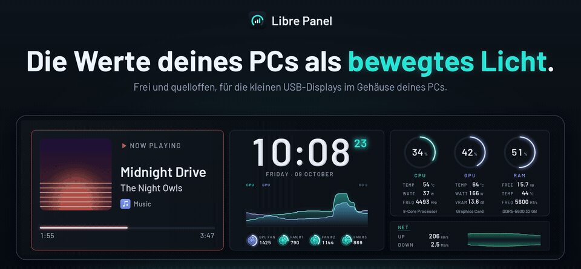
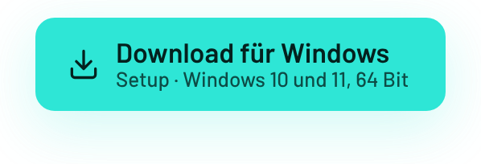
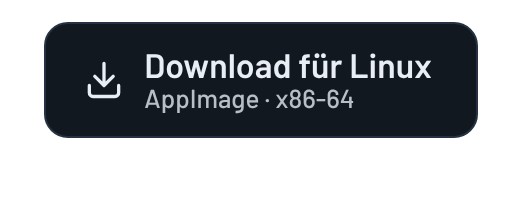

<p align="right"><sub><a href="README.md">English</a> · <b>Deutsch</b></sub></p>

<p>
  <picture>
    <source media="(prefers-reduced-motion: reduce)" srcset="docs/media/hero-de.png">
    
  </picture>
</p>

<p align="center">
  Libre Panel steuert die kleinen USB-Systemmonitor-Panels, die als TURZX, Turing Smart Screen,
  WeAct, Kipye und unter vielen anderen Namen verkauft werden, bis zu vier zugleich: Prozessor,
  Grafikkarte, Lüfter, Netzwerk, was gerade läuft und das Wetter, mit bis zu 50 Bildern pro
  Sekunde. Es läuft sofort, unter Windows und Linux, ohne Konto und ohne Cloud.
</p>

<p align="center">
  <a href="https://github.com/syntensa/libre-panel/releases/latest"></a>
  <a href="https://github.com/syntensa/libre-panel/releases/latest"></a>
  <br>
  <sub>
    <a href="https://github.com/syntensa/libre-panel/releases/latest">Portables Zip</a> ·
    <a href="https://github.com/syntensa/libre-panel/releases/latest">Linux-Tarball</a> ·
    <a href="#mit-python">Mit Python</a> ·
    <a href="CHANGELOG.md">Was ist neu</a> ·
    <a href="https://syntensa.github.io/libre-panel/de/">Website</a>
  </sub>
</p>

<p align="center">
  <a href="https://github.com/syntensa/libre-panel/releases/latest"></a>
  <a href="https://github.com/syntensa/libre-panel/actions/workflows/ci.yml"></a>
  <a href="LICENSE"></a>
  
</p>

<p align="center">
  <b>
    <a href="#funktionen">Funktionen</a> ·
    <a href="#die-app">Die App</a> ·
    <a href="#themes">Themes</a> ·
    <a href="#unterstützte-panels">Panels</a> ·
    <a href="#installation">Installation</a> ·
    <a href="#datenschutz">Datenschutz</a> ·
    <a href="#faq">FAQ</a> ·
    <a href="#dokumentation">Doku</a>
  </b>
</p>

<br>

<table>
<tr>
<td width="33%" align="center" valign="top">
<a href="#bis-zu-50-bilder-pro-sekunde"></a><br>
<b>Bis zu 50 Bilder pro Sekunde</b><br>
<sub>Zahlen zählen, Ringe gleiten, Lüfter drehen, auf den TURZX-USB-Panels.</sub>
<br><br>
<a href="#die-app"></a><br>
<b>Bau dir deins</b><br>
<sub>35 Module aufs Panel ziehen, einen Look wählen und es mit allen teilen.</sub>
</td>
<td width="33%" align="center" valign="top">
<a href="#mehrere-panels-zugleich"></a><br>
<b>Bis zu vier Panels</b><br>
<sub>Jedes mit eigenem Theme, im selben Takt; Companions zeigen, was das erste weglässt.</sub>
<br><br>
<a href="#alles-ist-dabei"></a><br>
<b>Läuft sofort</b><br>
<sub>Sensoren, Bildraten in Spielen und Videomodus ohne weiteres Programm.</sub>
</td>
<td width="33%" align="center" valign="top">
<a href="#bildschirme-für-musik-wetter-und-uhrzeit"></a><br>
<b>Bildschirme für jeden Moment</b><br>
<sub>Musik, Wetter, Uhrzeit, Spiele und KI-Werkzeuge, von selbst oder im Wechsel.</sub>
<br><br>
<a href="#datenschutz"></a><br>
<b>Privat von Grund auf</b><br>
<sub>Kein Konto, keine Telemetrie: Nichts verlässt deinen PC, was du nicht eingeschaltet hast.</sub>
</td>
</tr>
</table>

<p align="center">
  <sub><b>Läuft mit</b> Turing / TURZX · Turing Smart Screen · JONSBO · Waveshare · WeAct ·
  Kipye · UsbPCMonitor · XuanFang · Lian Li · Thermalright · BeadaPanel · NZXT Kraken ·
  Thermaltake · <a href="#unterstützte-panels">alle Panels</a></sub>
</p>

## Funktionen

Jeder Clip zeigt Libre Panel selbst, mit Demo-Werten.

### Bis zu 50 Bilder pro Sekunde

<p></p>

TURZX-USB-Panels haben einen Videodecoder, und Libre Panel füttert ihn mit bis zu 50 Bildern
pro Sekunde: Zahlen zählen zum nächsten Messwert, Ringe und Balken gleiten, Verläufe scrollen
mit jedem Bild ein Stück weiter, und Lüfter drehen mit ihrer echten Drehzahl. Werte liegen als
Licht in gefrästen Rillen, und feiner Staub treibt in der Tiefe dahinter. Standard sind 30
Bilder pro Sekunde, flüssig und für den PC deutlich leichter; alle anderen Panels bekommen
Standbilder, gesendet nur dort, wo sich etwas ändert.

### Karten im Wechsel

<p></p>

Ein Kartenfach auf Lumen, mehrere Karten: was gerade läuft, mit Cover, das Wetter mit bewegten
Symbolen und den nächsten Stunden, der Tag, ein Zifferblatt, der Mond oder deine Termine. Die
erste, die etwas zu zeigen hat, ist zu sehen, oder sie wechseln sich ab, jede für ihre Minuten.
Von einer zur nächsten geht das Fach, wie du willst: mit einer Lichtlinie, einer Überblendung,
einem Schub zur Seite oder nach oben oder einem Lichtstrahl, der darüberwischt.

### Hinweise

<p></p>

Dreh an der Lautstärke, und sie erscheint über jedem Screen, im Look deiner Wahl: als *Leiste*
am Rand, als *Pegel*, die steigen, als *Ring*, der sich füllt, oder *Groß*. Ein neuer Titel mit
Cover, ein Sensor über einer Grenze, die du festlegst, ein angesteckter Controller (Windows)
und deine eigenen Skripte (`libre-panel notify "Rendern fertig"`) bekommen kurze Hinweise in
den Farben des Themes.

### Spielmodus

<p></p>

Starte ein Spiel, und der Bildschirm schließt sich zu einer Linie, der Name des Spiels leuchtet
auf, und **Arena** öffnet sich: die FPS mit jedem Frame, wie er gemessen wurde, das 1-%-Low,
die Frametime und wer sie bremst. Das Spiel kommt aus deinem Launcher (Steam, Epic, GOG,
Ubisoft Connect, EA app, Battle.net, Xbox-App, Heroic, Lutris und mehr), die FPS von
PresentMon, RTSS oder MangoHud.

<p></p>

Nach einer Runde vergleicht ein optionaler **Rundenbericht** sie mit deinen letzten zehn: die
Lows, der längste Frame, was gebremst hat und wie warm es wurde.

### Bildschirme für Musik, Wetter und Uhrzeit

<p></p>

**Encore** ist für Musik, mit dem Cover groß und seinen Farben hinter dem ganzen Bildschirm;
**Nimbus** fürs Wetter, mit den nächsten Tagen und dem Mond; **Almanac** ist eine Uhr mit dem
Monat und **Almanac Analog** ein Zifferblatt mit gleitendem Sekundenzeiger. Encore übernimmt,
solange ein Titel läuft, und Almanac, wenn du weggehst, oder die Bildschirme wechseln sich ab:
fünf Minuten dies, zehn Minuten das, und wieder von vorn.

### Was deine KI-Werkzeuge gerade tun

<p></p>

Claude Code und Codex auf diesem PC und die Cloud-Sitzungen von Claude Code: arbeitet, wartet
auf dich oder ruht, mit dem Werkzeug bei der Arbeit, den Kosten des Tages und wie viel von den
Limits des Abos verbraucht ist. Auf Lumen kommt die KI-Karte von selbst, während eines davon
arbeitet; **Agents** gibt ihnen einen eigenen Bildschirm. Nichts verlässt diesen PC
([KI-Aktivität](docs/CONFIGURATION.md#ai-activity), englisch).

### Mehrere Panels zugleich

<p></p>

Bis zu vier Panels, jedes mit eigenem Theme, auf denselben Messwerten und im selben Takt. Ein
Panel neben Lumen bekommt **Lumen Companion**: jeden Kern, die Temperaturen mit drehenden
Lüftern, die Laufwerke und die Prozesse, und Lumen lässt weg, was sein Companion zeigt. Ein
Bild kann sich über alle Panels spannen, **Szenen** legen mit einem Klick auf jedes Panel ein
Theme, und erreicht ein Sensor seine kritische Grenze, pulsiert der Rand jedes Panels rot. Die
drei Lüfter-Displays eines JONSBO ZC-360 sind drei eigene Panels
([mehrere Panels zugleich](docs/CONFIGURATION.md#more-panels-at-once), englisch).

### Das Panel als Monitor

<p></p>

**Bildschirm** in der App bringt einen Bildschirm des Computers aufs Panel: einen deiner
Monitore, einen Teil davon, ein Fenster oder einen eigenen Monitor, auf den der Desktop sich
erweitert und auf den Fenster gehen wie auf jeden anderen. Unter Windows (mit dem quelloffenen
Virtual Display Driver, aus der App eingerichtet) und unter Linux mit X11 und Wayland. Ein
TURZX-Panel im Videomodus bekommt ihn direkt als Videostrom.

### Der Player

<p></p>

Deine Videos, GIFs und Bilder auf einem Panel statt seines Themes: In den **Player** ziehen,
eins anklicken, und die Bibliothek spielt von dort an, jedes Bild in seinem Moment. Anhalten,
weiterspringen und spulen, während die App das eigene Bild des Panels zeigt, immer wieder oder
gemischt; beim Stoppen kommt das Theme zurück.

### Der eigene Startbildschirm des Panels

<p></p>

TURZX-USB-Panels zeigen beim Einschalten ein eigenes Logo und spielen beim Start des PCs einen
Clip. Libre Panel zeichnet beides im Look deiner Wahl (dem eigenen, Polarlicht, Puls, Platine,
Nacht, Pegel oder Dunkel), passend zur Größe deines Panels und so fein, wie das Panel es zeigen
kann, und spielt es mit einem Klick auf; das Werkslogo kommt mit einem weiteren Klick zurück.

### Jede Größe, rund und hochkant

<table>
<tr>
<td width="50%" valign="top"></td>
<td width="50%" valign="top"></td>
</tr>
</table>

Vom 0,96"-Stick bis zum 12,3"-Display: Jedes Theme passt auf jedes Panel und ordnet sich dafür
neu an. Die runden Panels bekommen eigene Bildschirme, für den Kreis angelegt, und auf einer
hochkant montierten Leiste wird jeder Bildschirm neu angeordnet statt gedreht.

<p></p>

## Die App

<p></p>

<table>
<tr>
<td width="50%" valign="top"><br>
<b>Look</b>: sechs Farbwelten und wie Ringe, Balken, Verläufe und Schrift gezeichnet werden: als
Licht, Facette, Acryl oder flach.</td>
<td width="50%" valign="top"><br>
<b>Strg+K</b> findet jeden Befehl, jedes Theme, Modul, jeden Sensor und jede Einstellung mit ein
paar Buchstaben.</td>
</tr>
</table>

- **Gestalten**: Bausteine aufs Panel ziehen. Ein Modul passt sich dem Platz an, den du ihm
  gibst, und zeigt umso mehr, je größer es ist; 35 davon, von jedem Kern über den Ping, einen
  Timer und den Stromverbrauch des PCs bis zum nächsten Termin.
- **Start** zeigt das Panel auf einen Blick, die Themes dafür und die der Community, die Karten
  und die Abfolge; **Live** zeigt, wie es läuft, und mit eingeschaltetem Gedächtnis den
  **Verlauf**: Temperaturen, Last und Leistung über einen Tag, eine Woche oder einen Monat, dazu
  die gespielten Spiele.
- **Einstellungen** schreibt die `config.toml` für dich, Kommentare bleiben stehen, und findet
  die Namen von Prozessor, Grafikkarte und Arbeitsspeicher selbst. **Tastenkürzel** halten das
  Panel an, ändern seine Helligkeit oder öffnen die App aus jedem Fenster.
- In einem eigenen Fenster, in zehn Sprachen: Deutsch, Englisch, Französisch, Spanisch,
  Italienisch, Polnisch, Portugiesisch (Brasilien), Russisch, Japanisch und vereinfachtes
  Chinesisch.

## Themes

<p></p>

<p align="center"></p>

| Theme | Gemacht für | Was es zeigt |
|---|---|---|
| **Lumen** | 8,8"- und 9,2"-Leisten, dort der Standard | was läuft, die Uhrzeit mit der Last als Licht, leuchtende Ringe, benannt nach deiner Hardware |
| **Studio** | 8,8"- und 9,2"-Leisten | ruhig: eine große Uhr, das Kartenfach und leuchtende Ringe |
| **Encore** | 8,8"- und 9,2"-Leisten | für Musik: das Cover groß, seine Farben hinter dem ganzen Bildschirm |
| **Nimbus** | 8,8"- und 9,2"-Leisten | fürs Wetter: jetzt, die nächsten Stunden und Tage, der Mond |
| **Almanac** | 8,8"- und 9,2"-Leisten | eine Uhr mit dem Monat; **Almanac Analog** auf einem Zifferblatt |
| **Arena** | 8,8"- und 9,2"-Leisten, 12,3" | für den Spielmodus: die FPS groß, CPU und GPU, jeder Kern |
| **Agents** | 8,8"- und 9,2"-Leisten, 12,3" | was Claude Code und Codex tun; **Agents Claude** für Claude Code allein |
| **Libre Default** | 3,5", der Standard auf allen anderen Panels | zwei leuchtende Ringe, ein scrollender Verlauf, eine Karte in der Ecke |
| **Slate** | 5" | vier Karten: CPU, GPU, Arbeitsspeicher und Netzwerk |
| **Orbit** | rund, 2,1" und 2,8" | drei Ringe um eine große Uhr |
| **Column** | 3,5" hochkant | die Uhr, eine Zeile je Ressource und das Netzwerk |
| **Pico** | 0,96" | CPU mit Temperatur, und Arbeitsspeicher |
| **Companions** | ein Panel neben dem ersten | Lumen, Arena, Encore und Almanac Companion: was das erste Panel weglässt |
| **High Contrast** | jede Größe von 2,1" bis 12,3" | Weiß auf Schwarz in sehr großen Ziffern, auch von weitem lesbar |

Jedes Theme passt auf jedes andere Panel und ordnet sich dafür neu an. Themes sind schlichtes
JSON mit ihren Bildern und Schriften und können keinen Code ausführen
([alle eingebauten Themes](docs/THEMES.md#every-built-in-theme), [das Theme-Format](docs/THEMES.md),
englisch). Die acht Bildschirme von SPUR II sind als Legacy-Sammlung ebenfalls eingebaut
([wo alles begann](#wo-alles-begann)).

### Themes der Community

Themes, die andere Nutzer von Libre Panel gebaut haben, einen Klick entfernt: *Start → Themes →
Themes der Community* zeigt zuerst die, die für dein Panel gemacht sind, und **Installieren**
legt eins zu deinen. *Mit allen teilen …* auf der Karte deines eigenen Themes speichert es als
eine `.zip` und öffnet das ausgefüllte Formular auf GitHub: Eine Prüfung zeichnet sein Bild,
und nach einem Blick darauf steht es in der App aller. Die App holt die Liste und die Zips nur
aus diesem Repository, prüft jede vor dem Entpacken gegen ihren SHA-256 und verrät GitHub
nichts über dich oder dein Panel ([Teilen, Schritt für Schritt](community/themes/README.md)).

<details>
<summary><b>Alle 35 Module</b>: die Bausteine eigener Themes</summary>
<br>
<p align="center"></p>

Hardware bis zu jedem Kern, jedem Laufwerk und jedem Lüfter, der Ping, der Strom, den der PC
zieht, und was er kostet, eine USV; Uhren für jede Zeitzone, ein Countdown, ein Timer,
Sonnenauf- und -untergang und der Mond (berechnet, ohne Internet); was gerade läuft, ob das
Mikrofon stumm ist, deine Kalender (jede `.ics`), Werte aus Home Assistant, MQTT und JSON, was
Claude Code und Codex tun, eine Diashow. Jedes Modul zeigt umso mehr, je größer es ist, tritt
zur Seite, wenn seine Messwerte fehlen, und kostet nichts, solange kein Theme es zeigt.
</details>

## Unterstützte Panels

| Marke | Verifiziert auf echten Panels | Unterstützt, noch nicht verifiziert | Verbunden als |
|---|---|---|---|
| **Turing / TURZX** | 8,8", 9,2", 12,3" | 1,6", 2,1" rund, 2,8" rund, 4,6", 5,2", 8" | USB, Videomodus |
| **Turing Smart Screen** | 3,5", 8,8" | 2,1" rund, 5" | COM-Port |
| **JONSBO** | ZC-360, jedes Display ein eigenes Panel | ZC-360 als ein Bild, TF3-360SC, DS916, DS339 | USB |
| **Waveshare USB Monitor** | 2,8", als USB-Display | – | USB |
| **UsbPCMonitor** | – | 3,5", 5", 7" | COM-Port |
| **XuanFang** | – | 3,5" | COM-Port |
| **Kipye Qiye** | – | 3,5" | COM-Port |
| **WeAct Display FS V1** | – | 0,96", 3,5" | COM-Port |
| **VMAX** | – | 4,6" | USB |
| **Hongtai / Jungle Leopard** | – | Chill Arc 360, MSI EZ Display und mehr | COM-Port |
| **Lian Li** | – | Universal Screen, HydroShift II, OLED Curve | USB |
| **Thermalright** | – | Trofeo Vision | USB |
| **BeadaPanel** | – | jedes Modell | USB |
| **NZXT Kraken** | – | mit LCD | USB |
| **Thermaltake** | – | 6"-LCD | USB |

**Noch nicht unterstützt:** GUITION 3,5", Fuldho 3,5", AX206-Bilderrahmen sowie TL LCD,
Galahad II LCD und Lancool 207 von Lian Li.

**Du hast ein unverifiziertes?** Der Panel-Test in der App (*Live → Diagnose*, oder
`libre-panel doctor`) prüft es von Anfang bis Ende und schreibt einen Bericht ohne
Seriennummern; ein Klick öffnet einen
[Panel-Bericht](https://github.com/syntensa/libre-panel/issues/new?template=panel_support.yml)
damit ausgefüllt, und das Modell gilt für alle als verifiziert. Die Panels am COM-Port sind die
ältere, langsamere Bauart, deshalb hält Libre Panel ihre Bewegung ruhig; den Videomodus gibt es
für die TURZX-USB-Panels. Jedes Modell mit seinen USB-IDs und seiner Einrichtung:
[docs/HARDWARE.md](docs/HARDWARE.md) (englisch).

## Installation

<table>
<tr>
<td width="33%" valign="top">
<b>Windows 10 und 11</b><br>
<sub>64 Bit</sub>
<br><br>
Das <b>Setup</b> installiert für alle Benutzer, mit Startmenü-Eintrag und, in Kästchen, die
sagen, was jedes ist, Start bei der Anmeldung und dem Sensordienst. Oder das <b>portable Zip</b>.
<br><br>
<a href="https://github.com/syntensa/libre-panel/releases/latest">Download</a>
</td>
<td width="33%" valign="top">
<b>Linux</b><br>
<sub>x86-64</sub>
<br><br>
Das <b>AppImage</b>: ausführbar machen und starten, ohne Installation. <i>Start</i> gibt
deinem Benutzer mit einem Klick USB-Zugriff aufs Panel. Oder der <b>Tarball</b>.
<br><br>
<a href="https://github.com/syntensa/libre-panel/releases/latest">Download</a>
</td>
<td width="33%" valign="top">
<b>Mit Python</b><br>
<sub>3.11 oder neuer</sub>
<br><br>
<b>pipx</b> installiert es aus diesem Repository, mit den Treibern der Panels und dem Tray,
unter Windows und Linux.
<br><br>
<a href="#mit-python">Die Befehle</a>
</td>
</tr>
</table>

### Erster Start

1. **Hersteller-App beenden.** Sie hält das Panel für sich fest.
2. **Libre Panel starten**, mit angestecktem Panel. Die Windows-Downloads sind noch nicht
   signiert: SmartScreen fragt einmal nach (*Weitere Informationen → Trotzdem ausführen*).
   Unter Linux bietet *Start* an, deinem Benutzer Zugriff auf das Panel zu geben
   ([was dabei geschieht](docs/CONFIGURATION.md#linux-sensors-and-panel-access)).
3. **Einen Look wählen.** *Start* fragt „Wie soll es aussehen?“ mit den Themes für das
   gefundene Panel: Lumen auf den 8,8"- und 9,2"-Leisten, Libre Default auf den anderen.
4. **Einschalten, was du willst.** In den *Einstellungen*: Wetter und Ort, Videomodus, die
   Dienste (alle aus, bis du sie einschaltest). Das Tray-Symbol hat Theme, Helligkeit, Pause
   und *Mit dem System starten*.

Die App öffnet sich in einem eigenen Fenster (WebView2 unter Windows, WebKitGTK unter Linux,
sonst im Browser; [Einzelheiten](docs/BACKGROUND.md#the-apps-window)).

### Alles ist dabei

Sensoren, Lüfter, Grafikkarte, Bildraten in Spielen (Windows) und der Videomodus brauchen kein
weiteres Programm, und es muss nichts weiter heruntergeladen werden. Die Downloads bringen mit,
was die Funktionen ausführen, in einem Ordner `tools` neben dem Programm: ffmpeg für den
Videomodus und unter Windows PresentMon für die Bildraten in Spielen sowie den Installer des
PawnIO-Treibers. Den Rest richtet ein einziger Schritt ein und fragt dabei einmal: unter Windows
nach Administratorrechten, unter Linux nach deinem Passwort. Libre Panel selbst läuft ohne
Administratorrechte.

<details>
<summary><b>Was jeder Download einrichtet, und warum</b></summary>
<br>

| | Windows-Setup | Portables Zip | Linux (AppImage) |
|---|---|---|---|
| **Sensoren von Prozessor, Mainboard, Arbeitsspeicher und Laufwerken** | der Sensordienst und der PawnIO-Treiber, zwei angehakte Kästchen | *Alle Sensoren freischalten* auf Start und unter *Einstellungen → Sensoren* richtet dasselbe ein | Prozessor und NVMe-Laufwerke werden ohne Rechte gelesen; *Sensoren und Panel-Zugriff einrichten* lädt die Kerneltreiber für den Lüfterchip des Boards und für SATA-Laufwerke |
| **Leistung des Prozessors** | liest der Sensordienst | ebenso | ein Schalter in dieser Karte, aus, bis du ihn einschaltest |
| **Grafikkarte** | eingebaut (LibreHardwareMonitor) | eingebaut | AMD, Intel und NVIDIA, ohne Rechte gelesen |
| **Bildraten in Spielen** | PresentMon steckt im Download, mit eigenem Kästchen (abgewählt sagt das Setup vorher, was dann nicht geht); das dritte Kästchen der Sensoren nimmt dich in die Gruppe *Leistungsprotokollbenutzer* auf | PresentMon steckt im Download; *Alle Sensoren freischalten* nimmt dich auf | nur unter Windows |
| **Videomodus** | ffmpeg steckt im Download | ffmpeg steckt im Download | ffmpeg steckt im Download |
| **USB-Zugriff aufs Panel** | nichts zu tun | nichts zu tun | dieselbe Karte schreibt die udev-Regel |
| **Einstellungen** | in deinem eigenen Ordner | im Ordner `data` neben dem Programm: Sie ziehen mit um | in deinem eigenen Ordner |

- **Einmal gefragt, dann läuft es.** Windows fragt einmal nach Administratorrechten, beim Setup
  oder bei *Alle Sensoren freischalten*; unter Linux fragt dein System einmal nach dem
  Passwort. *Nur für mich installieren* geht weiterhin: Das Setup installiert dann ohne diese
  Rechte und überlässt die Systemteile *Alle Sensoren freischalten*. Die Werte kommen in wenigen
  Sekunden; Bildraten in Spielen zählen ab deiner nächsten Anmeldung, wenn Windows die neue
  Gruppenmitgliedschaft übernimmt.
- **Nur lesend.** Der Sensordienst liest nur: Er regelt keinen Lüfter und ändert keine
  Einstellung der Hardware. Wer am PC angemeldet ist, kann seine Werte lesen; Netzwerk-Anmeldungen
  und andere Computer werden abgewiesen
  ([wie er gebaut ist](docs/BACKGROUND.md#the-sensor-service), englisch). *Entfernen* unter
  *Einstellungen → Sensoren*, die Deinstallation und unter Linux *Wieder entfernen* nehmen alles
  zurück. Bei jedem Release installiert der Build das Windows-Setup auf einem Windows-Testrechner,
  prüft, dass der Dienst läuft und Libre Panel durch ihn liest, und deinstalliert es wieder; das
  Setup des AppImage läuft als Probelauf in der schmalen Umgebung, die `pkexec` ihm mitgibt.
- **Der Videomodus** schaltet sich auf dem 9,2" von selbst ein, sobald der Standby-Clip des
  Panels benannt ist; *Start* fragt einmal danach ([was er braucht](#faq)).
- **Die Programme** sind genau die Dateien, die ihre Projekte veröffentlichen. Beim Bau des
  Downloads wird jede gegen eine festgeschriebene SHA-256-Prüfsumme geprüft. ffmpeg steht unter
  der GPL-3.0, PresentMon unter MIT, der Treiber PawnIO unter der GPL-2.0-or-later mit Ausnahme
  ([welche Programme](docs/CONFIGURATION.md#programs-that-come-with-the-downloads); ihre Lizenzen
  und Quellen stehen in [NOTICE.md](NOTICE.md)).
</details>

### Mit Python

```bash
pipx install "libre-panel[usb,serial,tray] @ git+https://github.com/syntensa/libre-panel@v0.7.10"
libre-panel tray                    # die Hintergrund-App mit Tray-Symbol; öffnet ihr Fenster
libre-panel autostart enable        # bei jeder Anmeldung starten
```

<details>
<summary>Weitere Befehle</summary>

```bash
libre-panel                         # Panel und App im Terminal (Strg+C beendet)
libre-panel editor                  # nur die App, ohne Panel (--browser: im Browser)
libre-panel run                     # nur das Panel ansteuern
libre-panel preview lumen -o lumen.png    # ein Theme als Bild rendern
libre-panel models                  # alle bekannten Panels mit Auflösung
libre-panel devices                 # welches Panel ist angeschlossen?
libre-panel doctor                  # das Panel von Anfang bis Ende prüfen, Bericht schreiben
libre-panel sensors                 # jeder Sensor-Schlüssel mit seinem aktuellen Wert
libre-panel config init             # eine kommentierte config.toml schreiben
libre-panel location "Berlin"       # Koordinaten für das Wetter
libre-panel system-setup --linux    # Linux: ein Schritt für Panel-Zugriff und Mainboard-Lüfter
libre-panel udev-rules              # Linux: die Regel, die deinem Benutzer USB-Zugriff gibt
libre-panel quit                    # die Hintergrund-App beenden
```

</details>

## Datenschutz

**Nichts verlässt deinen PC, was du nicht selbst eingeschaltet hast.** Kein Konto, keine
Telemetrie. Die App wird nur für deinen eigenen PC ausgeliefert (127.0.0.1), und nur an
Anfragen mit einem geheimen Token, der bei jedem Start neu ist.

<details>
<summary><b>Was wohin geht</b>, Punkt für Punkt</summary>
<br>

- **Das Wetter** ist aus, bis du einen Ort setzt. Dann gehen nur seine Koordinaten an
  [Open-Meteo](https://open-meteo.com), alle 15 Minuten. Einen Ort, den du per Name suchst,
  bekommt die Ortssuche von Open-Meteo erst, wenn du auf *Suchen* drückst; gespeichert wird
  er auf etwa einen Kilometer genau.
- **Neue Versionen**: *Start* fragt einmal, ob nachgesehen werden soll. Sagst du ja, fragt
  Libre Panel einmal am Tag bei GitHub nach der neuesten Version; die Anfrage trägt nur deine
  Versionsnummer, nichts über dich oder dein Panel. *Einstellungen → Start und System* schaltet
  es wieder aus.
- **Hinweise von anderen Programmen** sind aus, bis du sie erlaubst, und kommen dann nur von
  diesem PC und nur mit dem Schlüssel, den Libre Panel dafür erstellt hat.
- **Was du selbst anbindest**, spricht mit der Adresse, die du ihm gibst: Kalender (`.ics`),
  Home Assistant, MQTT, eine JSON-Adresse, der upsd einer USV. Der Ping verbindet sich mit
  1.1.1.1 (oder den Hosts, die du einstellst), solange ein Theme ihn zeigt, und ein Cover, das ein
  Player per Webadresse nennt, wird von dort geladen.
- **Die optionalen Dienste** behalten, was sie lernen, auf diesem PC: Gedächtnis und
  Rundenbericht in einer SQLite-Datei, die du öffnen oder löschen kannst; die Kühlungsanalyse
  liest die Konfiguration von FanControl und schreibt sie nie. Kein Titel, kein Fenstertitel
  und kein Dateiname wird gelesen.
- **Die KI-Aktivität** ist aus, bis du sie einschaltest und Claude Code oder Codex einrichtest.
  Ihre Hooks geben, was sie tun, nur an Libre Panel auf diesem PC weiter, mit einem eigenen
  Schlüssel; für die Nutzung des Abos fragt Libre Panel die Programme, die mit deiner Anmeldung
  bei ihren eigenen Servern nachfragen. Die Cloud-Sitzungen von Claude Code schicken, wenn du
  sie einrichtest, ihren Zustand (nie einen Prompt) an ein ntfy-Topic mit einer langen
  Zufallsadresse, das Libre Panel liest.
- **Die Namen deiner Hardware** landen nie im Log, und `libre-panel doctor` schreibt keine
  Seriennummern und keine persönlichen Pfade in seinen Bericht.
</details>

## FAQ

<details>
<summary><b>Welches Panel habe ich?</b></summary>
<br>

Produktname und Aufkleber auf der Rückseite sagen es meist. Angesteckt listet `libre-panel
devices`, was es sieht: Ein TURZX-USB-Panel meldet sich mit der USB-ID `1cbe:…` und seiner
Größe, die anderen als virtueller COM-Port (`COM3`, `/dev/ttyACM0`). *Start* in der App nennt
das gefundene Panel; unter *Anderes Panel* wählst du selbst. Im Zweifel fragt und prüft
`libre-panel doctor`. Die [Hardware-Liste](docs/HARDWARE.md) kennt jedes Modell.
</details>

<details>
<summary><b>Warum zeigen CPU-Temperatur und -Leistung unter Windows „--“?</b></summary>
<br>

Die Windows-Downloads bringen die Bibliothek von LibreHardwareMonitor mit und lesen die
Grafikkarte und ihre Lüfter ohne weiteres Programm. Temperatur, Leistung und Takt des
Prozessors, die Temperaturen von RAM und Laufwerken und die Mainboard-Lüfter brauchen
**Administratorrechte** und den Treiber **PawnIO**; dessen Installer steckt im Download. Der
**Sensordienst** von Libre Panel hat beides, und das Setup richtet die beiden ein (die
angehakten Kästchen *Sensordienst* und *PawnIO-Treiber*): Nach dem Setup ist nichts mehr zu
tun. „--“ siehst du nur, wo dieser Teil nicht eingerichtet wurde, also nach *Nur für mich
installieren* oder beim portablen Zip. Dann richtet *Alle Sensoren freischalten* auf Start oder
unter *Einstellungen → Sensoren* ihn mit einer Frage von Windows ein, und Libre Panel selbst
läuft weiter ohne Administratorrechte
([wie das sicher bleibt](docs/BACKGROUND.md#the-sensor-service)). *Einstellungen → Sensoren*
sagt, ob der Dienst läuft. Bei einer Python-Installation gibt es keinen Dienst: Installiere
PawnIO von [pawnio.eu](https://pawnio.eu) und nimm `libre-panel autostart enable --elevated`
(als Administrator) oder ein LibreHardwareMonitor, den du selbst mit Webserver laufen lässt
([Einzelheiten](docs/CONFIGURATION.md#windows-sensors-gpu-power-fans)).
</details>

<details>
<summary><b>Warum fehlen unter Linux die Lüfter oder die CPU-Leistung?</b></summary>
<br>

Die meisten Sensoren brauchen unter Linux keine Rechte (Prozessor, Grafikkarte, NVMe-Laufwerke,
Speicher). Drei Dinge schon: die **USB-Berechtigung für das Panel**, der **Treiber für den Chip,
der die Mainboard-Lüfter liest** (der Kernel hat ihn, aber niemand lädt ihn) und, nur wenn du sie
willst, die **Leistung des Prozessors** (diese Zähler hält der Kernel seit 2020 von allen außer
root fern). *Start* zeigt eine Karte, wenn eines davon fehlt, und *Einstellungen → Sensoren* hat
sie immer: ein Klick, dein System fragt einmal nach dem Passwort, und die Karte sagt genau, was
geändert wird. In einem Terminal: `libre-panel system-setup --linux` (mit `--rapl` für die
Leistung, mit `--remove` wird alles zurückgenommen). Ein Board, für dessen Lüfterchip der Kernel
keinen Treiber hat (manche MSI- und Gigabyte-Boards), braucht einen von außerhalb des Kernels,
den Libre Panel nicht installiert. Mehr:
[Linux-Sensoren und Panel-Zugriff](docs/CONFIGURATION.md#linux-sensors-and-panel-access).
</details>

<details>
<summary><b>Wie bekomme ich den flüssigen Videomodus? Brauche ich ffmpeg?</b></summary>
<br>

Den Videomodus gibt es für die TURZX-USB-Panels, die einen Videodecoder haben. Die Windows-
und Linux-Downloads bringen das [ffmpeg](https://ffmpeg.org) mit, das er braucht; du gibst nur
unter *Einstellungen → Panel* den Namen des Standby-Clips des Panels an, so wie ihn die
Hersteller-App zeigt, oder spielst unter *Einstellungen → Panel → Startbildschirm* den
Standby-Clip von Libre Panel auf, der ihn gleich mit einträgt. Auf dem 9,2" schaltet er sich
dann von selbst ein; auf den anderen TURZX-USB-Panels stellst du ihn zum Ausprobieren auf
*an*. Mit einer Python-Installation installierst du ffmpeg selbst (Windows: `winget install
ffmpeg`; Linux: das Paket deiner Distribution) oder nennst es an derselben Stelle. Der
Videomodus speichert nichts auf dem Panel; nur der Startbildschirm schreibt darauf, auf einen
Klick. Die seriellen Panels bekommen Standbilder, von denen nur die geänderten Teile gesendet
werden ([Einzelheiten](docs/CONFIGURATION.md#video)).
</details>

<details>
<summary><b>Brauche ich LibreHardwareMonitor, FanControl oder PresentMon?</b></summary>
<br>

Es braucht kein weiteres Programm: LibreHardwareMonitor und Intels
[PresentMon](https://github.com/GameTechDev/PresentMon) (Windows, MIT-Lizenz) stecken in den
Windows-Downloads. Die Quelle *Bildrate im Spiel* ist unter Windows von Anfang an an und zählt
die Bilder eines Spiels, solange ein Theme sie zeigt. PresentMon braucht Administratorrechte
oder dein Konto in der Windows-Gruppe „Leistungsprotokollbenutzer“ („Performance Log Users“);
das dritte Kästchen des Setups (oder *Alle Sensoren freischalten*) nimmt dich auf, ab der
nächsten Anmeldung ([wie](docs/CONFIGURATION.md#more-sensor-sources)). Wo RivaTuner Statistics
Server ohnehin läuft, kann Libre Panel die Bildraten stattdessen von dort nehmen. Die
Kühlungsanalyse liest die Lüfterkurven von FanControl, falls du FanControl nutzt.
</details>

<details>
<summary><b>Kann es meinem Panel schaden?</b></summary>
<br>

Libre Panel sendet nur Anzeigebefehle: Bilder, Helligkeit, Video. Es fasst die Firmware nie
an; es speichert nichts auf dem Panel außer einem Startbildschirm, den du selbst aufspielst, und
Firmware-Updates bleiben Sache der Hersteller-App.
</details>

<details>
<summary><b>macOS?</b></summary>
<br>

Seit 0.5 nicht mehr: Unterstützt werden Windows und Linux, und die macOS-Builds früherer
Versionen hat niemand heruntergeladen.
</details>

## Dokumentation

Die Dokumentation ist englisch.

| Thema | Was drinsteht |
|---|---|
| [Panels](docs/HARDWARE.md) | jedes Modell, seine USB-IDs, die Einrichtung je System und wie du deins hinzufügst |
| [Konfiguration](docs/CONFIGURATION.md) | jede Einstellung der `config.toml`: Sensoren, Dienste, Video, Sprachen |
| [Hintergrund-App](docs/BACKGROUND.md) | das Tray, der Autostart, das Fenster der App und der Sensordienst |
| [Themes](docs/THEMES.md) | das Theme-Format, die Module und jeder Sensor-Schlüssel |
| [Plugins](docs/PLUGINS.md) | eigene Sensoren, Dienste und Treiber |
| [Architektur](docs/ARCHITECTURE.md) | wie es gebaut ist, von den Messwerten bis zum Panel |
| [Protokolle](docs/protocol/turzx-usb.md) | das TURZX-USB-Protokoll und die [seriellen](docs/protocol/serial.md) |
| [Roadmap](docs/ROADMAP.md) · [Changelog](CHANGELOG.md) | was kommt, und was kam |

## Mitmachen

Am meisten hilft gerade ein **Panel-Bericht**: `libre-panel doctor` auf einem Modell, das als
*unverifiziert* gilt, macht es für alle *verifiziert*. Themes sind in der
[Galerie der Community](community/themes/README.md) und in den
[Discussions](https://github.com/syntensa/libre-panel/discussions) willkommen; eine Sprache
braucht eine JSON-Datei ([wie](docs/CONFIGURATION.md#language)); Code, Treiber und Plugins
beginnen bei [CONTRIBUTING.md](CONTRIBUTING.md). Sicherheitslücken bitte über ein
[privates Advisory](SECURITY.md) melden.

## Wo alles begann

<a href="docs/media/where-it-started.gif"></a>

Libre Panel ist aus SPUR II entstanden, einem privaten Dashboard für ein 9,2"-Panel an einem
PC, das das USB-Protokoll des Panels und seinen Videomodus auf echter Hardware erprobt hat.
Seine Ideen (Licht in gefrästen Rillen, die Karten, das Band, die Röhre) gehören jetzt Libre
Panel, für jedes Panel und jeden PC, und seine acht Bildschirme sind als Legacy-Sammlung *SPUR
II* dabei, am Ende von *Start → Alle* ([was daraus übernommen wurde](docs/SPUR2_MIGRATION.md)).

## Lizenz und Hinweise

Libre Panel ist freie Software unter der [GPL-3.0-or-later](LICENSE). Die eingebauten Themes
haben ihre eigene Lizenz, angegeben in jeder `theme.json`. Es steht auf den Schultern von
[turing-smart-screen-python](https://github.com/mathoudebine/turing-smart-screen-python)
(GPL-3.0), dessen Reverse Engineering diese Panels dokumentiert; die Windows-Downloads bringen
[LibreHardwareMonitor](https://github.com/LibreHardwareMonitor/LibreHardwareMonitor) mit
(MPL-2.0), [PresentMon](https://github.com/GameTechDev/PresentMon) (MIT) und den Installer des
Treibers [PawnIO](https://pawnio.eu) (GPL-2.0-or-later mit Ausnahme), und jeder Download
[ffmpeg](https://ffmpeg.org) (GPL-3.0-or-later); die Schriften sind Barlow, JetBrains Mono und
Liberation Sans (SIL OFL 1.1); Wetterdaten von [Open-Meteo.com](https://open-meteo.com) (CC BY 4.0). Alles in
[NOTICE.md](NOTICE.md).

„TURZX“, „Turing Smart Screen“ und andere Produktnamen sind Marken ihrer Inhaber. Libre Panel
ist ein unabhängiges Projekt und mit ihnen nicht verbunden.
