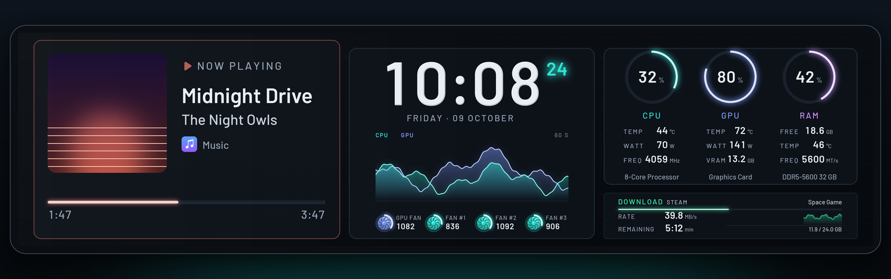
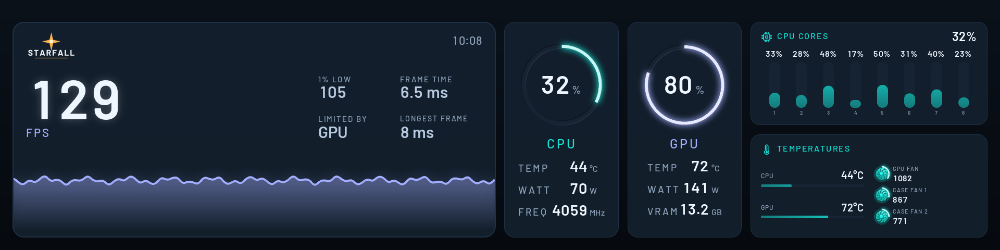
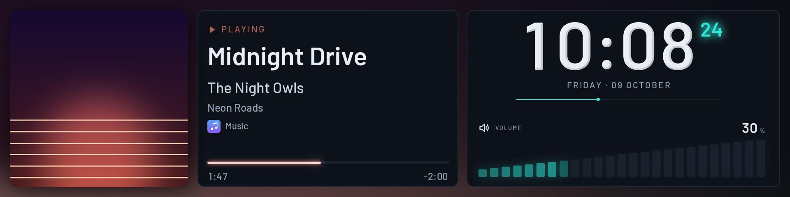
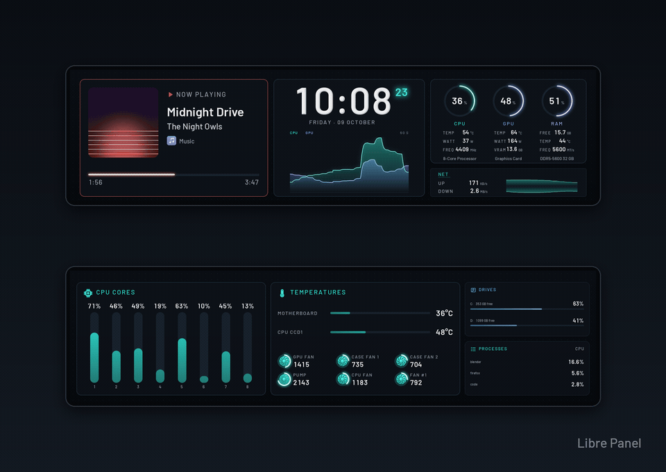
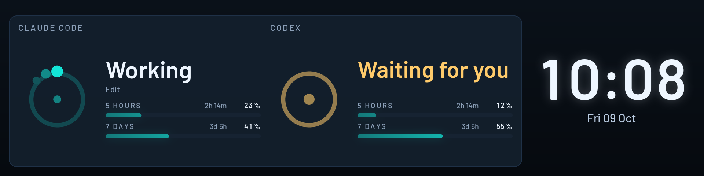

<p align="right"><a href="README.md">English</a> · <b>Deutsch</b></p>

<h1 align="center">
  <br>
  Libre Panel
</h1>

<p align="center">
  <b>Die Werte deines PCs als bewegtes Licht, auf dem kleinen USB-Display im Gehäuse.</b><br>
  Freie Open-Source-Software für Systemmonitor-Panels von TURZX, Turing Smart Screen, WeAct,
  Kipye und kompatible. Windows und Linux, ohne Konto, ohne Cloud.
</p>

<p align="center">
  <a href="https://github.com/syntensa/libre-panel/releases/latest"></a>
  <a href="https://github.com/syntensa/libre-panel/actions/workflows/ci.yml"></a>
  <a href="LICENSE"></a>
  
</p>

<picture>
  <source media="(prefers-reduced-motion: reduce)" srcset="docs/images/hero.png">
  
</picture>

<p align="center">
  <a href="https://github.com/syntensa/libre-panel/releases/latest"></a>
  <a href="https://github.com/syntensa/libre-panel/releases/latest"></a>
  <a href="https://github.com/syntensa/libre-panel/releases/latest"></a>
  <br>
  <sub>Windows 10 und 11 (x64) · Linux (x86-64) · alle Dateien und die Release-Notes im
  <a href="https://github.com/syntensa/libre-panel/releases/latest">neuesten Release</a></sub>
</p>

<p align="center">
  <a href="#in-30-sekunden">Rundgang</a> ·
  <a href="#themes">Themes</a> ·
  <a href="#unterstützte-panels">Panels</a> ·
  <a href="#sofort-startklar">Sofort startklar</a> ·
  <a href="#installation-und-erster-start">Installation</a> ·
  <a href="#datenschutz">Datenschutz</a> ·
  <a href="#faq">FAQ</a> ·
  <a href="https://syntensa.github.io/libre-panel/de/">Website</a>
</p>

Panel anstecken, Libre Panel starten: Es zeigt Prozessor, Grafikkarte, Arbeitsspeicher,
Lüfter, Netzwerk, was gerade läuft und das Wetter draußen, in einem Theme, das du auswählst
oder selbst baust, auf bis zu vier Panels zugleich. Es läuft unauffällig im Tray und ersetzt
die Hersteller-App.

**Alles funktioniert sofort, out of the box.** Sensoren, Lüfter, Grafikkarte, Bildraten in
Spielen (Windows) und der Videomodus mit 50 fps brauchen kein weiteres Programm. Die Downloads
bringen mit, was die Funktionen ausführen; den Rest richtet unter Windows das Setup ein, beim
portablen Zip und unter Linux ein Klick in der App. Gefragt wird einmal: unter Windows nach
Administratorrechten, unter Linux nach deinem Passwort
([was eingerichtet wird](#sofort-startklar)).

## In 30 Sekunden

### Flüssig im Videomodus



TURZX-USB-Panels haben einen Videodecoder, und Libre Panel füttert ihn mit bis zu 50 Bildern
pro Sekunde. Zahlen zählen zum nächsten Messwert, Ringe und Balken gleiten, Verläufe scrollen
mit jedem Bild ein Stück weiter, und Lüfter drehen mit ihrer echten Drehzahl. Werte liegen als
Licht in gefrästen Rillen; Schrift kann facettiertes Metall sein, und feiner Staub treibt in
der Tiefe dahinter. Die Downloads bringen das ffmpeg mit, das er braucht, und er schaltet sich
auf dem 9,2" von selbst ein, sobald der Standby-Clip des Panels benannt ist
([was er braucht](#faq)); alle anderen Panels bekommen Standbilder, gesendet nur dort, wo sich
etwas ändert.

### Karten, die von selbst wechseln


Ein Kartenfach, mehrere Karten: was gerade läuft, mit Cover und dem Symbol des Players; läuft
nichts, das Wetter mit bewegten Symbolen, den nächsten Stunden und dem Regen der nächsten zwei
Stunden; ist beides nicht da, der Tag. Beim Wechsel zündet eine Lichtlinie, die Karte rollt in
sie hinein, und die nächste rollt aus ihr heraus. Mit dem Downloads-Dienst zeigt die
Netzwerk-Karte einen laufenden Download an ihrer Stelle.

### Hinweise


Dreh an der Lautstärke, und sie erscheint über jedem Screen, im Look deiner Wahl: als *Leiste*
am Rand, als *Pegel*, die steigen, als *Ring*, der sich füllt, oder *Groß*, eingeschaltet mit
einem Klick auf *Start*. Ein neuer Titel mit Cover, ein Sensor über einer Grenze, die du
festlegst, ein Stick oder Controller angesteckt (Windows): kurze Hinweise in den Farben des
Themes, als Band oder Karte; ein Bildschirm, der Lautstärke oder Titel selbst zeigt, bekommt
keinen darüber. Auch deine eigenen Skripte und eine Stream-Deck-Taste können einen zeigen,
sobald du es erlaubst: `libre-panel notify "Rendern fertig"` oder eine Adresse mit Schlüssel,
nur von diesem PC aus. Wie jeder Dienst sind sie aus, bis du sie einschaltest.

### Spielmodus



Starte ein Spiel aus deiner eigenen Liste oder deiner Steam-Bibliothek, und der Bildschirm
schließt sich zu einer Linie, der Name des Spiels leuchtet auf, und der Spielbildschirm
öffnet sich: die FPS, die 1-%-Lows und wer sie bremst, gezählt von Intels PresentMon, dazu
klein in der Ecke die Uhrzeit. Seinen
Bildschirm wählst du unter *Gestalten → Seiten*: **Arena**, den eigenen von Libre Panel, oder
einen von SPUR II. Nach einer Runde vergleicht ein optionaler Bericht sie mit deinen letzten
zehn.


### Bildschirme für Musik, Wetter und Uhrzeit



**Encore** ist für Musik: das Cover groß und seine Farben hinter dem ganzen Bildschirm, die
Uhrzeit mit rollenden Ziffern und die Lautstärke als Pegel, die steigen, während du drehst.


**Nimbus** ist fürs Wetter: jetzt und die nächsten Stunden, die nächsten Tage mit ihrem Regen,
der Mond, wie er heute Nacht leuchtet, und eine kleine Uhr.


**Almanac** ist eine Uhr mit dem Monat, dem heutigen Tag und der Kalenderwoche; **Almanac
Analog** zeigt die Zeit auf einem Zifferblatt, dessen Sekundenzeiger gleitet, tickt oder
durchläuft.

Sie kommen auch von selbst: Schalte unter *Gestalten → Seiten* die Seite **Musik** ein, und
Encore übernimmt, solange ein Titel läuft; mit der Seite **Leerlauf** erscheint Almanac, wenn
du vom PC weggehst.


### Abfolge


Fünf Minuten Almanac, fünf Minuten Nimbus, zehn Minuten Studio, und wieder von vorn: Unter
**Start** wählst du die Bildschirme, gibst jedem seine Sekunden, Minuten oder Stunden, und das
Panel zeigt sie nacheinander. Ein Spiel, ein Hinweis oder ein Theme, das ein Dienst anfordert,
geht weiterhin vor.

### Der eigene Startbildschirm des Panels


TURZX-USB-Panels zeigen beim Einschalten ein eigenes Logo und spielen beim Start des PCs einen
Clip, bevor irgendeine App mit ihnen spricht. Libre Panel zeichnet beides in seinem Look,
passend zur Größe deines Panels, und spielt es mit einem Klick unter **Einstellungen → Panel →
Startbildschirm** auf, nach einer Rückfrage; das Werkslogo bleibt auf dem Panel und kommt mit
einem weiteren Klick zurück.

### Leisten hochkant


Deine Leiste steht hochkant? Sag es beim ersten Start, auf *Start* oder unter *Einstellungen →
Panel*: Jeder Screen erscheint dann in seiner Fassung dafür, neu angeordnet statt gedreht.
Lumen, Studio, Encore, Nimbus, Almanac, Arena und der Rundenbericht haben je eine, und das
eigene Bootlogo und der Standby-Clip des Panels werden ebenfalls hochkant gezeichnet.

### Mehrere Panels zugleich

<picture>
  <source media="(prefers-reduced-motion: reduce)" srcset="docs/images/more-panels.png">
  
</picture>

Bis zu vier Panels zugleich, jedes mit eigenem Theme, auf denselben Messwerten und im selben
Takt. Ein Panel neben Lumen bekommt **Lumen Companion**: jeden Kern, die Temperaturen mit
drehenden Lüftern, die Laufwerke und die Prozesse, und Lumen lässt weg, was sein Companion
zeigt, sodass nichts doppelt steht. Encore, Almanac und Arena haben auch einen, und ein
Companion folgt dem ersten Panel ins Spiel. Unter *Einstellungen → Panel* stehen die Panels in
echter Größe neben deinem Monitor; ein Bild kann über alle gehen, eine Szene legt mit einem
Klick auf jedes Panel ein Theme, und ein Modul zieht von einem Panel aufs andere. Erreicht ein
Sensor seine kritische Grenze, pulsiert der Rand jedes Panels rot. Jedes Panel hat seinen
eigenen Startbildschirm, Live, das Tray und die Übersicht zeigen jedes, und *Bild aller Panels*
speichert sie, wie sie stehen, zum Teilen.

### Was deine KI-Werkzeuge gerade tun



**Agents** zeigt, was Claude Code und Codex auf diesem PC tun: arbeitet, wartet auf dich oder
ruht, jedes mit einem bewegten Zeichen, dem Werkzeug bei der Arbeit und wie viel von den
Limits des Abos verbraucht ist, mit der Zeit, bis sie neu beginnen. Unter *Einstellungen →
Dienste → KI-Aktivität* siehst du, was in den Einstellungen der Programme ergänzt wird, bevor
etwas geschrieben wird, und nimmst es dort wieder heraus; nichts verlässt diesen PC
([KI-Aktivität](docs/CONFIGURATION.md#ai-activity)).

### Jede Panelgröße


Vom 0,96"-Stick bis zum 12,3"-Display: Jedes Theme passt auf jedes Panel und ordnet sich
dafür neu an. Libre Default, hier auf einem 3,5"-Panel, ist der Standard auf allen Panels
außer den 8,8"- und 9,2"-Leisten.

### Die App


**Gestalten**: Bausteine aufs Panel ziehen. Ein Modul passt sich dem Platz an, den du ihm
gibst, und zeigt umso mehr, je größer es ist; 35 davon, von jedem Kern über den Ping, einen
Timer und den Stromverbrauch des PCs bis zum nächsten Termin.


**Look**: sechs Farbwelten und wie Ringe, Balken, Verläufe und Schrift gezeichnet werden
(Licht, Facette, Acryl oder flach), dazu Panel-Licht, Raster, Tiefenstaub und Hinweise,
neben dem Bild des Panels.


**Strg+K** findet jeden Befehl, jedes Theme, Modul, jeden Sensor und jede Einstellung mit ein
paar Buchstaben. **Einstellungen** schreibt die `config.toml` für dich, Kommentare bleiben
stehen; die Namen von Prozessor, Grafikkarte und Arbeitsspeicher findet Libre Panel selbst,
und du kannst eigene eintippen. **Start** zeigt das Panel auf einen Blick und die Themes, die
dafür gemacht sind, und sagt, wenn eine neue Version da ist, sofern du es nachsehen lässt.
**Live** zeigt, wie es läuft, und mit eingeschaltetem Gedächtnis den **Verlauf**: Temperaturen,
Last und Leistung über einen Tag, eine Woche oder einen Monat, dazu die gespielten Spiele.
**Tastenkürzel** für den ganzen PC halten das Panel an, ändern seine Helligkeit oder öffnen die
App aus jedem Fenster (Windows, Linux mit X11) und lassen sich als Ganzes ausschalten. Die App
spricht Deutsch, Englisch, Französisch, Spanisch, Polnisch, Portugiesisch (Brasilien) und
vereinfachtes Chinesisch.

## Themes

<p align="center"></p>

| Theme | Gemacht für | |
|---|---|---|
| **Lumen** | 8,8"- und 9,2"-Leisten (1920×480); dort der Standard | das eigene Theme von Libre Panel: was läuft, sonst das Wetter, sonst der Tag; die Uhrzeit mit der Last als vorbeiziehendes Licht und den drehenden Lüftern; leuchtende Ringe für CPU, GPU und RAM, benannt nach deiner Hardware, über dem Netzwerk |
| **Studio** | 8,8"- und 9,2"-Leisten | ruhig: eine große Uhr, das Kartenfach und leuchtende Ringe für CPU, RAM und GPU |
| **Encore** | 8,8"- und 9,2"-Leisten | für Musik: das Cover groß und seine Farben hinter dem ganzen Bildschirm, die Uhrzeit mit rollenden Ziffern, die Lautstärke als steigende Pegel |
| **Nimbus** | 8,8"- und 9,2"-Leisten | fürs Wetter: jetzt und die nächsten Stunden, die nächsten Tage, der Mond, wie er heute Nacht leuchtet, eine kleine Uhr |
| **Almanac** | 8,8"- und 9,2"-Leisten | eine Uhr mit dem Monat: die Uhrzeit groß oder auf einem Zifferblatt mit gleitendem Sekundenzeiger (**Almanac Analog**), daneben der Monat mit heute und der Kalenderwoche |
| **Arena** | 8,8"- und 9,2"-Leisten | für den Spielmodus: die FPS des Spiels groß mit 1-%-Low, Frametime und Verlauf, CPU und GPU als Instrumente, jeder Kern, die Temperaturen und, klein in der Ecke, die Uhrzeit |
| **Agents** | 8,8"- und 9,2"-Leisten, 12,3" | was Claude Code und Codex tun: ein bewegtes Zeichen für jedes (arbeitet, wartet auf dich, ruht), das Werkzeug bei der Arbeit, wie viel von den Limits des Abos verbraucht ist und wann sie neu beginnen, neben der Uhrzeit; **Agents Claude** zeigt Claude Code allein, mit der Auslastung seines Kontexts ([KI-Aktivität](docs/CONFIGURATION.md#ai-activity)) |
| **Libre Default** | 3,5" (480×320); der Standard auf allen anderen Panels | zwei leuchtende Ringe, Temperatur, Laufwerk und Netzwerk, ein scrollender Verlauf; in der Ecke, was läuft, das Wetter oder der Tag |
| **Slate** | 5" (800×480) | vier Karten: CPU, GPU, Arbeitsspeicher und Netzwerk |
| **Orbit** | rund, 2,1" und 2,8" | drei Ringe um eine große Uhr |
| **Column** | 3,5" hochkant | die Uhr, eine Zeile je Ressource und das Netzwerk |
| **Pico** | 0,96" (160×80) | CPU mit Temperatur, und Arbeitsspeicher |
| **Companions** | ein Panel neben dem ersten, 9,2" in beiden Richtungen und 12,3" | Lumen Companion (jeder Kern, die Temperaturen mit den Lüftern, die Laufwerke, die Prozesse), Arena Companion, Encore Companion und Almanac Companion: was der Screen des ersten Panels weglässt, während er weglässt, was sie zeigen |
| **High Contrast** | jede Größe von 2,1" bis 12,3", auch hochkant | Weiß auf Schwarz in sehr großen Ziffern, auch von weitem lesbar: die Temperaturen von Prozessor und Grafikkarte, orange wenn warm, rot wenn heiß, und die Uhrzeit |

Jedes Theme lässt sich oben in *Gestalten* über den Panel-Knopf auf jedes andere Panel
bringen. Themes sind schlichtes JSON mit ihren Bildern und Schriften und können keinen Code
ausführen ([Theme-Format](docs/THEMES.md)). Eins gebaut, das dir gefällt? *Exportieren …* auf
seiner Karte in *Start → Themes* speichert es als eine `.zip`, und *Importieren …* dort fügt
eins hinzu, das dir jemand gegeben hat. Teile es in den
[Discussions](https://github.com/syntensa/libre-panel/discussions) oder mit allen unter den
[Themes der Community](community/themes/README.md), die die App auflistet und mit einem Klick
installiert. Ebenfalls eingebaut: die
acht Bildschirme von SPUR II als Legacy-Sammlung, siehe [Wo alles begann](#wo-alles-begann).

<details>
<summary><b>Alle 35 Module</b>: die Bausteine eigener Themes</summary>
<br>
<p align="center"></p>

Hardware bis zu jedem Kern, jedem Laufwerk und jedem Lüfter, der Ping, der Strom, den der PC
zieht, und was er kostet, eine USV; Uhren für jede Zeitzone, ein Countdown, ein Timer,
Sonnenauf- und -untergang und der Mond (berechnet, ohne Internet); was gerade läuft, ob das
Mikrofon stumm ist, deine Kalender (jede `.ics`), Werte aus Home Assistant, MQTT und JSON, was
Claude Code und Codex tun, eine Diashow. Jedes Modul zeigt umso mehr, je größer es ist, tritt
zur Seite, wenn seine Messwerte fehlen, und kostet nichts, solange kein Theme es zeigt.
</details>

## Unterstützte Panels

| Panel | Größen | Meldet sich als | Stand |
|---|---|---|---|
| Turing / TURZX | 1,6", rund 2,1", rund 2,8", 4,6", 5,2", 8", 8,8", 9,2", 12,3" | USB-Gerät (`1cbe:…`) | 9,2", 8,8" und 12,3": auf der Hardware bestätigt (das 9,2" stundenlang, als Standbild und als Video mit 50 fps, mit dem Doctor-Bericht eines Besitzers; 8,8" und 12,3" laut ihren Besitzern). Andere Größen: dasselbe Protokoll, ungeprüft |
| Turing Smart Screen | rund 2,1", 3,5", 5", 8,8" | virtueller COM-Port | 3,5" und 8,8": laufen, wie ihre Besitzer berichten. 2,1" und 5": ungeprüft |
| UsbPCMonitor | 3,5", 5", 7" | virtueller COM-Port | ungeprüft |
| XuanFang | 3,5" | virtueller COM-Port | ungeprüft |
| Kipye Qiye | 3,5" | virtueller COM-Port | ungeprüft |
| WeAct Display FS V1 | 0,96", 3,5" | virtueller COM-Port | ungeprüft |
| JONSBO ZC-360 (Lüfter-Displays) | 3 × 3,38", gesteuert als ein Bild von 1920×180 | USB-Geräte (`43a8:0e61`) | ungeprüft |
| JONSBO TF3-360SC (AIO) | Pumpe: 3,5", 640×480; Lüfter: die drei Displays des ZC-360, ein Panel daneben | USB-Geräte (`1cbe:0035`, `43a8:0e61`) | ungeprüft |
| JONSBO DS916 | 9,16", 1920×462 | USB-Seriell-Port (`33c3:f101`), JPEG-Bilder | ungeprüft |
| JONSBO DS339 | 3,39", 960×376; Modell auswählen (wird von „auto“ nicht gefunden) | USB-Display-Chip MS9132 (`345f:9132`) | ungeprüft |
| VMAX 4,6" | 960×320; Modell auswählen (wird von „auto“ nicht gefunden) | USB-Display-Chip MS9132 (`345f:9132`) | ungeprüft |
| Hongtai / Jungle Leopard (Chill Arc 360; MSI EZ Display, Thermaltake, ZOTAC und weitere Displays mit dieser Firmware) | 960×480, die Leiste 1920×462 | USB-Seriell-Port (`33c3:7788`), JPEG-Bilder | ungeprüft |
| Lian Li Universal Screen, HydroShift II LCD und OLED Curve | Leisten mit 8,8" und 9,2", 480×480, 2288×1080 | USB-Gerät (`1cbe:a088`, `a092`, `a034`, `a068`) | ungeprüft |

*Ungeprüft* heißt: Der Treiber folgt einem Protokoll, das auf echten Panels erprobt ist, aber
noch niemand hat dieses Modell mit Libre Panel bestätigt. **Die Panels von JONSBO, Hongtai, VMAX
und Lian Li sind hier neu**: Ihre Treiber folgen den Notizen anderer Projekte, und noch niemand
hat sie mit Libre Panel betrieben. Keines hat flüssige Bewegung; das DS916, die Hongtai-Displays
und die von Lian Li nehmen ganze JPEG-Bilder (die von Hongtai wenige pro Sekunde); DS916, DS339
und VMAX haben keine Steuerung der Hintergrundbeleuchtung, Dimmen macht also das Bild dunkler;
DS339 und VMAX brauchen unter Windows den Treiber des Herstellers. *Einstellungen → Panel* nennt
unter dem Namen des Panels, was es nicht kann ([alles dazu](docs/HARDWARE.md)). **Du hast eins?** Der Panel-Test in
der App (*Live → Diagnose*, oder `libre-panel doctor` im Terminal) prüft es von Anfang bis
Ende und schreibt einen Bericht ohne Seriennummern; ein Klick öffnet einen
[Panel-Bericht](https://github.com/syntensa/libre-panel/issues/new?template=panel_support.yml)
damit ausgefüllt, und das Modell gilt für alle als *unterstützt*.

**Die Panels am virtuellen COM-Port sind langsamer.** Sie sind die ältere Bauart. Libre Panel
hält ihre Bewegung von selbst ruhig: ein Bild pro Sekunde, von dem es nur die geänderten Teile
schickt, sodass Zahlen, Balken und die Uhr mitkommen. Verläufe rücken einmal pro Sekunde weiter,
Zahlen wechseln ohne Gleiten, die Wettersymbole stehen still, Themes wechseln ohne Überblendung,
und ein neues Theme baut sich einen Moment lang auf. *Einstellungen → Panel → Bewegung auf dem
Panel* schaltet die volle Bewegung für ein Panel ein, das mitkommt. Für die meiste Bewegung sind die TURZX-USB-Panels die richtigen. Den Videomodus gibt es für die TURZX-USB-Panels;
die anderen haben keinen Videodecoder. Einzelheiten, Rechte unter Linux und die Panels anderer
Marken: [docs/HARDWARE.md](docs/HARDWARE.md) (englisch).

## Sofort startklar

Es muss nichts weiter heruntergeladen oder installiert werden. Die Downloads bringen die
Programme mit, die die Funktionen ausführen, in einem Ordner `tools` neben dem Programm: ffmpeg
für den Videomodus (Windows und Linux) und unter Windows PresentMon für die Bildraten in Spielen
sowie der Installer des PawnIO-Treibers. Den Rest richtet ein einziger Schritt ein: unter
Windows das Setup, beim portablen Zip und unter Linux eine Karte in der App. Libre Panel selbst
läuft ohne Administratorrechte.

| | Windows-Setup | Portables Zip | Linux (AppImage) |
|---|---|---|---|
| **Sensoren von Prozessor, Mainboard, Arbeitsspeicher und Laufwerken** | der Sensordienst und der PawnIO-Treiber, zwei angehakte Kästchen | *Alle Sensoren freischalten* auf Start und unter *Einstellungen → Sensoren* richtet dasselbe ein | Prozessor und NVMe-Laufwerke werden ohne Rechte gelesen; *Sensoren und Panel-Zugriff einrichten* lädt die Kerneltreiber für den Lüfterchip des Boards und für SATA-Laufwerke |
| **Leistung des Prozessors** | liest der Sensordienst | ebenso | ein Schalter in dieser Karte, aus, bis du ihn einschaltest |
| **Grafikkarte** | eingebaut (LibreHardwareMonitor) | eingebaut | AMD, Intel und NVIDIA, ohne Rechte gelesen |
| **Bildraten in Spielen** | PresentMon steckt im Download; das dritte Kästchen nimmt dich in die Gruppe *Leistungsprotokollbenutzer* auf | PresentMon steckt im Download; *Alle Sensoren freischalten* nimmt dich auf | nur unter Windows |
| **Videomodus mit 50 fps** | ffmpeg steckt im Download | ffmpeg steckt im Download | ffmpeg steckt im Download |
| **USB-Zugriff aufs Panel** | nichts zu tun | nichts zu tun | dieselbe Karte schreibt die udev-Regel |
| **Einstellungen** | in deinem eigenen Ordner | im Ordner `data` neben dem Programm: Sie ziehen mit um | in deinem eigenen Ordner |

- **Einmal gefragt, dann läuft es.** Windows fragt einmal nach Administratorrechten, beim Setup
  oder bei *Alle Sensoren freischalten*; unter Linux fragt dein System einmal nach dem
  Passwort. *Nur für mich installieren* geht weiterhin: Das Setup installiert dann ohne diese
  Rechte und überlässt die Systemteile *Alle Sensoren freischalten*. Die Werte kommen in wenigen
  Sekunden; Bildraten in Spielen zählen ab deiner nächsten Anmeldung, wenn Windows die neue
  Gruppenmitgliedschaft übernimmt.
- **Nur lesend.** Der Sensordienst liest nur: Er regelt keinen Lüfter und ändert keine
  Einstellung der Hardware. Wer am PC angemeldet ist, kann seine Werte lesen; Netzwerk-Anmeldungen
  und andere Computer werden abgewiesen
  ([wie er gebaut ist](docs/BACKGROUND.md#the-sensor-service), englisch). *Entfernen* unter
  *Einstellungen → Sensoren*, die Deinstallation und unter Linux *Wieder entfernen* nehmen alles
  zurück. Bei jedem Release installiert der Build das Windows-Setup auf einem Windows-Testrechner,
  prüft, dass der Dienst läuft und Libre Panel durch ihn liest, und deinstalliert es wieder; das
  Setup des AppImage läuft als Probelauf in der schmalen Umgebung, die `pkexec` ihm mitgibt.
- **Der Videomodus** schaltet sich auf dem 9,2" von selbst ein, sobald der Standby-Clip des
  Panels benannt ist; *Start* fragt einmal danach ([was er braucht](#faq)).
- **Die Programme** sind genau die Dateien, die ihre Projekte veröffentlichen. Beim Bau des
  Downloads wird jede gegen eine festgeschriebene SHA-256-Prüfsumme geprüft. ffmpeg steht unter
  der GPL-3.0, PresentMon unter MIT, der Treiber PawnIO unter der GPL-2.0-or-later mit Ausnahme
  ([welche Programme](docs/CONFIGURATION.md#programs-that-come-with-the-downloads); ihre Lizenzen
  und Quellen stehen in [NOTICE.md](NOTICE.md)).

## Installation und erster Start

Aus dem [neuesten Release](https://github.com/syntensa/libre-panel/releases/latest), ohne
Python:

- **Windows 10 und 11:** `libre-panel-…-windows-x64-setup.exe` installiert für alle Benutzer,
  mit Startmenü-Eintrag, auf Wunsch Start bei der Anmeldung und, in angehakten Kästchen, die
  sagen, was jedes ist, dem Sensordienst, dem Treiber PawnIO und dem, was Bildraten in Spielen
  brauchen; Windows fragt einmal nach Administratorrechten, Libre Panel selbst läuft ohne sie.
  Ein portables Zip gibt es auch: Sein *Alle Sensoren freischalten* richtet dasselbe ein.
- **Linux (x86-64):** `Libre_Panel-…-x86_64.AppImage`: ausführbar machen und starten, ohne
  Installation. Ein Tarball gibt es auch.

1. **Hersteller-App beenden.** Sie hält das Panel für sich fest.
2. **Libre Panel starten**, mit angestecktem Panel. Die Windows-Downloads sind noch nicht
   signiert: SmartScreen fragt einmal nach (*Weitere Informationen → Trotzdem ausführen*).
   Unter Linux bietet *Start* an, deinem Benutzer mit einem Klick Zugriff auf das Panel zu geben
   ([was dabei geschieht](docs/CONFIGURATION.md#linux-sensors-and-panel-access)).
3. **Einen Look wählen.** *Start* fragt „Wie soll es aussehen?“ mit den Themes für das
   gefundene Panel: Lumen auf den 8,8"- und 9,2"-Leisten, Libre Default auf den anderen.
4. **Einschalten, was du willst.** In den *Einstellungen*: Wetter und Ort, Videomodus, die
   Dienste (alle aus, bis du sie einschaltest). Das Tray-Symbol hat Theme, Helligkeit, Pause
   und *Mit dem System starten*.

Die App öffnet sich in einem eigenen Fenster (WebView2 unter Windows, WebKitGTK unter Linux);
das AppImage öffnet sie vorerst im Browser
([Einzelheiten](docs/BACKGROUND.md#the-apps-window)). Was die Downloads mitbringen und was
jedes System einrichtet: [Sofort startklar](#sofort-startklar).

Mit Python:

```bash
pipx install "libre-panel[usb,serial,tray] @ git+https://github.com/syntensa/libre-panel@v0.7.0"
libre-panel tray                    # die Hintergrund-App mit Tray-Symbol; öffnet ihr Fenster
libre-panel autostart enable        # bei jeder Anmeldung starten
```

<details>
<summary>Weitere Befehle</summary>

```bash
libre-panel                         # Panel und App im Terminal (Strg+C beendet)
libre-panel editor                  # nur die App, ohne Panel (--browser: im Browser)
libre-panel run                     # nur das Panel ansteuern
libre-panel preview lumen -o lumen.png    # ein Theme als Bild rendern
libre-panel models                  # alle bekannten Panels mit Auflösung
libre-panel devices                 # welches Panel ist angeschlossen?
libre-panel doctor                  # das Panel von Anfang bis Ende prüfen, Bericht schreiben
libre-panel sensors                 # jeder Sensor-Schlüssel mit seinem aktuellen Wert
libre-panel config init             # eine kommentierte config.toml schreiben
libre-panel location "Berlin"       # Koordinaten für das Wetter
libre-panel system-setup --linux    # Linux: ein Schritt für Panel-Zugriff und Mainboard-Lüfter
libre-panel udev-rules              # Linux: die Regel, die deinem Benutzer USB-Zugriff gibt
libre-panel quit                    # die Hintergrund-App beenden
```

</details>

## Datenschutz

**Nichts verlässt deinen PC, was du nicht selbst eingeschaltet hast.** Kein Konto, keine
Telemetrie. Die App wird nur für deinen eigenen PC ausgeliefert (127.0.0.1), und nur an
Anfragen mit einem geheimen Token, der bei jedem Start neu ist.

- **Das Wetter** ist aus, bis du einen Ort setzt. Dann gehen nur seine Koordinaten an
  [Open-Meteo](https://open-meteo.com), alle 15 Minuten. Einen Ort, den du per Name suchst,
  bekommt die Ortssuche von Open-Meteo erst, wenn du auf *Suchen* drückst; gespeichert wird
  er auf etwa einen Kilometer genau.
- **Neue Versionen**: *Start* fragt einmal, ob nachgesehen werden soll. Sagst du ja, fragt
  Libre Panel einmal am Tag bei GitHub nach der neuesten Version; die Anfrage trägt nur deine
  Versionsnummer, nichts über dich oder dein Panel. *Einstellungen → Start und System* schaltet
  es wieder aus.
- **Hinweise von anderen Programmen** sind aus, bis du sie erlaubst, und kommen dann nur von
  diesem PC und nur mit dem Schlüssel, den Libre Panel dafür erstellt hat.
- **Was du selbst anbindest**, spricht mit der Adresse, die du ihm gibst: Kalender (`.ics`),
  Home Assistant, MQTT, eine JSON-Adresse, der upsd einer USV. Der Ping verbindet sich mit
  1.1.1.1 (oder den Hosts, die du einstellst), solange ein Theme ihn zeigt, und ein Cover, das ein
  Player per Webadresse nennt, wird von dort geladen.
- **Die optionalen Dienste** behalten, was sie lernen, auf diesem PC: Gedächtnis und
  Rundenbericht in einer SQLite-Datei, die du öffnen oder löschen kannst; die Kühlungsanalyse
  liest die Konfiguration von FanControl und schreibt sie nie. Kein Titel, kein Fenstertitel
  und kein Dateiname wird gelesen.
- **Die KI-Aktivität** ist aus, bis du sie einschaltest und Claude Code oder Codex einrichtest.
  Ihre Hooks geben, was sie tun, nur an Libre Panel auf diesem PC weiter, mit einem eigenen
  Schlüssel; für die Nutzung des Abos fragt Libre Panel die Programme, die mit deiner Anmeldung
  bei ihren eigenen Servern nachfragen.
- **Die Namen deiner Hardware** landen nie im Log, und `libre-panel doctor` schreibt keine
  Seriennummern und keine persönlichen Pfade in seinen Bericht.

## FAQ

<details>
<summary><b>Welches Panel habe ich?</b></summary>
<br>

Produktname und Aufkleber auf der Rückseite sagen es meist. Angesteckt listet `libre-panel
devices`, was es sieht: Ein TURZX-USB-Panel meldet sich mit der USB-ID `1cbe:…` und seiner
Größe, die anderen als virtueller COM-Port (`COM3`, `/dev/ttyACM0`). *Start* in der App nennt
das gefundene Panel; unter *Anderes Panel* wählst du selbst. Im Zweifel fragt und prüft
`libre-panel doctor`. Die [Hardware-Liste](docs/HARDWARE.md) kennt jedes Modell.
</details>

<details>
<summary><b>Warum zeigen CPU-Temperatur und -Leistung unter Windows „--“?</b></summary>
<br>

Die Windows-Downloads bringen die Bibliothek von LibreHardwareMonitor mit und lesen die
Grafikkarte und ihre Lüfter ohne weiteres Programm. Temperatur, Leistung und Takt des
Prozessors, die Temperaturen von RAM und Laufwerken und die Mainboard-Lüfter brauchen
**Administratorrechte** und den Treiber **PawnIO**; dessen Installer steckt im Download. Der
**Sensordienst** von Libre Panel hat beides, und das Setup richtet die beiden ein (die
angehakten Kästchen *Sensordienst* und *PawnIO-Treiber*): Nach dem Setup ist nichts mehr zu
tun. „--“ siehst du nur, wo dieser Teil nicht eingerichtet wurde, also nach *Nur für mich
installieren* oder beim portablen Zip. Dann richtet *Alle Sensoren freischalten* auf Start oder
unter *Einstellungen → Sensoren* ihn mit einer Frage von Windows ein, und Libre Panel selbst
läuft weiter ohne Administratorrechte
([wie das sicher bleibt](docs/BACKGROUND.md#the-sensor-service)). *Einstellungen → Sensoren*
sagt, ob der Dienst läuft. Bei einer Python-Installation gibt es keinen Dienst: Installiere
PawnIO von [pawnio.eu](https://pawnio.eu) und nimm `libre-panel autostart enable --elevated`
(als Administrator) oder ein LibreHardwareMonitor, den du selbst mit Webserver laufen lässt
([Einzelheiten](docs/CONFIGURATION.md#windows-sensors-gpu-power-fans)).
</details>

<details>
<summary><b>Warum fehlen unter Linux die Lüfter oder die CPU-Leistung?</b></summary>
<br>

Die meisten Sensoren brauchen unter Linux keine Rechte (Prozessor, Grafikkarte, NVMe-Laufwerke,
Speicher). Drei Dinge schon: die **USB-Berechtigung für das Panel**, der **Treiber für den Chip,
der die Mainboard-Lüfter liest** (der Kernel hat ihn, aber niemand lädt ihn) und, nur wenn du sie
willst, die **Leistung des Prozessors** (diese Zähler hält der Kernel seit 2020 von allen außer
root fern). *Start* zeigt eine Karte, wenn eines davon fehlt, und *Einstellungen → Sensoren* hat
sie immer: ein Klick, dein System fragt einmal nach dem Passwort, und die Karte sagt genau, was
geändert wird. In einem Terminal: `libre-panel system-setup --linux` (mit `--rapl` für die
Leistung, mit `--remove` wird alles zurückgenommen). Ein Board, für dessen Lüfterchip der Kernel
keinen Treiber hat (manche MSI- und Gigabyte-Boards), braucht einen von außerhalb des Kernels,
den Libre Panel nicht installiert. Mehr:
[Linux-Sensoren und Panel-Zugriff](docs/CONFIGURATION.md#linux-sensors-and-panel-access).
</details>

<details>
<summary><b>Wie bekomme ich den flüssigen Videomodus? Brauche ich ffmpeg?</b></summary>
<br>

Den Videomodus gibt es für die TURZX-USB-Panels, die einen Videodecoder haben. Die Windows-
und Linux-Downloads bringen das [ffmpeg](https://ffmpeg.org) mit, das er braucht; du gibst nur
unter *Einstellungen → Panel* den Namen des Standby-Clips des Panels an, so wie ihn die
Hersteller-App zeigt, oder spielst unter *Einstellungen → Panel → Startbildschirm* den
Standby-Clip von Libre Panel auf, der ihn gleich mit einträgt. Auf dem 9,2" schaltet er sich
dann von selbst ein; auf den anderen TURZX-USB-Panels stellst du ihn zum Ausprobieren auf
*an*. Mit einer Python-Installation installierst du ffmpeg selbst (Windows: `winget install
ffmpeg`; Linux: das Paket deiner Distribution) oder nennst es an derselben Stelle. Der
Videomodus speichert nichts auf dem Panel; nur der Startbildschirm schreibt darauf, auf einen
Klick. Die seriellen Panels bekommen Standbilder, von denen nur die geänderten Teile gesendet
werden ([Einzelheiten](docs/CONFIGURATION.md#video)).
</details>

<details>
<summary><b>Brauche ich LibreHardwareMonitor, FanControl oder PresentMon?</b></summary>
<br>

Es braucht kein weiteres Programm: LibreHardwareMonitor und Intels
[PresentMon](https://github.com/GameTechDev/PresentMon) (Windows, MIT-Lizenz) stecken in den
Windows-Downloads. Die Quelle *Bildrate im Spiel* ist unter Windows von Anfang an an und zählt
die Bilder eines Spiels, solange ein Theme sie zeigt. PresentMon braucht Administratorrechte
oder dein Konto in der Windows-Gruppe „Leistungsprotokollbenutzer“ („Performance Log Users“);
das dritte Kästchen des Setups (oder *Alle Sensoren freischalten*) nimmt dich auf, ab der
nächsten Anmeldung ([wie](docs/CONFIGURATION.md#more-sensor-sources)). Die Kühlungsanalyse liest
die Lüfterkurven von FanControl, falls du FanControl nutzt.
</details>

<details>
<summary><b>Kann es meinem Panel schaden?</b></summary>
<br>

Libre Panel sendet nur Anzeigebefehle: Bilder, Helligkeit, Video. Es fasst die Firmware nie
an und speichert nichts auf dem Panel; Firmware-Updates bleiben Sache der Hersteller-App.
</details>

<details>
<summary><b>macOS?</b></summary>
<br>

Seit 0.5 nicht mehr: Unterstützt werden Windows und Linux, und die macOS-Builds früherer
Versionen hat niemand heruntergeladen.
</details>

## Mitmachen

Am meisten hilft gerade ein **Panel-Bericht**: `libre-panel doctor` auf einem Modell, das als
*ungeprüft* gilt, macht es für alle *unterstützt*. Themes sind in den
[Discussions](https://github.com/syntensa/libre-panel/discussions) willkommen; eine Sprache
braucht eine JSON-Datei ([wie](docs/CONFIGURATION.md#language)); Code, Treiber und Plugins
beginnen bei [CONTRIBUTING.md](CONTRIBUTING.md) und der [Plugin-API](docs/PLUGINS.md).
Sicherheitslücken bitte über ein [privates Advisory](SECURITY.md) melden.

**Dokumentation (englisch):** [Panels](docs/HARDWARE.md) ·
[Hintergrund-App und Autostart](docs/BACKGROUND.md) ·
[Konfiguration](docs/CONFIGURATION.md) · [Themes und Sensor-Schlüssel](docs/THEMES.md) ·
[Plugins](docs/PLUGINS.md) · [Architektur](docs/ARCHITECTURE.md) ·
[TURZX-USB-Protokoll](docs/protocol/turzx-usb.md) · [serielle Protokolle](docs/protocol/serial.md) ·
[Roadmap](docs/ROADMAP.md) · [Release](docs/RELEASING.md) · [Changelog](CHANGELOG.md)

## Wo alles begann

Libre Panel ist aus SPUR II entstanden, einem privaten Dashboard für ein 9,2"-Panel an einem
PC. SPUR II hat das USB-Protokoll des Panels und seinen Videomodus auf echter Hardware
erprobt, und seine Ideen (Licht in gefrästen Rillen, die Karten, das Band, die Röhre) gehören
jetzt Libre Panel, für jedes Panel und jeden PC. Seine acht Bildschirme sind als
Legacy-Sammlung *SPUR II* dabei, am Ende von *Start → Alle*
([was daraus übernommen wurde](docs/SPUR2_MIGRATION.md)).

<p align="center"><a href="docs/media/where-it-started.gif"></a></p>

## Lizenz und Hinweise

Libre Panel ist freie Software unter der [GPL-3.0-or-later](LICENSE). Die eingebauten Themes
haben ihre eigene Lizenz, angegeben in jeder `theme.json`. Es steht auf den Schultern von
[turing-smart-screen-python](https://github.com/mathoudebine/turing-smart-screen-python)
(GPL-3.0), dessen Reverse Engineering diese Panels dokumentiert; die Windows-Downloads bringen
[LibreHardwareMonitor](https://github.com/LibreHardwareMonitor/LibreHardwareMonitor) mit
(MPL-2.0), [PresentMon](https://github.com/GameTechDev/PresentMon) (MIT) und den Installer des
Treibers [PawnIO](https://pawnio.eu) (GPL-2.0-or-later mit Ausnahme), und jeder Download
[ffmpeg](https://ffmpeg.org) (GPL-3.0-or-later); die Schriften sind Barlow, JetBrains Mono und
Liberation Sans (SIL OFL 1.1); Wetterdaten von [Open-Meteo.com](https://open-meteo.com) (CC BY 4.0). Alles in
[NOTICE.md](NOTICE.md).

„TURZX“, „Turing Smart Screen“ und andere Produktnamen sind Marken ihrer Inhaber. Libre Panel
ist ein unabhängiges Projekt und mit ihnen nicht verbunden.
