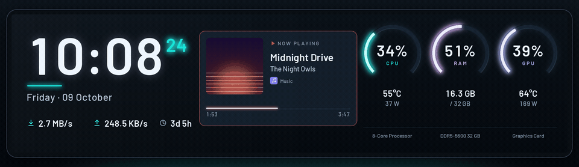

<p align="right"><b>English</b> · <a href="README.de.md">Deutsch</a></p>

<h1 align="center">
  <br>
  Libre Panel
</h1>

<p align="center">
  <b>Your PC's vitals as moving light, on the small USB screen in its case.</b><br>
  Free, open-source software for TURZX, Turing Smart Screen, WeAct, Kipye and compatible
  system-monitor panels. Windows and Linux, no account, no cloud.
</p>

<p align="center">
  <a href="https://github.com/syntensa/libre-panel/releases/latest"></a>
  <a href="https://github.com/syntensa/libre-panel/actions/workflows/ci.yml"></a>
  <a href="LICENSE"></a>
  
</p>

<picture>
  <source media="(prefers-reduced-motion: reduce)" srcset="docs/images/hero.png">
  
</picture>

<p align="center">
  <a href="https://github.com/syntensa/libre-panel/releases/latest"></a>
  <a href="https://github.com/syntensa/libre-panel/releases/latest"></a>
  <a href="https://github.com/syntensa/libre-panel/releases/latest"></a>
  <br>
  <sub>Windows 10 and 11 (x64) · Linux (x86-64) · every file and the release notes on the
  <a href="https://github.com/syntensa/libre-panel/releases/latest">latest release</a></sub>
</p>

<p align="center">
  <a href="#a-30-second-tour">Tour</a> ·
  <a href="#themes">Themes</a> ·
  <a href="#supported-panels">Panels</a> ·
  <a href="#install-and-first-start">Install</a> ·
  <a href="#privacy">Privacy</a> ·
  <a href="#faq">FAQ</a> ·
  <a href="https://syntensa.github.io/libre-panel/">Website</a>
</p>

Plug in the panel, start Libre Panel, and it shows your processor, graphics card, memory,
fans, network, what is playing and the weather outside, in a theme you pick or build
yourself. It runs quietly in the tray and takes the vendor app's place.

## A 30-second tour

### Smooth, in video mode

<p>
  
  
</p>

TURZX USB panels have a video decoder, and Libre Panel feeds it up to 50 frames a second.
Numbers count to each new reading, rings and bars glide, graphs scroll a little on every
frame and fans turn at their own speed. Values sit as light in milled grooves; lettering can
be faceted metal, and fine dust drifts in the depth behind. The downloads carry the ffmpeg it
needs, and it turns itself on on the 9.2" once the panel's standby clip is named
([what it needs](#faq)); every other panel gets still frames, sent where something changed.

### Cards that change by themselves


One slot, several cards: what is playing, with its cover and the player's icon; when nothing
plays, the weather with moving symbols, the next hours and the rain of the next two hours;
when there is neither, the day. A change ignites a line of light, the card rolls up into it
and the next one rolls down. With the downloads service on, the network card shows a
download in its place while one runs.

### Notices



Turn the volume and a band rolls down from a glowing edge, changing in place while you turn.
A new track with its cover, a sensor past a limit you set, a stick or a game controller
plugged in (Windows): short notices in the theme's colours, as a band or a card. Like every
service, they are off until you switch them on.

### Game mode


Start a game, from a list of your own or your Steam library, and the screen closes to a
line, the game's name lights up and the game screen opens: the frame rate, its 1% low and
who holds it back, counted by Intel's PresentMon. After a round, an optional report compares
it with your last ten.

### Every panel size


From the 0.96" stick to the 12.3" screen: every theme moves to every panel and lays itself
out for it. Libre Default, here on a 3.5" panel, is the default on every panel but the bars.

### The app


**Design**: drag building blocks onto the panel. A module fits itself to the room you give
it and shows more the larger it is; 25 of them, from every core to your next appointment.


**Look**: six colour worlds, and how rings, bars, graphs and lettering are drawn (light,
facet, acrylic or flat), the panel light, the grid, the depth dust and the notices, beside
the picture of the panel.


**Ctrl+K** finds every command, theme, module, sensor and setting by a few letters.
**Settings** writes `config.toml` for you, comments kept; the names of your processor,
graphics card and memory are found by themselves, and you can type your own. **Start** shows
the panel at a glance and the themes made for it, **Live** how it runs.

## Themes

<p align="center"></p>

| Theme | Made for | |
|---|---|---|
| **Lumen** | 8.8" and 9.2" bars (1920×480); the default there | Libre Panel's own: what plays, else the weather, else the day; the time with the load of the last minute as scrolling light and the fans turning; lit rings for CPU, GPU and RAM named after your hardware, over the network |
| **Studio** | 8.8" and 9.2" bars | calm: a large clock, the card slot and lit rings for CPU, RAM and GPU |
| **Libre Default** | 3.5" (480×320); the default on every other panel | two lit rings, temperature, disk and network, a history that scrolls; what plays, the weather or the day in the corner |
| **Slate** | 5" (800×480) | four cards: CPU, GPU, memory and network |
| **Orbit** | round 2.1" and 2.8" | three rings around a large clock |
| **Column** | 3.5" portrait | the clock, a row per resource and the network |
| **Pico** | 0.96" (160×80) | CPU with its temperature, and memory |

Every theme moves to any other panel from the panel button at the top of *Design*. Themes
are plain JSON with their pictures and fonts, and cannot run code
([theme format](docs/THEMES.md)). Made one you like? Share it in
[Discussions](https://github.com/syntensa/libre-panel/discussions). Also built in: the eight
screens of SPUR II as a legacy collection, see [Where it started](#where-it-started).

<details>
<summary><b>All 25 modules</b>: the building blocks of your own themes</summary>
<br>
<p align="center"></p>

Hardware down to every core, drive and fan; clocks for any time zone, a countdown, sunrise,
sunset and the moon (computed, no internet); what is playing, your calendars (any `.ics`),
Home Assistant and MQTT values, a slideshow. Each module shows more the larger it is, steps
aside when its readings are missing, and costs nothing while no theme shows it.
</details>

## Supported panels

| Panel | Sizes | Connects as | Status |
|---|---|---|---|
| Turing / TURZX | 2.8" round, 4.6", 5.2", 8", 8.8", 9.2", 12.3" | USB device (`1cbe:…`) | 9.2": proven for hours, as stills and as 50 fps video. Other sizes: the same protocol, unverified |
| Turing Smart Screen | 2.1" round, 3.5", 5", 8.8" | virtual COM port | unverified |
| UsbPCMonitor | 3.5", 5", 7" | virtual COM port | unverified |
| XuanFang | 3.5" | virtual COM port | unverified |
| Kipye Qiye | 3.5" | virtual COM port | unverified |
| WeAct Display FS V1 | 0.96", 3.5" | virtual COM port | unverified |

*Unverified* means the driver follows a protocol proven on real panels, but nobody has
confirmed that model with Libre Panel yet. **Own one?** `libre-panel doctor` checks it end to
end and writes a report without serial numbers; attach it to a
[panel report](https://github.com/syntensa/libre-panel/issues/new?template=panel_support.yml)
and the model becomes *supported* for everyone. Video mode is for the TURZX USB panels; the
others have no video decoder. Details, Linux permissions and the panels of other brands:
[docs/HARDWARE.md](docs/HARDWARE.md).

## <a name="install"></a>Install and first start

From the [latest release](https://github.com/syntensa/libre-panel/releases/latest), no
Python needed:

- **Windows 10 and 11:** `libre-panel-…-windows-x64-setup.exe` installs for all users, with
  a start menu entry, an optional start at login and, in checked boxes that say what each
  is, the sensor service, the PawnIO driver and what game frame rates need; Windows asks
  once for administrator rights, Libre Panel itself runs without them. A portable zip is
  there too: its *Unlock all sensors* sets up the same.
- **Linux (x86-64):** `Libre_Panel-…-x86_64.AppImage`: make it executable and start it, no
  installation. A tarball is there too.

The downloads carry what the features run, in a `tools` folder next to the program: ffmpeg
for the video mode, and on Windows PresentMon for game frame rates and the installer of the
PawnIO driver for the CPU's sensors. Nothing else has to be installed; ffmpeg is GPL-3.0, the
others are MIT and GPL-2.0 ([which programs](docs/CONFIGURATION.md#programs-that-come-with-the-downloads),
and [NOTICE.md](NOTICE.md) for their sources).

1. **Close the vendor app.** It keeps the panel to itself.
2. **Start Libre Panel** with the panel plugged in. The Windows downloads are not code-signed
   yet: SmartScreen asks once (*More info → Run anyway*). On Linux, *Start* offers to give your
   user access to the panel with one click ([what it does](docs/CONFIGURATION.md#linux-sensors-and-panel-access)).
3. **Pick a look.** *Start* asks "How should it look?" with the themes made for the panel it
   found: Lumen on the 8.8" and 9.2" bars, Libre Default on the others.
4. **Turn on what you want.** In *Settings*: the weather and your place, video mode, the
   services (all off until you switch them on). The tray icon has the theme, brightness,
   pause and *Start with system*.

On Windows, the processor's temperature and power, the mainboard's fans and the
temperatures of memory and drives come through Libre Panel's sensor service, which reads
them with the rights they need ([FAQ](#faq)); the app itself runs without those rights. On
Linux the sensors need no rights, except the mainboard's fans and the processor's power:
*Start* offers both with one click ([FAQ](#faq)).
The app opens in a window of its own (WebView2 on Windows, WebKitGTK on Linux); the AppImage
opens it in the browser for now ([details](docs/BACKGROUND.md#the-apps-window)).

With Python instead:

```bash
pipx install "libre-panel[usb,serial,tray] @ git+https://github.com/syntensa/libre-panel@v0.5.0"
libre-panel tray                    # the background app with its tray icon; opens its window
libre-panel autostart enable        # start it whenever you log in
```

<details>
<summary>More commands</summary>

```bash
libre-panel                         # panel and app in a terminal (Ctrl+C stops)
libre-panel editor                  # only the app, without the panel (--browser: in the browser)
libre-panel run                     # only drive the panel
libre-panel preview lumen -o lumen.png    # render a theme to an image
libre-panel models                  # every known panel and its resolution
libre-panel devices                 # which panel is connected?
libre-panel doctor                  # check the panel end to end, write a report
libre-panel sensors                 # every sensor key with its current value
libre-panel config init             # write a commented config.toml
libre-panel location "Berlin"       # coordinates for the weather
libre-panel system-setup --linux    # Linux: one step for the panel's permission, the board's fans
libre-panel udev-rules              # Linux: the rule that gives your user USB access
libre-panel quit                    # quit the background app
```

</details>

## Privacy

**Nothing leaves your PC except the weather you turn on.** No account, no telemetry, no
update check. The app is served to your own PC only (127.0.0.1), and only to requests that
carry a secret token, new at every start.

- **The weather** is off until you set a place. Then only its coordinates go to
  [Open-Meteo](https://open-meteo.com), every 15 minutes. A place you look up by name goes
  to Open-Meteo's place search when you press *Search*, and is kept to about a kilometre.
- **What you connect yourself** talks to the address you give it: calendars (`.ics`),
  Home Assistant, MQTT. The ping of the network details module connects to 1.1.1.1 (or the
  host you set) while that module is on the panel, and a cover that a player names by a web
  address is loaded from there.
- **The optional services** keep what they learn on this PC: the memory and the round report
  in a SQLite file you can open or delete; the cooling analysis reads FanControl's
  configuration and never writes it. No track title, window title or file name is read.
- **The hardware's names** never go to the log, and `libre-panel doctor` writes no serial
  numbers or personal paths into its report.

## FAQ

<details>
<summary><b>Which panel do I have?</b></summary>
<br>

The product name and the back label usually say it. Plugged in, `libre-panel devices` lists
what it sees: a TURZX USB panel shows up with the USB id `1cbe:…` and its size, the others
as a virtual COM port (`COM3`, `/dev/ttyACM0`). *Start* in the app names the panel it found;
*Another panel* lets you choose. When in doubt, `libre-panel doctor` asks and checks. The
[hardware list](docs/HARDWARE.md) has every model.
</details>

<details>
<summary><b>Why do the CPU temperature and power show "--" on Windows?</b></summary>
<br>

The Windows downloads carry LibreHardwareMonitor's library and read the graphics card and
its fans with no other program. The processor's temperature, power and clock, the RAM's and
the drives' temperatures and the mainboard's fans need **administrator rights** and the
**PawnIO** driver ([pawnio.eu](https://pawnio.eu)). Libre Panel's **sensor service** has
both: the setup installs it (the checked box *Sensor service*), the portable zip offers
*Unlock all sensors* on Start (one question of Windows), and Libre Panel itself goes on
without administrator rights ([how it is kept safe](docs/BACKGROUND.md#the-sensor-service)).
*Settings → Sensors* says whether it runs. Without it, `libre-panel autostart enable
--elevated` (as administrator) or a LibreHardwareMonitor that you run yourself with its web
server work as before ([details](docs/CONFIGURATION.md#windows-sensors-gpu-power-fans)).
</details>

<details>
<summary><b>Why are the fans or the CPU power missing on Linux?</b></summary>
<br>

Most sensors need no rights on Linux (processor, graphics card, NVMe drives, memory). Three
things do: the **panel's USB permission**, the **driver for the chip that reads the mainboard's
fans** (the kernel has it, but nobody loads it), and, only if you want it, the **processor's
power** (the kernel has kept those counters from everyone but root since 2020). *Start* shows a
card when one of them is missing, *Settings → Sensors* always has it: one click, your system
asks for the password once, and the card says exactly what is changed. In a terminal:
`libre-panel system-setup --linux` (add `--rapl` for the power, `--remove` to undo it all). More:
[Linux sensors and panel access](docs/CONFIGURATION.md#linux-sensors-and-panel-access).
</details>

<details>
<summary><b>How do I get the smooth video mode? Do I need ffmpeg?</b></summary>
<br>

Video mode is for the TURZX USB panels, which have a video decoder. The Windows and Linux
downloads carry the [ffmpeg](https://ffmpeg.org) it needs, so you only name the panel's
standby clip, as the vendor app shows it, in *Settings → Panel*. On the 9.2" it then turns
itself on; on the other TURZX USB panels set it to *on* to try it. With a pip install, install
ffmpeg yourself (Windows: `winget install ffmpeg`; Linux: your distribution's package) or
name it in the same place. Nothing is saved on the panel. The serial panels get still frames,
with only the changed parts sent ([details](docs/CONFIGURATION.md#video)).
</details>

<details>
<summary><b>Do I need LibreHardwareMonitor, FanControl or PresentMon?</b></summary>
<br>

No other program is needed: LibreHardwareMonitor and Intel's
[PresentMon](https://github.com/GameTechDev/PresentMon) (Windows, MIT licence) are in the
Windows downloads. For the game's frame rate switch *Game frame rate* on in *Settings →
Sensors*; PresentMon needs administrator rights or your account in the Windows group
"Performance Log Users", which the setup can arrange
([how](docs/CONFIGURATION.md#more-sensor-sources)). The cooling analysis reads FanControl's
fan curves, if you use FanControl.
</details>

<details>
<summary><b>Can it harm my panel?</b></summary>
<br>

Libre Panel sends display commands only: pictures, brightness, video. It never touches the
firmware and stores nothing on the panel; firmware updates stay the vendor app's job.
</details>

<details>
<summary><b>macOS?</b></summary>
<br>

Not since 0.5: Windows and Linux are supported, and nobody downloaded the macOS builds of
earlier releases.
</details>

## Contributing

The most valuable help right now is a **panel report**: `libre-panel doctor` on a model
marked *unverified* turns it *supported* for everyone. Themes are welcome in
[Discussions](https://github.com/syntensa/libre-panel/discussions); a language needs one JSON
file ([how](docs/CONFIGURATION.md#language)); code, drivers and plugins start at
[CONTRIBUTING.md](CONTRIBUTING.md) and the [plugin API](docs/PLUGINS.md). Security issues go
through a [private advisory](SECURITY.md).

**Documentation:** [panels](docs/HARDWARE.md) ·
[background app and autostart](docs/BACKGROUND.md) ·
[configuration](docs/CONFIGURATION.md) · [themes and sensor keys](docs/THEMES.md) ·
[plugins](docs/PLUGINS.md) · [architecture](docs/ARCHITECTURE.md) ·
[TURZX USB protocol](docs/protocol/turzx-usb.md) · [serial protocols](docs/protocol/serial.md) ·
[roadmap](docs/ROADMAP.md) · [releasing](docs/RELEASING.md) · [changelog](CHANGELOG.md)

## Where it started

Libre Panel grew out of SPUR II, a private dashboard for one 9.2" panel on one PC. SPUR II
proved the panel's USB protocol and its video mode on real hardware, and its ideas (light in
milled grooves, the cards, the band, the tube) are now Libre Panel's own, for every panel and
every PC. Its eight screens ship as the legacy collection *SPUR II*, at the end of *Start →
All* ([what came from it](docs/SPUR2_MIGRATION.md)).

<p align="center"><a href="docs/media/where-it-started.gif"></a></p>

## License and notices

Libre Panel is free software under the [GPL-3.0-or-later](LICENSE). The built-in themes carry
their own licence, stated in each `theme.json`. It stands on the shoulders of
[turing-smart-screen-python](https://github.com/mathoudebine/turing-smart-screen-python)
(GPL-3.0), whose reverse-engineering documents these panels; the Windows downloads carry
[LibreHardwareMonitor](https://github.com/LibreHardwareMonitor/LibreHardwareMonitor)
(MPL-2.0), [PresentMon](https://github.com/GameTechDev/PresentMon) (MIT) and the installer of
the [PawnIO](https://pawnio.eu) driver (GPL-2.0-or-later with an exception), and every
download [ffmpeg](https://ffmpeg.org) (GPL-3.0-or-later); the fonts are Barlow, JetBrains Mono
and Liberation Sans (SIL OFL 1.1); weather
data by [Open-Meteo.com](https://open-meteo.com) (CC BY 4.0). All of it in
[NOTICE.md](NOTICE.md).

"TURZX", "Turing Smart Screen" and other product names are trademarks of their owners.
Libre Panel is an independent project and not affiliated with them.
