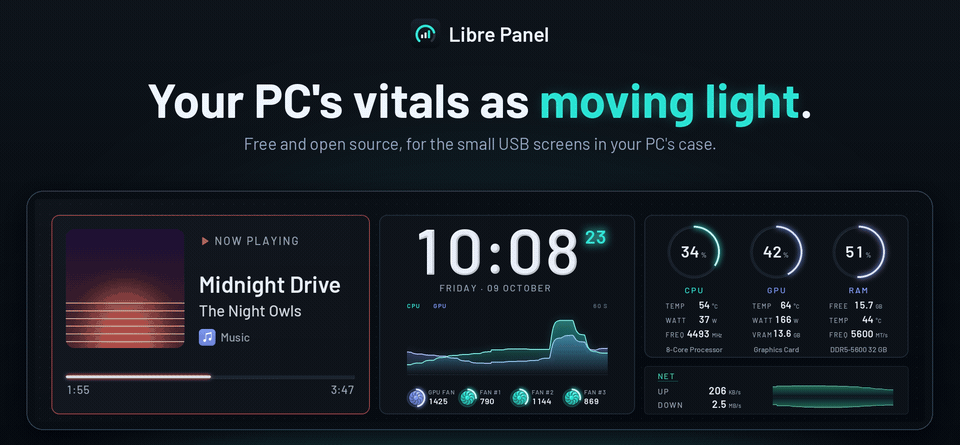
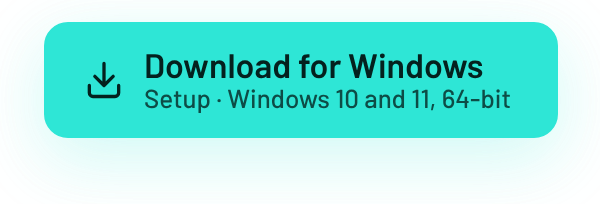
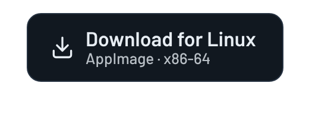
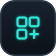
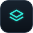
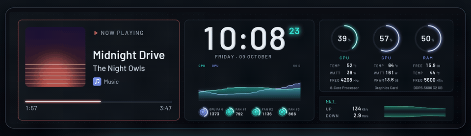
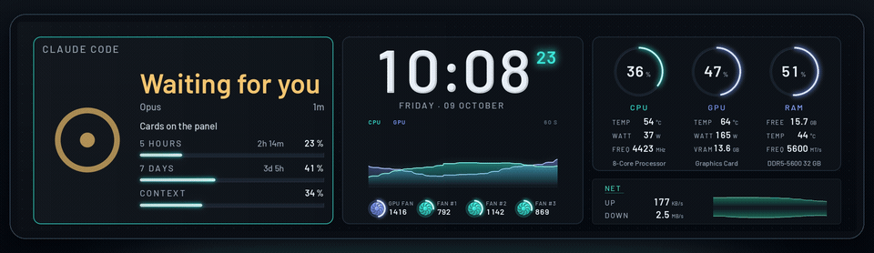
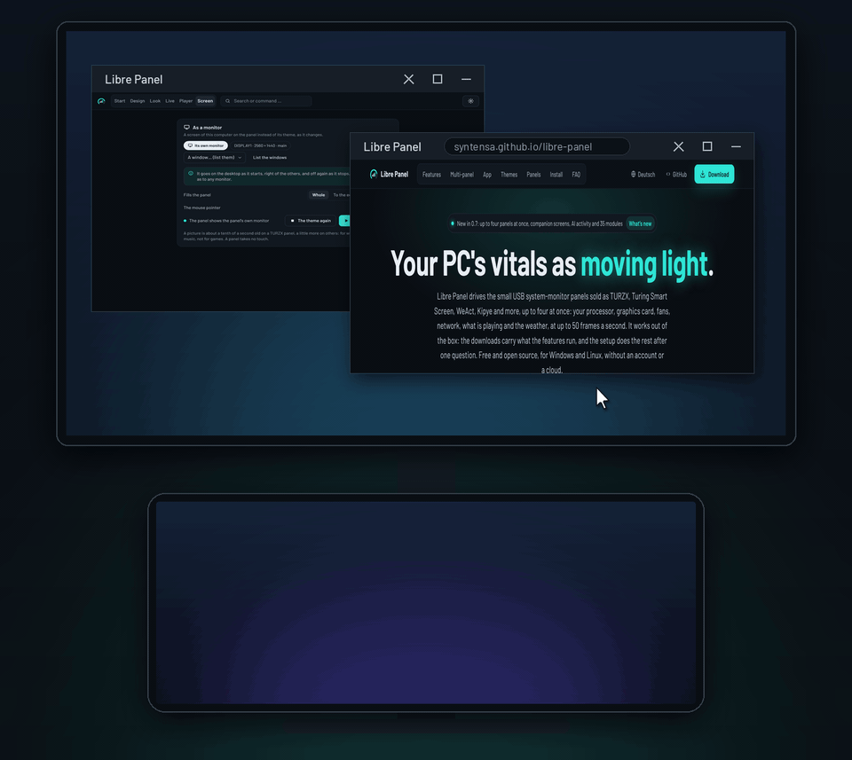
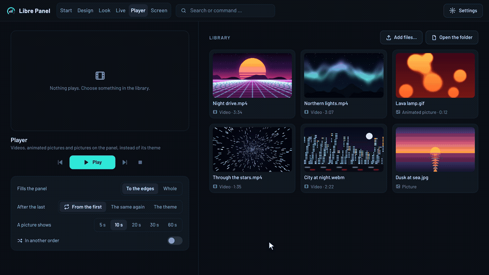
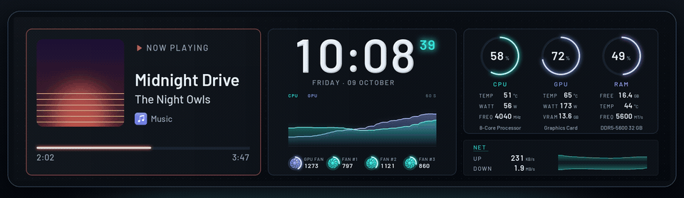

<p align="right"><sub><b>English</b> · <a href="README.de.md">Deutsch</a></sub></p>

<p>
  <picture>
    <source media="(prefers-reduced-motion: reduce)" srcset="docs/media/hero.png">
    
  </picture>
</p>

<p align="center">
  Libre Panel drives the small USB system-monitor panels sold as TURZX, Turing Smart Screen,
  WeAct, Kipye and more, up to four at once: your processor, graphics card, fans, network, what
  is playing and the weather, at up to 50 frames a second. It works out of the box, on Windows
  and Linux, without an account or a cloud.
</p>

<p align="center">
  <a href="https://github.com/syntensa/libre-panel/releases/latest"></a>
  <a href="https://github.com/syntensa/libre-panel/releases/latest"></a>
  <br>
  <sub>
    <a href="https://github.com/syntensa/libre-panel/releases/latest">Portable zip</a> ·
    <a href="https://github.com/syntensa/libre-panel/releases/latest">Linux tarball</a> ·
    <a href="#with-python">With Python</a> ·
    <a href="CHANGELOG.md">What's new</a> ·
    <a href="https://syntensa.github.io/libre-panel/">Website</a>
  </sub>
</p>

<p align="center">
  <a href="https://github.com/syntensa/libre-panel/releases/latest"></a>
  <a href="https://github.com/syntensa/libre-panel/actions/workflows/ci.yml"></a>
  <a href="LICENSE"></a>
  
</p>

<p align="center">
  <b>
    <a href="#features">Features</a> ·
    <a href="#the-app">The app</a> ·
    <a href="#themes">Themes</a> ·
    <a href="#supported-panels">Panels</a> ·
    <a href="#install">Install</a> ·
    <a href="#privacy">Privacy</a> ·
    <a href="#faq">FAQ</a> ·
    <a href="#documentation">Docs</a>
  </b>
</p>

<br>

<table>
<tr>
<td width="33%" align="center" valign="top">
<a href="#up-to-50-frames-a-second"></a><br>
<b>Up to 50 frames a second</b><br>
<sub>Numbers count, rings glide and fans turn, in video mode on the TURZX USB panels.</sub>
<br><br>
<a href="#the-app"></a><br>
<b>Build your own</b><br>
<sub>Drag 35 modules onto the panel, pick a look, and share it with everyone.</sub>
</td>
<td width="33%" align="center" valign="top">
<a href="#several-panels-at-once"></a><br>
<b>Up to four panels</b><br>
<sub>Each with its own theme, in one beat; companions show what the first leaves out.</sub>
<br><br>
<a href="#everything-comes-with-it"></a><br>
<b>Works out of the box</b><br>
<sub>Sensors, game frame rates and video mode need no other program.</sub>
</td>
<td width="33%" align="center" valign="top">
<a href="#screens-for-music-weather-and-time"></a><br>
<b>Screens for every moment</b><br>
<sub>Music, the weather, the time, your games and your AI tools, by themselves or in turn.</sub>
<br><br>
<a href="#privacy"></a><br>
<b>Private by design</b><br>
<sub>No account, no telemetry: nothing leaves your PC that you have not turned on.</sub>
</td>
</tr>
</table>

<p align="center">
  <sub><b>Works with</b> Turing / TURZX · Turing Smart Screen · JONSBO · Waveshare · WeAct ·
  Kipye · UsbPCMonitor · XuanFang · Lian Li · Thermalright · BeadaPanel · NZXT Kraken ·
  Thermaltake · <a href="#supported-panels">every panel</a></sub>
</p>

## Features

Every clip shows Libre Panel itself, with demo values.

### Up to 50 frames a second

<p></p>

TURZX USB panels have a video decoder, and Libre Panel feeds it up to 50 frames a second:
numbers count to each new reading, rings and bars glide, graphs scroll a little on every frame
and fans turn at their own speed. Values sit as light in milled grooves, and fine dust drifts in
the depth behind. 30 frames a second is the default, smooth and far lighter on the PC; every
other panel gets still frames, sent where something changed.

### Cards that take turns

<p></p>

One slot on Lumen, several cards: what is playing with its cover, the weather with moving
symbols and the next hours, the day, a clock face, the moon or your agenda. The first with
something to show is on show, or they take turns, each for its minutes. From one to the next
the slot goes as you choose: a line of light, a fade, a push to the side or upwards, or a beam
of light that wipes across.

### Notices

<p></p>

Turn the volume and it shows over every screen, in the look you pick: a *Bar* along the edge,
*Levels* that rise, a *Ring* that fills or a *Large* number. A new track with its cover, a
sensor past a limit you set, a controller plugged in (Windows) and your own scripts
(`libre-panel notify "Render done"`) get short notices in the theme's colours.

### Game mode

<p></p>

Start a game and the screen closes to a line, the game's name lights up and **Arena** opens:
the frame rate with every frame as measured, its 1% low, the frame time and who holds it back.
The game comes from your launcher (Steam, Epic, GOG, Ubisoft Connect, the EA app, Battle.net,
the Xbox app, Heroic, Lutris and more), its frame rate from PresentMon, RTSS or MangoHud.

<p></p>

After a round, an optional **round report** compares it with your last ten: the lows, the
longest frame, what held it back and how warm it got.

### Screens for music, weather and time

<p></p>

**Encore** is for music, with the cover large and its colours behind the whole screen;
**Nimbus** for the weather, with the next days and the moon; **Almanac** is a clock with the
month, and **Almanac Analog** a face whose second hand glides. Encore takes over while a track
plays and Almanac when you step away, or the screens take turns: five minutes this, ten minutes
that, and round again.

### What your AI tools are doing

<p></p>

Claude Code and Codex on this PC, and Claude Code's cloud sessions: working, waiting for you or
idle, with the tool at work, what today cost and how much of the plan's limits is used. On Lumen
the AI card comes up by itself while one of them works; **Agents** gives them a screen of their
own. Nothing leaves this PC ([AI activity](docs/CONFIGURATION.md#ai-activity)).

### Several panels at once

<p></p>

Up to four panels, each with its own theme, on the same readings and in the same beat. A panel
beside Lumen gets **Lumen Companion**: every core, the temperatures with the fans turning, the
drives and the processes, while Lumen leaves out what its companion shows. One picture can span
all panels, **scenes** put a theme on every panel with one click, and when a sensor reaches its
critical limit every panel's edge pulses red. A JONSBO ZC-360's three fan screens are three
panels of their own ([more panels at once](docs/CONFIGURATION.md#more-panels-at-once)).

### The panel as a monitor

<p></p>

The app's **Screen** puts a screen of the computer on a panel: one of your monitors, a part of
one, a window, or a monitor of its own that the desktop extends to, where windows go as to any
other. On Windows (with the open-source Virtual Display Driver, set up from the app) and on
Linux with X11 and Wayland. A TURZX panel in video mode gets it straight as its video stream.

### The Player

<p></p>

Your videos, GIFs and pictures on a panel instead of its theme: drop them into the **Player**,
click one, and the library plays from there, each frame at its moment. Pause, skip and seek
while the app shows the panel's own picture, round and round or shuffled; the theme comes back
when you stop.

### The panel's own start screen

<p></p>

TURZX USB panels show a logo of their own when they are switched on and play a clip when the PC
starts. Libre Panel draws both in its own look, for your panel's size, and puts them on it with
one click; the factory logo comes back with another.

### Every size, round and upright

<table>
<tr>
<td width="50%" valign="top"></td>
<td width="50%" valign="top"></td>
</tr>
</table>

From the 0.96" stick to the 12.3" screen, every theme moves to every panel and lays itself out
for it. The round panels get screens of their own, laid out for the circle, and a bar mounted
upright gets every screen laid out anew, not turned on its side.

<p></p>

## The app

<p></p>

<table>
<tr>
<td width="50%" valign="top"><br>
<b>Look</b>: six colour worlds, and how rings, bars, graphs and lettering are drawn: as light,
facets, acrylic or flat.</td>
<td width="50%" valign="top"><br>
<b>Ctrl+K</b> finds every command, theme, module, sensor and setting by a few letters.</td>
</tr>
</table>

- **Design**: drag building blocks onto the panel. A module fits itself to the room you give
  it and shows more the larger it is; 35 of them, from every core to the ping, a timer, the
  power the PC draws and your next appointment.
- **Start** shows the panel at a glance, the themes made for it and the community's, the cards
  and the screens in turn; **Live** shows how it runs, and with the memory on, the **history**:
  temperatures, load and power over a day, a week or a month, and the games you played.
- **Settings** writes `config.toml` for you, comments kept, and finds the names of your
  processor, graphics card and memory by itself. **Keyboard shortcuts** pause the panel, turn
  its brightness or open the app from any window.
- In a window of its own, in ten languages: English, German, French, Spanish, Italian, Polish,
  Portuguese (Brazil), Russian, Japanese and Simplified Chinese.

## Themes

<p></p>

<p align="center"></p>

| Theme | Made for | What it shows |
|---|---|---|
| **Lumen** | 8.8" and 9.2" bars, the default there | what plays, the time with the load as light, lit rings named after your hardware |
| **Studio** | 8.8" and 9.2" bars | calm: a large clock, the card slot and lit rings |
| **Encore** | 8.8" and 9.2" bars | for music: the cover large, its colours behind the whole screen |
| **Nimbus** | 8.8" and 9.2" bars | for the weather: now, the next hours and days, the moon |
| **Almanac** | 8.8" and 9.2" bars | a clock with the month; **Almanac Analog** on a face |
| **Arena** | 8.8" and 9.2" bars, 12.3" | for game mode: the frame rate large, CPU and GPU, every core |
| **Agents** | 8.8" and 9.2" bars, 12.3" | what Claude Code and Codex do; **Agents Claude** for Claude Code alone |
| **Libre Default** | 3.5", the default on every other panel | two lit rings, a history that scrolls, a card in the corner |
| **Slate** | 5" | four cards: CPU, GPU, memory and network |
| **Orbit** | round 2.1" and 2.8" | three rings around a large clock |
| **Column** | 3.5" portrait | the clock, a row per resource and the network |
| **Pico** | 0.96" | CPU with its temperature, and memory |
| **Companions** | a panel beside the first | Lumen, Arena, Encore and Almanac Companion: what the first panel leaves out |
| **High Contrast** | every size from 2.1" to 12.3" | white on black in very large digits, to read from across the room |

Every theme moves to any other panel and lays itself out for it. Themes are plain JSON with
their pictures and fonts and cannot run code ([every built-in theme](docs/THEMES.md#every-built-in-theme),
[the theme format](docs/THEMES.md)). The eight screens of SPUR II are built in too, as a legacy
collection ([where it started](#where-it-started)).

### Community themes

Themes other Libre Panel users made, one click away: *Start → Themes → Community themes* shows
first the ones made for your panel, and **Install** puts one among yours. *Share with
everyone…* on your own theme's card saves it as one `.zip` and opens GitHub's form, filled in:
a check draws its picture, and after a look it is in everyone's app. The app takes the list and
the zips from this repository only, checks each against its SHA-256 before anything is
unpacked, and tells GitHub nothing of you or your panel
([sharing, step by step](community/themes/README.md)).

<details>
<summary><b>All 35 modules</b>: the building blocks of your own themes</summary>
<br>
<p align="center"></p>

Hardware down to every core, drive and fan, the ping, the power the PC draws and what it
costs, a UPS; clocks for any time zone, a countdown, a timer, sunrise, sunset and the moon
(computed, no internet); what is playing, whether the microphone is muted, your calendars (any
`.ics`), Home Assistant, MQTT and JSON values, what Claude Code and Codex do, a slideshow.
Each module shows more the larger it is, steps aside when its readings are missing, and costs
nothing while no theme shows it.
</details>

## Supported panels

| Brand | Verified on real panels | Supported, not yet verified | Connects as |
|---|---|---|---|
| **Turing / TURZX** | 8.8", 9.2", 12.3" | 1.6", 2.1" round, 2.8" round, 4.6", 5.2", 8" | USB, video mode |
| **Turing Smart Screen** | 3.5", 8.8" | 2.1" round, 5" | COM port |
| **JONSBO** | ZC-360, each screen its own panel | ZC-360 as one picture, TF3-360SC, DS916, DS339 | USB |
| **Waveshare USB Monitor** | 2.8", as a USB display | – | USB |
| **UsbPCMonitor** | – | 3.5", 5", 7" | COM port |
| **XuanFang** | – | 3.5" | COM port |
| **Kipye Qiye** | – | 3.5" | COM port |
| **WeAct Display FS V1** | – | 0.96", 3.5" | COM port |
| **VMAX** | – | 4.6" | USB |
| **Hongtai / Jungle Leopard** | – | Chill Arc 360, MSI EZ Display and more | COM port |
| **Lian Li** | – | Universal Screen, HydroShift II, OLED Curve | USB |
| **Thermalright** | – | Trofeo Vision | USB |
| **BeadaPanel** | – | every model | USB |
| **NZXT Kraken** | – | with an LCD | USB |
| **Thermaltake** | – | 6" LCD | USB |

**Not supported yet:** GUITION 3.5", Fuldho 3.5", AX206 picture frames, and Lian Li's TL LCD,
Galahad II LCD and Lancool 207.

**Own an unverified one?** The panel test in the app (*Live → Diagnose*, or `libre-panel
doctor`) checks it end to end and writes a report without serial numbers; one click opens a
[panel report](https://github.com/syntensa/libre-panel/issues/new?template=panel_support.yml)
with it filled in, and the model becomes verified for everyone. The panels on a COM port are the
older kind and slower, so Libre Panel keeps their motion calm; video mode is for the TURZX USB
panels. Every model with its USB ids and its setup: [docs/HARDWARE.md](docs/HARDWARE.md).

## Install

<table>
<tr>
<td width="33%" valign="top">
<b>Windows 10 and 11</b><br>
<sub>64-bit</sub>
<br><br>
The <b>setup</b> installs for all users, with a start menu entry and, in boxes that say what
each is, a start at login and the sensor service. Or the <b>portable zip</b>.
<br><br>
<a href="https://github.com/syntensa/libre-panel/releases/latest">Download</a>
</td>
<td width="33%" valign="top">
<b>Linux</b><br>
<sub>x86-64</sub>
<br><br>
The <b>AppImage</b>: make it executable and start it, no installation. <i>Start</i> gives
your user the panel's USB access with one click. Or the <b>tarball</b>.
<br><br>
<a href="https://github.com/syntensa/libre-panel/releases/latest">Download</a>
</td>
<td width="33%" valign="top">
<b>With Python</b><br>
<sub>3.11 or newer</sub>
<br><br>
<b>pipx</b> installs it from this repository, with the panel's drivers and the tray, on
Windows and Linux.
<br><br>
<a href="#with-python">The commands</a>
</td>
</tr>
</table>

### First start

1. **Close the vendor app.** It keeps the panel to itself.
2. **Start Libre Panel** with the panel plugged in. The Windows downloads are not code-signed
   yet: SmartScreen asks once (*More info → Run anyway*). On Linux, *Start* offers to give your
   user access to the panel ([what it does](docs/CONFIGURATION.md#linux-sensors-and-panel-access)).
3. **Pick a look.** *Start* asks "How should it look?" with the themes made for the panel it
   found: Lumen on the 8.8" and 9.2" bars, Libre Default on the others.
4. **Turn on what you want.** In *Settings*: the weather and your place, video mode, the
   services (all off until you switch them on). The tray icon has the theme, brightness, pause
   and *Start with system*.

The app opens in a window of its own (WebView2 on Windows, WebKitGTK on Linux, else the browser;
[details](docs/BACKGROUND.md#the-apps-window)).

### Everything comes with it

Sensors, fans, graphics card, game frame rates (Windows) and the video mode need no other
program, and nothing else is to be downloaded. The downloads carry what the features run, in a
`tools` folder next to the program: ffmpeg for the video mode, and on Windows PresentMon for game
frame rates and the installer of the PawnIO driver. One setup step does the rest and asks once:
for administrator rights on Windows, for your password on Linux. Libre Panel itself runs without
administrator rights.

<details>
<summary><b>What each download sets up, and why</b></summary>
<br>

| | Windows setup | Portable zip | Linux (AppImage) |
|---|---|---|---|
| **Processor, mainboard, memory and drive sensors** | the sensor service and the PawnIO driver, two checked boxes | *Unlock all sensors* on Start and in *Settings → Sensors* sets up the same | the processor and NVMe drives are read without rights; *Set up sensors and panel access* loads the kernel's drivers for the board's fan chip and for SATA drives |
| **Processor power** | read by the sensor service | the same | a switch in that card, off until you turn it on |
| **Graphics card** | built in (LibreHardwareMonitor) | built in | AMD, Intel and NVIDIA, read without rights |
| **Game frame rates** | PresentMon is in the download, a box of its own (unchecked, the setup says first what will not work); the third box of the sensors adds you to *Performance Log Users* | PresentMon is in the download; *Unlock all sensors* adds you | Windows only |
| **Video mode** | ffmpeg is in the download | ffmpeg is in the download | ffmpeg is in the download |
| **The panel's USB access** | nothing to do | nothing to do | the same card writes the udev rule |
| **Settings** | in your own folder | in the folder `data` beside the program: it moves with it | in your own folder |

- **One question.** Windows asks for administrator rights once, for the setup or for *Unlock
  all sensors*; on Linux your system asks for your password once. *Install for me only* is
  still possible: the setup then installs without those rights and leaves the system parts to
  *Unlock all sensors*. The readings arrive within a few seconds; game frame rates count from
  your next sign-in, when Windows applies the group.
- **Read only.** The sensor service only reads: it sets no fan and changes no setting of the
  hardware. People signed in at the PC can read its values; network logons and other computers
  are refused ([how it is built](docs/BACKGROUND.md#the-sensor-service)). *Remove* in
  *Settings → Sensors*, the uninstaller and, on Linux, *Remove again* take it all out. Every
  release build installs the Windows setup on a Windows test machine, checks that the service
  runs and that Libre Panel reads through it, and uninstalls it again; the AppImage's setup is
  run as a dry run in the bare environment `pkexec` makes.
- **Video mode** turns itself on on the 9.2" once the panel's standby clip is named; *Start*
  asks for the name once ([what it needs](#faq)).
- **The programs** are the files their projects publish, unchanged, each checked against a
  SHA-256 when the download is built. ffmpeg is GPL-3.0, PresentMon MIT, PawnIO's driver
  GPL-2.0-or-later with an exception
  ([which programs](docs/CONFIGURATION.md#programs-that-come-with-the-downloads); their
  licences and sources are in [NOTICE.md](NOTICE.md)).
</details>

### With Python

```bash
pipx install "libre-panel[usb,serial,tray] @ git+https://github.com/syntensa/libre-panel@v0.7.7"
libre-panel tray                    # the background app with its tray icon; opens its window
libre-panel autostart enable        # start it whenever you log in
```

<details>
<summary>More commands</summary>

```bash
libre-panel                         # panel and app in a terminal (Ctrl+C stops)
libre-panel editor                  # only the app, without the panel (--browser: in the browser)
libre-panel run                     # only drive the panel
libre-panel preview lumen -o lumen.png    # render a theme to an image
libre-panel models                  # every known panel and its resolution
libre-panel devices                 # which panel is connected?
libre-panel doctor                  # check the panel end to end, write a report
libre-panel sensors                 # every sensor key with its current value
libre-panel config init             # write a commented config.toml
libre-panel location "Berlin"       # coordinates for the weather
libre-panel system-setup --linux    # Linux: one step for the panel's permission, the board's fans
libre-panel udev-rules              # Linux: the rule that gives your user USB access
libre-panel quit                    # quit the background app
```

</details>

## Privacy

**Nothing leaves your PC that you have not turned on.** No account, no telemetry. The app is
served to your own PC only (127.0.0.1), and only to requests that carry a secret token, new at
every start.

<details>
<summary><b>What goes where</b>, one by one</summary>
<br>

- **The weather** is off until you set a place. Then only its coordinates go to
  [Open-Meteo](https://open-meteo.com), every 15 minutes. A place you look up by name goes
  to Open-Meteo's place search when you press *Search*, and is kept to about a kilometre.
- **New versions**: *Start* asks once whether to look. Say yes, and once a day Libre Panel
  asks GitHub for its latest release; the request carries the version you have, nothing about
  you or your panel. *Settings → Start and system* switches it off again.
- **Notices from other programs** are off until you allow them, and then taken only from this
  PC and only with the key Libre Panel made for them.
- **What you connect yourself** talks to the address you give it: calendars (`.ics`),
  Home Assistant, MQTT, a JSON address, a UPS's upsd. The ping connects to 1.1.1.1 (or the
  hosts you set) while a theme shows it, and a cover that a player names by a web
  address is loaded from there.
- **The optional services** keep what they learn on this PC: the memory and the round report
  in a SQLite file you can open or delete; the cooling analysis reads FanControl's
  configuration and never writes it. No track title, window title or file name is read.
- **AI activity** is off until you switch it on and set up Claude Code or Codex. Their hooks
  hand what they do to Libre Panel on this PC only, with a key of its own; for the plan's
  usage Libre Panel asks the programs, which ask their own servers with your sign-in. Claude
  Code's cloud sessions, once you set them up, send their state (never a prompt) to an ntfy
  topic with a long random address, which Libre Panel reads.
- **The hardware's names** never go to the log, and `libre-panel doctor` writes no serial
  numbers or personal paths into its report.
</details>

## FAQ

<details>
<summary><b>Which panel do I have?</b></summary>
<br>

The product name and the back label usually say it. Plugged in, `libre-panel devices` lists
what it sees: a TURZX USB panel shows up with the USB id `1cbe:…` and its size, the others
as a virtual COM port (`COM3`, `/dev/ttyACM0`). *Start* in the app names the panel it found;
*Another panel* lets you choose. When in doubt, `libre-panel doctor` asks and checks. The
[hardware list](docs/HARDWARE.md) has every model.
</details>

<details>
<summary><b>Why do the CPU temperature and power show "--" on Windows?</b></summary>
<br>

The Windows downloads carry LibreHardwareMonitor's library and read the graphics card and
its fans with no other program. The processor's temperature, power and clock, the RAM's and
the drives' temperatures and the mainboard's fans need **administrator rights** and the
**PawnIO** driver, and the downloads carry its installer. Libre Panel's **sensor service**
has both, and the setup installs the two (the checked boxes *Sensor service* and *PawnIO
driver*), so after the setup nothing is left to do. You see "--" only where that part was
not set up: after *Install for me only*, or with the portable zip. *Unlock all sensors* on
Start, or in *Settings → Sensors*, sets it up with one question of Windows, and Libre Panel
itself goes on without administrator rights
([how it is kept safe](docs/BACKGROUND.md#the-sensor-service)). *Settings → Sensors* says
whether the service runs. With a pip install there is no service: install PawnIO from
[pawnio.eu](https://pawnio.eu) and use `libre-panel autostart enable --elevated` (as
administrator), or a LibreHardwareMonitor that you run yourself with its web server
([details](docs/CONFIGURATION.md#windows-sensors-gpu-power-fans)).
</details>

<details>
<summary><b>Why are the fans or the CPU power missing on Linux?</b></summary>
<br>

Most sensors need no rights on Linux (processor, graphics card, NVMe drives, memory). Three
things do: the **panel's USB permission**, the **driver for the chip that reads the mainboard's
fans** (the kernel has it, but nobody loads it), and, only if you want it, the **processor's
power** (the kernel has kept those counters from everyone but root since 2020). *Start* shows a
card when one of them is missing, *Settings → Sensors* always has it: one click, your system
asks for the password once, and the card says exactly what is changed. In a terminal:
`libre-panel system-setup --linux` (add `--rapl` for the power, `--remove` to undo it all).
A board whose fan chip the kernel has no driver for (some MSI and Gigabyte boards) needs one
from outside the kernel, which Libre Panel does not install. More:
[Linux sensors and panel access](docs/CONFIGURATION.md#linux-sensors-and-panel-access).
</details>

<details>
<summary><b>How do I get the smooth video mode? Do I need ffmpeg?</b></summary>
<br>

Video mode is for the TURZX USB panels, which have a video decoder. The Windows and Linux
downloads carry the [ffmpeg](https://ffmpeg.org) it needs, so you only name the panel's
standby clip, as the vendor app shows it, in *Settings → Panel*, or put Libre Panel's own
standby clip on the panel under *Settings → Panel → Start screen*, which names it for you. On
the 9.2" it then turns itself on; on the other TURZX USB panels set it to *on* to try it. With
a pip install, install ffmpeg yourself (Windows: `winget install ffmpeg`; Linux: your
distribution's package) or name it in the same place. Video mode saves nothing on the panel;
only the Start screen writes to it, on a click. The serial panels get still frames, with only
the changed parts sent ([details](docs/CONFIGURATION.md#video)).
</details>

<details>
<summary><b>Do I need LibreHardwareMonitor, FanControl or PresentMon?</b></summary>
<br>

No other program is needed: LibreHardwareMonitor and Intel's
[PresentMon](https://github.com/GameTechDev/PresentMon) (Windows, MIT licence) are in the
Windows downloads. The *Game frame rate* source is on by default on Windows and counts a
game's frames while a theme shows them. PresentMon needs administrator rights or your
account in the Windows group "Performance Log Users", which the setup's third box (or
*Unlock all sensors*) arranges; it applies from your next sign-in
([how](docs/CONFIGURATION.md#more-sensor-sources)). Where RivaTuner Statistics Server runs
anyway, Libre Panel can take the frame rates from it instead. The cooling analysis reads
FanControl's fan curves, if you use FanControl.
</details>

<details>
<summary><b>Can it harm my panel?</b></summary>
<br>

Libre Panel sends display commands only: pictures, brightness, video. It never touches the
firmware; it stores nothing on the panel but a start screen you put there yourself, and
firmware updates stay the vendor app's job.
</details>

<details>
<summary><b>macOS?</b></summary>
<br>

Not since 0.5: Windows and Linux are supported, and nobody downloaded the macOS builds of
earlier releases.
</details>

## Documentation

| Guide | What it covers |
|---|---|
| [Panels](docs/HARDWARE.md) | every model, its USB ids, the setup per system, and how to add yours |
| [Configuration](docs/CONFIGURATION.md) | every setting of `config.toml`: sensors, services, video, languages |
| [Background app](docs/BACKGROUND.md) | the tray, autostart, the app's window and the sensor service |
| [Themes](docs/THEMES.md) | the theme format, the modules and every sensor key |
| [Plugins](docs/PLUGINS.md) | sensors, services and drivers of your own |
| [Architecture](docs/ARCHITECTURE.md) | how it is built, from the readings to the panel |
| [Protocols](docs/protocol/turzx-usb.md) | the TURZX USB protocol, and the [serial ones](docs/protocol/serial.md) |
| [Roadmap](docs/ROADMAP.md) · [Changelog](CHANGELOG.md) | what comes, and what came |

## Contributing

The most valuable help right now is a **panel report**: `libre-panel doctor` on a model marked
*unverified* turns it *verified* for everyone. Themes are welcome in the
[community gallery](community/themes/README.md) and in
[Discussions](https://github.com/syntensa/libre-panel/discussions); a language needs one JSON
file ([how](docs/CONFIGURATION.md#language)); code, drivers and plugins start at
[CONTRIBUTING.md](CONTRIBUTING.md). Security issues go through a
[private advisory](SECURITY.md).

## Where it started

<a href="docs/media/where-it-started.gif"></a>

Libre Panel grew out of SPUR II, a private dashboard for one 9.2" panel on one PC, which proved
the panel's USB protocol and its video mode on real hardware. Its ideas (light in milled
grooves, the cards, the band, the tube) are now Libre Panel's own, for every panel and every
PC, and its eight screens ship as the legacy collection *SPUR II*, at the end of *Start → All*
([what came from it](docs/SPUR2_MIGRATION.md)).

## License and notices

Libre Panel is free software under the [GPL-3.0-or-later](LICENSE). The built-in themes carry
their own licence, stated in each `theme.json`. It stands on the shoulders of
[turing-smart-screen-python](https://github.com/mathoudebine/turing-smart-screen-python)
(GPL-3.0), whose reverse-engineering documents these panels; the Windows downloads carry
[LibreHardwareMonitor](https://github.com/LibreHardwareMonitor/LibreHardwareMonitor)
(MPL-2.0), [PresentMon](https://github.com/GameTechDev/PresentMon) (MIT) and the installer of
the [PawnIO](https://pawnio.eu) driver (GPL-2.0-or-later with an exception), and every
download [ffmpeg](https://ffmpeg.org) (GPL-3.0-or-later); the fonts are Barlow, JetBrains Mono
and Liberation Sans (SIL OFL 1.1); weather
data by [Open-Meteo.com](https://open-meteo.com) (CC BY 4.0). All of it in
[NOTICE.md](NOTICE.md).

"TURZX", "Turing Smart Screen" and other product names are trademarks of their owners.
Libre Panel is an independent project and not affiliated with them.
