<p align="right"><b>English</b> · <a href="README.de.md">Deutsch</a></p>

<h1 align="center">
  <br>
  Libre Panel
</h1>

<p align="center">
  <b>Your PC's vitals as moving light, on the small USB screen in its case.</b><br>
  Free, open-source software for TURZX, Turing Smart Screen, WeAct, Kipye and compatible
  system-monitor panels. Windows and Linux, no account, no cloud.
</p>

<p align="center">
  <a href="https://github.com/syntensa/libre-panel/releases/latest"></a>
  <a href="https://github.com/syntensa/libre-panel/actions/workflows/ci.yml"></a>
  <a href="LICENSE"></a>
  
</p>

<picture>
  <source media="(prefers-reduced-motion: reduce)" srcset="docs/images/hero.png">
  
</picture>

<p align="center">
  <b>A video mode at up to 50 fps, screens of its own and an editor to build yours, up to four panels
  at once with companion screens, and all of it works out of the box, with no other program.</b>
</p>

<p align="center">
  <a href="https://github.com/syntensa/libre-panel/releases/latest"></a>
  <a href="https://github.com/syntensa/libre-panel/releases/latest"></a>
  <a href="https://github.com/syntensa/libre-panel/releases/latest"></a>
  <br>
  <sub>Windows 10 and 11 (x64) · Linux (x86-64) · every file and the release notes on the
  <a href="https://github.com/syntensa/libre-panel/releases/latest">latest release</a></sub>
</p>

<p align="center">
  <a href="#supported-panels">Panels</a> ·
  <a href="#features">Features</a> ·
  <a href="#several-panels-at-once">Several panels</a> ·
  <a href="#a-30-second-tour">Tour</a> ·
  <a href="#themes">Themes</a> ·
  <a href="#install-and-first-start">Install</a> ·
  <a href="#out-of-the-box">Out of the box</a> ·
  <a href="#privacy">Privacy</a> ·
  <a href="#faq">FAQ</a> ·
  <a href="#contributing">Contributing</a> ·
  <a href="https://syntensa.github.io/libre-panel/">Website</a>
</p>

Plug in the panel, start Libre Panel, and it shows your processor, graphics card, memory,
fans, network, what is playing and the weather outside, in a theme you pick, build yourself
or install from the community, on up to four panels at once. It runs quietly in the tray and takes the vendor
app's place.

## Supported panels

### Supported and verified

<p>
  
  
  
  
</p>

Run with Libre Panel on real panels, as their owners report.

### Supported and unverified

<p>
  
  
  
  
  
  
  
  
  
  
  
  
  
  
</p>

The driver follows a protocol proven on real panels, but nobody has confirmed the
model with Libre Panel yet. **Own one?** The panel test in the app (*Live →
Diagnose*, or `libre-panel doctor` in a terminal) checks it end to end and writes a
report without serial numbers; one click opens a
[panel report](https://github.com/syntensa/libre-panel/issues/new?template=panel_support.yml)
with it filled in, and the model becomes verified for everyone.

### Not supported

<p>
  
  
  
  
</p>

No driver here yet.

What a panel can and cannot do (motion, brightness, the maker's driver) *Settings →
Panel* says under its name; all of it, with the USB ids and the setup:
[docs/HARDWARE.md](docs/HARDWARE.md).

**The panels on a virtual COM port are slower.** They are the older kind, and Libre Panel keeps
their motion calm by itself. For the most motion, the TURZX USB panels are the ones to have.

<details>
<summary>More</summary>
<br>

Libre Panel sends them a picture a second, of which it sends only the parts that changed, so
numbers, bars and the clock keep up. Graphs move on a step a second, numbers change without
gliding, the weather symbols stand still, themes change without a fade, and a new theme builds
up for a moment. *Settings → Panel → Motion on the panel* turns full motion on for a panel that
keeps up with it. Video mode is for the TURZX USB panels; the others have no video decoder.
Details, Linux permissions and the panels of other brands: [docs/HARDWARE.md](docs/HARDWARE.md).
</details>

## Features

<table>
<tr>
<td width="50%" valign="top"><a href="#smooth-in-video-mode">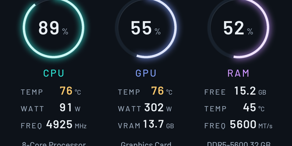</a><br>
<b><a href="#smooth-in-video-mode">Smooth, in video mode</a></b><br>
Up to 50 frames a second on the TURZX USB panels: numbers count, rings glide, fans turn.</td>
<td width="50%" valign="top"><a href="#several-panels-at-once">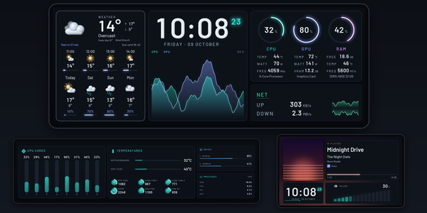</a><br>
<b><a href="#several-panels-at-once">Several panels at once</a></b><br>
Up to four, in one beat: companions show what the first leaves out.</td>
</tr>
<tr>
<td width="50%" valign="top"><a href="#cards-that-change-by-themselves">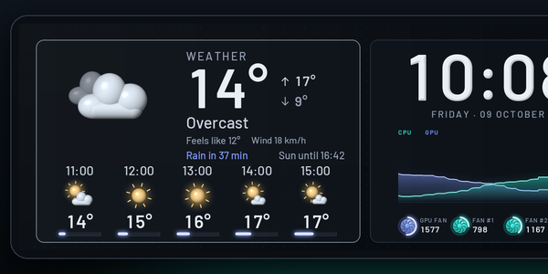</a><br>
<b><a href="#cards-that-change-by-themselves">Cards that change by themselves</a></b><br>
What plays, else the weather, else the day, a line of light between them.</td>
<td width="50%" valign="top"><a href="#notices">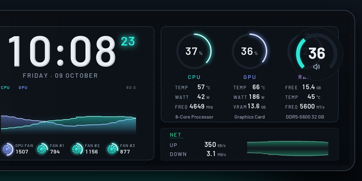</a><br>
<b><a href="#notices">Notices</a></b><br>
The volume in four looks, a new track, a sensor past its limit, your own scripts.</td>
</tr>
<tr>
<td width="50%" valign="top"><a href="#game-mode">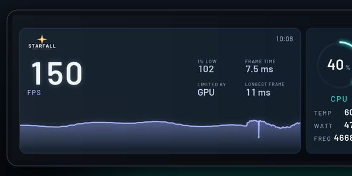</a><br>
<b><a href="#game-mode">Game mode</a></b><br>
An entrance for every game, the frame rate with its lows, a report after the round.</td>
<td width="50%" valign="top"><a href="#screens-for-music-weather-and-time">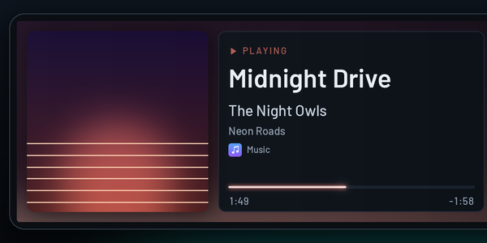</a><br>
<b><a href="#screens-for-music-weather-and-time">Music, weather and time</a></b><br>
Encore, Nimbus and Almanac, which take over while music plays or you are away.</td>
</tr>
<tr>
<td width="50%" valign="top"><a href="#screens-in-turn">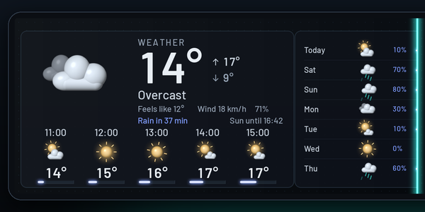</a><br>
<b><a href="#screens-in-turn">Screens in turn</a></b><br>
Five minutes this, ten minutes that, and round again.</td>
<td width="50%" valign="top"><a href="#the-panels-own-start-screen">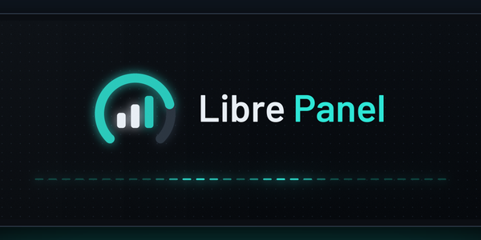</a><br>
<b><a href="#the-panels-own-start-screen">The panel's own start screen</a></b><br>
Its boot logo and standby clip in Libre Panel's look, with one click.</td>
</tr>
<tr>
<td width="50%" valign="top"><a href="#bars-on-end">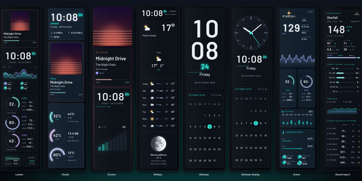</a><br>
<b><a href="#bars-on-end">Bars on end</a></b><br>
Mounted upright? Every screen is laid out anew, not turned.</td>
<td width="50%" valign="top"><a href="#what-your-ai-tools-are-doing">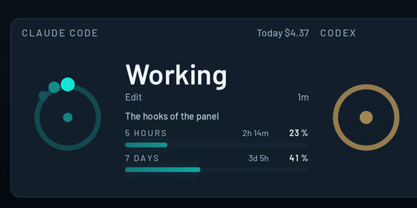</a><br>
<b><a href="#what-your-ai-tools-are-doing">What your AI tools are doing</a></b><br>
Claude Code and Codex: working, waiting for you, and the plan's limits.</td>
</tr>
<tr>
<td width="50%" valign="top"><a href="#every-panel-size">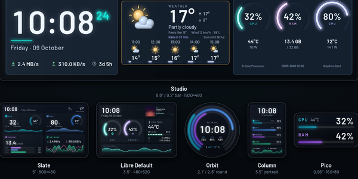</a><br>
<b><a href="#every-panel-size">Every panel size</a></b><br>
From the 0.96" stick to the 12.3" screen, round and portrait ones too.</td>
<td width="50%" valign="top"><a href="#the-app">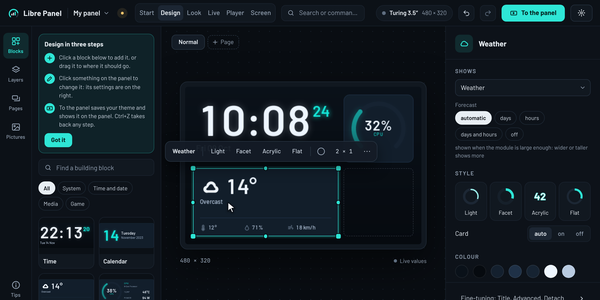</a><br>
<b><a href="#the-app">The app</a></b><br>
Drag 35 modules onto the panel, pick a look, find anything with Ctrl+K.</td>
</tr>
</table>

## Several panels at once

<a name="more-panels-at-once"></a>

<p align="center">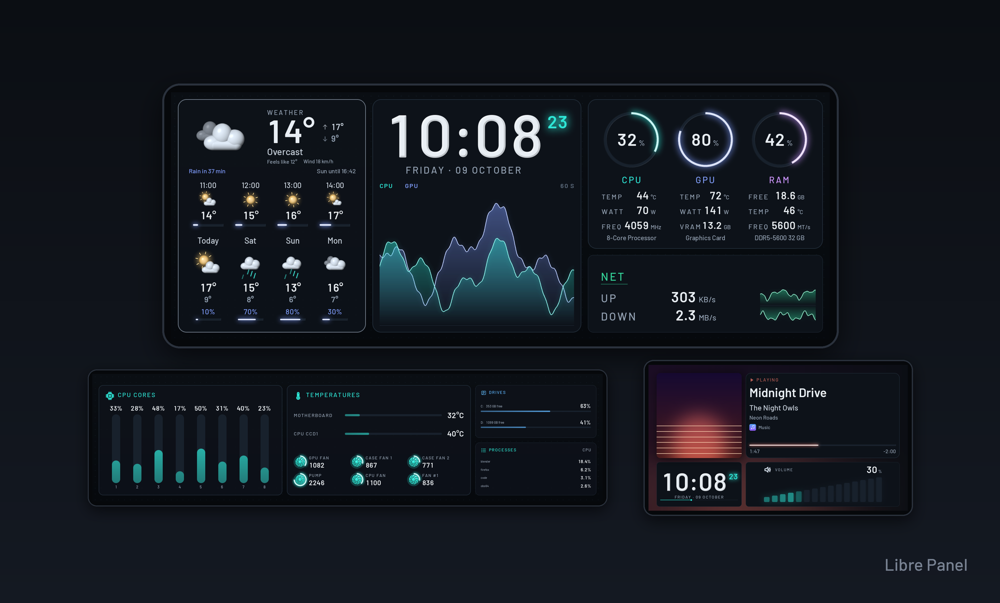</p>

Up to four panels at once, each with its own theme, on the same readings and in the same beat.

- **Companions, nothing shown twice.** A panel added beside Lumen gets **Lumen Companion**:
  every core, the temperatures with the fans turning, the drives and the processes, while Lumen
  leaves out what its companion shows. Encore, Almanac and Arena have companions too, and a
  companion follows the first panel into a game.
- **One picture across all panels**, each showing the part where it stands, and **scenes**
  that put a theme on every panel with one click.
- **Panel 1 | 2 | 3** in the app's header picks the panel *Live* shows and *Design* edits; a
  module moves from one panel to another.
- **Each its own**: brightness (or the first panel's, with an offset), the way it is mounted,
  its start screen, and a process of its own, so two panels in video mode wait for nothing.
- **In their real sizes**: *Settings → Panels* places them beside your monitor, and *Add a
  panel* asks step by step which panel it is, how it is mounted and what it shows.

A JONSBO ZC-360 has three screens under its fans: each is a panel of its own, and they start
with Lumen for the processor, the graphics card and the memory.

<p align="center">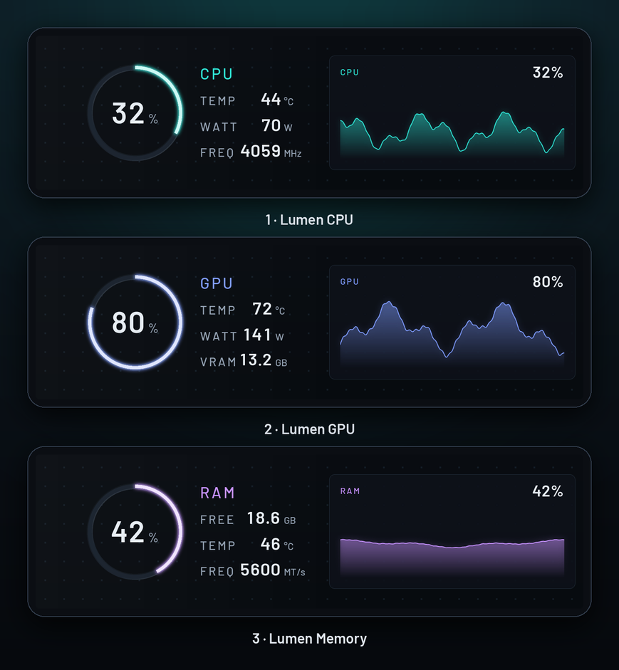</p>

When a sensor reaches its critical limit, every panel's edge pulses red:

<picture>
  <source media="(prefers-reduced-motion: reduce)" srcset="docs/images/more-panels.png">
  
</picture>

<details>
<summary>More</summary>
<br>

Live, the tray and the Overview show each panel, and *Picture of all panels* saves them where
they stand, to share. Everything about it: [More panels at
once](docs/CONFIGURATION.md#more-panels-at-once) and [Scenes](docs/CONFIGURATION.md#scenes).
</details>

## A 30-second tour

### Smooth, in video mode


TURZX USB panels have a video decoder, and Libre Panel feeds it up to 50 frames a second:
numbers count to each new reading, rings and bars glide, graphs scroll a little on every frame
and fans turn at their own speed. 30 by default, which looks smooth and asks far less of the PC;
50 is smoother still, at about two thirds more processor time (Settings → Panel).

<details>
<summary>More</summary>
<br>

Values sit as light in milled grooves; lettering can be faceted metal, and fine dust drifts in
the depth behind. The downloads carry the ffmpeg it needs, and it turns itself on on the 9.2"
once the panel's standby clip is named ([what it needs](#faq)); every other panel gets still
frames, sent where something changed.

[The picture](docs/images/hero.png): Lumen on a 9.2-inch panel: what is playing with its
cover, the time with the load as light, the fans, and lit rings for CPU, GPU and RAM.
</details>

### Cards that change by themselves


One slot, several cards: what is playing, with its cover and the player's icon; when nothing
plays, the weather; when there is neither, the day.

<details>
<summary>More</summary>
<br>

The weather comes with moving symbols, the next hours and the rain of the next two hours. A
change ignites a line of light, the card rolls up into it and the next one rolls down. With the
downloads service on, the network card shows a download in its place while one runs.
</details>

### Notices


Turn the volume and it shows over every screen, in the look you pick: a *Bar* along the edge,
*Levels* that rise, a *Ring* that fills or a *Large* number.

<details>
<summary>More</summary>
<br>

It is switched on with one click on *Start*. A new track with its cover, a sensor past a limit
you set, a stick or a game controller plugged in (Windows): short notices in the theme's
colours, as a band or a card; a screen that shows the volume or the track itself gets none over
it. Your own scripts and a Stream Deck button can show one too, once you allow it:
`libre-panel notify "Render done"`, or an address with a key, from this PC only. Like every
service, they are off until you switch them on.
</details>

### Game mode


Start a game and the screen closes to a line, the game's name lights up and the game screen
opens: the frame rate, its 1% low and who holds it back. After a round, an optional report
compares it with your last ten.

<details>
<summary>More</summary>
<br>

The game comes from your launcher (Steam, Epic, GOG, Ubisoft Connect, the EA app, Battle.net,
Rockstar, Amazon, the Xbox app, Heroic or Lutris) or a list and folders of your own, its frame
rate is counted by Intel's PresentMon, and the time shows small in a corner. Its screen is yours to pick in
*Design → Pages*: **Arena**, Libre Panel's own, or one of SPUR II's.

[The game screen](docs/images/arena.png): Arena, the game screen: the frame rate large with
its 1% low, the frame time and what holds it back, its course, CPU and GPU as instruments,
every core and the temperatures with the fans.
</details>

### Screens for music, weather and time


**Encore** is for music, **Nimbus** for the weather and **Almanac** is a clock with the month;
switched on as pages, Encore takes over while a track plays and Almanac when you step away.

<details>
<summary>More</summary>
<br>

**Encore**: the cover large and its colours behind the whole screen, the time with rolling
digits, and the volume as levels that rise while you turn it.
[The picture](docs/images/encore.png): Encore: the cover large with its colours behind the
whole screen, the track, artist and album, the time and the volume as levels.

**Nimbus**: now and the next hours, the next days with their rain, the moon as it is lit
tonight and a small clock.

**Almanac**: a clock with the month, today and the week; **Almanac Analog** puts the time on a
face whose second hand glides, ticks or sweeps.
▶ [The clip](docs/media/almanac.gif): Almanac: the time large with rolling digits beside the
month; the tube opens Almanac Analog, a face whose second hand glides, and goes back.

They come by themselves too: switch on the **Music** page in *Design → Pages* and Encore takes
over while a track plays, the **Idle** page and Almanac shows when you step away from the PC.
▶ [The clip](docs/media/music-page.gif): The music page: nothing plays on Lumen; a track
starts and Encore opens by itself from a line of light, the volume levels rise and fall as it
is turned, and when the track stops the panel goes back to Lumen.
</details>

### Screens in turn


Five minutes Almanac, five minutes Nimbus, ten minutes Studio, and round again: on **Start**,
pick the screens and give each its time.

<details>
<summary>More</summary>
<br>

Each gets its seconds, minutes or hours, and the panel shows them one after another. A game, a
notice or a theme a service asks for still comes first.
</details>

### The panel's own start screen


TURZX USB panels show a logo of their own when they are switched on and play a clip when the
PC starts. Libre Panel draws both in its own look and puts them on the panel with one click.

<details>
<summary>More</summary>
<br>

Both show before any app talks to the panel. Libre Panel makes them for the size of your
panel and puts them on it from **Settings → Panel → Start screen**, after a question; the
factory logo stays on the panel and comes back with another click.
</details>

### Bars on end


Mounted your bar upright? Every screen then shows in its version for a bar on end, laid out
anew, not turned on its side.

<details>
<summary>More</summary>
<br>

Say so on the first start, on *Start* or in *Settings → Panel*. Lumen, Studio, Encore, Nimbus,
Almanac, Arena and the round report each have one, and the panel's own boot logo and standby
clip are drawn upright too.
</details>

### What your AI tools are doing


**Agents** shows what Claude Code and Codex do on this PC: working, waiting for you or idle,
and how much of the plan's limits is used. On Lumen the AI card comes up by itself while one of
them works, and Claude Code's cloud sessions come too.

<details>
<summary>More</summary>
<br>

Each with a moving sign, the tool at work and the time until the limits begin anew.
*Settings → Game mode and more → AI activity* shows what it adds to the programs' settings
before it writes, and takes it out again; nothing leaves this PC. Sessions on claude.ai/code
report by a relay of their own, with no more than their state
([AI activity](docs/CONFIGURATION.md#ai-activity)).
</details>

### Every panel size


From the 0.96" stick to the 12.3" screen: every theme moves to every panel and lays itself out
for it. On the round panels of 480x480, the screens come in versions of their own, laid out for the
circle:

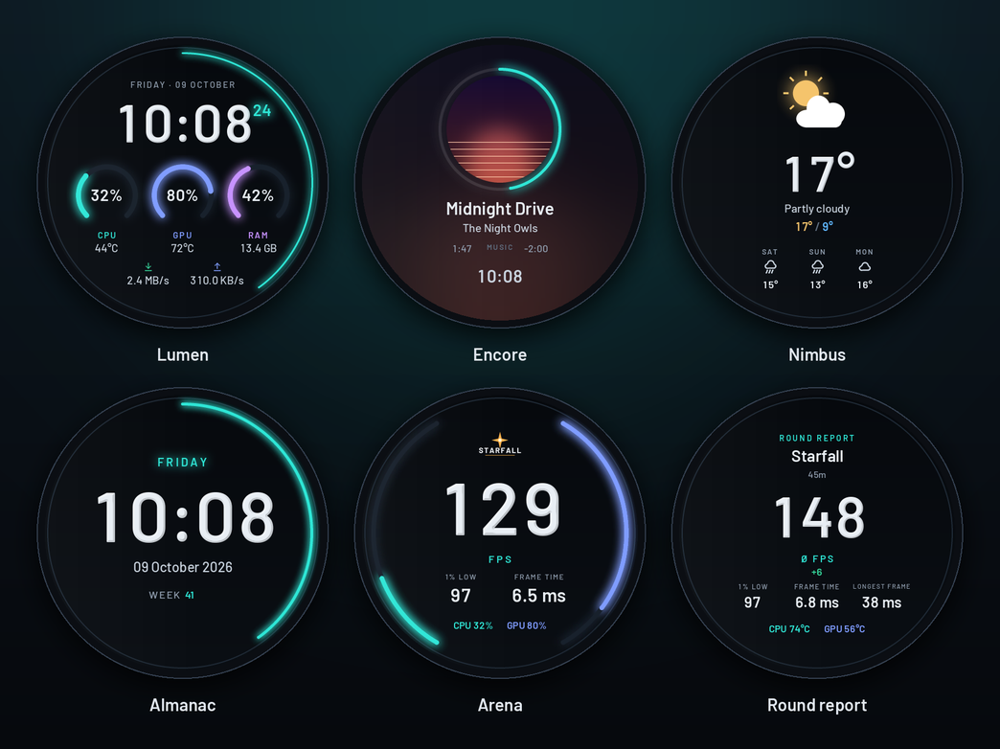

<details>
<summary>More</summary>
<br>

Libre Default, here on a 3.5" panel, is the default on every panel but the bars.
</details>

### The app


**Design**: drag building blocks onto the panel. **Look**: colour worlds and how everything is
drawn. **Ctrl+K** finds everything.

<details>
<summary>More</summary>
<br>

**Design**: a module fits itself to the room you give it and shows more the larger it is; 35 of
them, from every core to the ping, a timer, the power the PC draws and your next appointment.

**Look**: six colour worlds, and how rings, bars, graphs and lettering are drawn (light, facet,
acrylic or flat), the panel light, the grid, the depth dust and the notices, beside the picture
of the panel. ▶ [The clip](docs/media/app-look.gif): Look: a click on the colour world Neon
recolours the whole of Lumen, and a test notice shows how notices will look.

**Ctrl+K** finds every command, theme, module, sensor and setting by a few letters.
▶ [The clip](docs/media/app-command-palette.gif): Ctrl+K: typing neon finds the look Neon
among themes, panels and building blocks, and Enter applies it to the whole panel.

**Settings** writes `config.toml` for you, comments kept; the names of your processor,
graphics card and memory are found by themselves, and you can type your own. **Start** shows
the panel at a glance and the themes made for it, and says when a new version is out if you let
it look. **Live** shows how it runs, and with the memory on, the **history**: temperatures, load
and power over a day, a week or a month, and the games you played.
**Keyboard shortcuts** for the whole PC pause the panel, turn its brightness or open the app
from any window (Windows, Linux with X11), and switch off as a whole. The app speaks English,
German, French, Spanish, Italian, Polish, Portuguese (Brazil), Russian, Japanese and
Simplified Chinese.
</details>

## Themes

<p align="center"></p>

| Theme | Made for | |
|---|---|---|
| **Lumen** | 8.8" and 9.2" bars (1920×480); the default there | what plays, the time with the load as light, lit rings named after your hardware |
| **Studio** | 8.8" and 9.2" bars | calm: a large clock, the card slot and lit rings |
| **Encore** | 8.8" and 9.2" bars | for music: the cover large, its colours behind the whole screen |
| **Nimbus** | 8.8" and 9.2" bars | for the weather: now, the next hours and days, the moon |
| **Almanac** | 8.8" and 9.2" bars | a clock with the month; **Almanac Analog** on a face |
| **Arena** | 8.8" and 9.2" bars | for game mode: the frame rate large, CPU and GPU, every core |
| **Agents** | 8.8" and 9.2" bars, 12.3" | what Claude Code and Codex do; **Agents Claude** for Claude Code alone |
| **Libre Default** | 3.5" (480×320); the default on every other panel | two lit rings, a history that scrolls, a card in the corner |
| **Slate** | 5" (800×480) | four cards: CPU, GPU, memory and network |
| **Orbit** | round 2.1" and 2.8" | three rings around a large clock |
| **Column** | 3.5" portrait | the clock, a row per resource and the network |
| **Pico** | 0.96" (160×80) | CPU with its temperature, and memory |
| **Companions** | a panel beside the first, 9.2" either way up and 12.3" | Lumen, Arena, Encore and Almanac Companion: what the first panel leaves out |
| **High Contrast** | every size from 2.1" to 12.3", upright too | white on black in very large digits, to read from across the room |

What each one shows, in full: [every built-in theme](docs/THEMES.md#every-built-in-theme).
Every theme moves to any other panel from the panel button at the top of *Design*. Themes are
plain JSON with their pictures and fonts, and cannot run code ([theme format](docs/THEMES.md)).

### Community themes

Themes other Libre Panel users made, one click away: *Start → Themes → Community themes*
shows first the ones made for the panel you chose in the header, marked *Fits*, and the others
under *All sizes*. **Install** puts one among yours, and **Show on the panel** puts it there;
one made for another size asks first, as it would be scaled.

- **Share yours in two clicks.** *Share with everyone…* (the globe on your theme's card) asks
  what it is called and shows, saves it as one `.zip` and opens GitHub's form, filled in: drag
  the file in and send. A check runs by itself, draws its picture and prepares it for the list;
  after a look it is in everyone's app. *Export…* and *Import…* pass a theme on directly.
- **Safe by design.** A theme is plain JSON with its pictures and fonts and cannot run code.
  The app takes the list and the zips from this repository only, checks each zip against its
  SHA-256 and the panel size its entry names before anything is unpacked, and every theme is
  looked at before it is listed.
- **No account.** The app asks GitHub for the list only when you open it, and the request
  carries nothing of you or your panel.

The gallery is new, so the first themes in it can be yours
([sharing, step by step](community/themes/README.md)). Themes to talk about or still in the
making belong in [Discussions](https://github.com/syntensa/libre-panel/discussions).

<details>
<summary><b>SPUR II's screens</b></summary>
<br>

Also built in: the eight screens of SPUR II as a legacy collection, see
[Where it started](#where-it-started).
</details>

<details>
<summary><b>All 35 modules</b>: the building blocks of your own themes</summary>
<br>
<p align="center"></p>

Hardware down to every core, drive and fan, the ping, the power the PC draws and what it
costs, a UPS; clocks for any time zone, a countdown, a timer, sunrise, sunset and the moon
(computed, no internet); what is playing, whether the microphone is muted, your calendars (any
`.ics`), Home Assistant, MQTT and JSON values, what Claude Code and Codex do, a slideshow.
Each module shows more the larger it is, steps aside when its readings are missing, and costs
nothing while no theme shows it.
</details>

## <a name="install"></a>Install and first start

From the [latest release](https://github.com/syntensa/libre-panel/releases/latest), no
Python needed:

- **Windows 10 and 11:** `libre-panel-…-windows-x64-setup.exe` installs for all users, with
  a start menu entry, an optional start at login and, in checked boxes that say what each
  is, the sensor service, the PawnIO driver and what game frame rates need; Windows asks
  once for administrator rights, Libre Panel itself runs without them. A portable zip is
  there too: its *Unlock all sensors* sets up the same.
- **Linux (x86-64):** `Libre_Panel-…-x86_64.AppImage`: make it executable and start it, no
  installation. A tarball is there too.

1. **Close the vendor app.** It keeps the panel to itself.
2. **Start Libre Panel** with the panel plugged in. The Windows downloads are not code-signed
   yet: SmartScreen asks once (*More info → Run anyway*). On Linux, *Start* offers to give your
   user access to the panel with one click ([what it does](docs/CONFIGURATION.md#linux-sensors-and-panel-access)).
3. **Pick a look.** *Start* asks "How should it look?" with the themes made for the panel it
   found: Lumen on the 8.8" and 9.2" bars, Libre Default on the others.
4. **Turn on what you want.** In *Settings*: the weather and your place, video mode, the
   services (all off until you switch them on). The tray icon has the theme, brightness,
   pause and *Start with system*.

The app opens in a window of its own (WebView2 on Windows, WebKitGTK on Linux); the AppImage
opens it in the browser for now ([details](docs/BACKGROUND.md#the-apps-window)).

### Out of the box

**Everything works out of the box.** Sensors, fans, graphics card, game frame rates (Windows)
and the video mode need no other program, and nothing else is to be downloaded or
installed. The downloads carry the programs the features run, in a `tools` folder next to the
program: ffmpeg for the video mode (Windows and Linux), and on Windows PresentMon for game
frame rates and the installer of the PawnIO driver. One setup step does the rest: the installer
on Windows, one click on a card in the app for the portable zip and for Linux. It asks once, for
administrator rights on Windows and for your password on Linux; Libre Panel itself runs
without administrator rights.

<details>
<summary><b>What each download sets up, and why</b></summary>
<br>

| | Windows setup | Portable zip | Linux (AppImage) |
|---|---|---|---|
| **Processor, mainboard, memory and drive sensors** | the sensor service and the PawnIO driver, two checked boxes | *Unlock all sensors* on Start and in *Settings → Sensors* sets up the same | the processor and NVMe drives are read without rights; *Set up sensors and panel access* loads the kernel's drivers for the board's fan chip and for SATA drives |
| **Processor power** | read by the sensor service | the same | a switch in that card, off until you turn it on |
| **Graphics card** | built in (LibreHardwareMonitor) | built in | AMD, Intel and NVIDIA, read without rights |
| **Game frame rates** | PresentMon is in the download; the third box adds you to *Performance Log Users* | PresentMon is in the download; *Unlock all sensors* adds you | Windows only |
| **Video mode** | ffmpeg is in the download | ffmpeg is in the download | ffmpeg is in the download |
| **The panel's USB access** | nothing to do | nothing to do | the same card writes the udev rule |
| **Settings** | in your own folder | in the folder `data` beside the program: it moves with it | in your own folder |

- **One question.** Windows asks for administrator rights once, for the setup or for *Unlock
  all sensors*; on Linux your system asks for your password once. *Install for me only* is
  still possible: the setup then installs without those rights and leaves the system parts to
  *Unlock all sensors*. The readings arrive within a few seconds; game frame rates count from
  your next sign-in, when Windows applies the group.
- **Read only.** The sensor service only reads: it sets no fan and changes no setting of the
  hardware. People signed in at the PC can read its values; network logons and other computers
  are refused ([how it is built](docs/BACKGROUND.md#the-sensor-service)). *Remove* in
  *Settings → Sensors*, the uninstaller and, on Linux, *Remove again* take it all out. Every
  release build installs the Windows setup on a Windows test machine, checks that the service
  runs and that Libre Panel reads through it, and uninstalls it again; the AppImage's setup is
  run as a dry run in the bare environment `pkexec` makes.
- **Video mode** turns itself on on the 9.2" once the panel's standby clip is named; *Start*
  asks for the name once ([what it needs](#faq)).
- **The programs** are the files their projects publish, unchanged, each checked against a
  SHA-256 when the download is built. ffmpeg is GPL-3.0, PresentMon MIT, PawnIO's driver
  GPL-2.0-or-later with an exception
  ([which programs](docs/CONFIGURATION.md#programs-that-come-with-the-downloads); their
  licences and sources are in [NOTICE.md](NOTICE.md)).
</details>

### With Python

```bash
pipx install "libre-panel[usb,serial,tray] @ git+https://github.com/syntensa/libre-panel@v0.7.0"
libre-panel tray                    # the background app with its tray icon; opens its window
libre-panel autostart enable        # start it whenever you log in
```

<details>
<summary>More commands</summary>

```bash
libre-panel                         # panel and app in a terminal (Ctrl+C stops)
libre-panel editor                  # only the app, without the panel (--browser: in the browser)
libre-panel run                     # only drive the panel
libre-panel preview lumen -o lumen.png    # render a theme to an image
libre-panel models                  # every known panel and its resolution
libre-panel devices                 # which panel is connected?
libre-panel doctor                  # check the panel end to end, write a report
libre-panel sensors                 # every sensor key with its current value
libre-panel config init             # write a commented config.toml
libre-panel location "Berlin"       # coordinates for the weather
libre-panel system-setup --linux    # Linux: one step for the panel's permission, the board's fans
libre-panel udev-rules              # Linux: the rule that gives your user USB access
libre-panel quit                    # quit the background app
```

</details>

## Privacy

**Nothing leaves your PC that you have not turned on.** No account, no telemetry. The app is
served to your own PC only (127.0.0.1), and only to requests that carry a secret token, new at
every start.

<details>
<summary><b>What goes where</b>, one by one</summary>
<br>

- **The weather** is off until you set a place. Then only its coordinates go to
  [Open-Meteo](https://open-meteo.com), every 15 minutes. A place you look up by name goes
  to Open-Meteo's place search when you press *Search*, and is kept to about a kilometre.
- **New versions**: *Start* asks once whether to look. Say yes, and once a day Libre Panel
  asks GitHub for its latest release; the request carries the version you have, nothing about
  you or your panel. *Settings → Start and system* switches it off again.
- **Notices from other programs** are off until you allow them, and then taken only from this
  PC and only with the key Libre Panel made for them.
- **What you connect yourself** talks to the address you give it: calendars (`.ics`),
  Home Assistant, MQTT, a JSON address, a UPS's upsd. The ping connects to 1.1.1.1 (or the
  hosts you set) while a theme shows it, and a cover that a player names by a web
  address is loaded from there.
- **The optional services** keep what they learn on this PC: the memory and the round report
  in a SQLite file you can open or delete; the cooling analysis reads FanControl's
  configuration and never writes it. No track title, window title or file name is read.
- **AI activity** is off until you switch it on and set up Claude Code or Codex. Their hooks
  hand what they do to Libre Panel on this PC only, with a key of its own; for the plan's
  usage Libre Panel asks the programs, which ask their own servers with your sign-in. Claude
  Code's cloud sessions, once you set them up, send their state (never a prompt) to an ntfy
  topic with a long random address, which Libre Panel reads.
- **The hardware's names** never go to the log, and `libre-panel doctor` writes no serial
  numbers or personal paths into its report.
</details>

## FAQ

<details>
<summary><b>Which panel do I have?</b></summary>
<br>

The product name and the back label usually say it. Plugged in, `libre-panel devices` lists
what it sees: a TURZX USB panel shows up with the USB id `1cbe:…` and its size, the others
as a virtual COM port (`COM3`, `/dev/ttyACM0`). *Start* in the app names the panel it found;
*Another panel* lets you choose. When in doubt, `libre-panel doctor` asks and checks. The
[hardware list](docs/HARDWARE.md) has every model.
</details>

<details>
<summary><b>Why do the CPU temperature and power show "--" on Windows?</b></summary>
<br>

The Windows downloads carry LibreHardwareMonitor's library and read the graphics card and
its fans with no other program. The processor's temperature, power and clock, the RAM's and
the drives' temperatures and the mainboard's fans need **administrator rights** and the
**PawnIO** driver, and the downloads carry its installer. Libre Panel's **sensor service**
has both, and the setup installs the two (the checked boxes *Sensor service* and *PawnIO
driver*), so after the setup nothing is left to do. You see "--" only where that part was
not set up: after *Install for me only*, or with the portable zip. *Unlock all sensors* on
Start, or in *Settings → Sensors*, sets it up with one question of Windows, and Libre Panel
itself goes on without administrator rights
([how it is kept safe](docs/BACKGROUND.md#the-sensor-service)). *Settings → Sensors* says
whether the service runs. With a pip install there is no service: install PawnIO from
[pawnio.eu](https://pawnio.eu) and use `libre-panel autostart enable --elevated` (as
administrator), or a LibreHardwareMonitor that you run yourself with its web server
([details](docs/CONFIGURATION.md#windows-sensors-gpu-power-fans)).
</details>

<details>
<summary><b>Why are the fans or the CPU power missing on Linux?</b></summary>
<br>

Most sensors need no rights on Linux (processor, graphics card, NVMe drives, memory). Three
things do: the **panel's USB permission**, the **driver for the chip that reads the mainboard's
fans** (the kernel has it, but nobody loads it), and, only if you want it, the **processor's
power** (the kernel has kept those counters from everyone but root since 2020). *Start* shows a
card when one of them is missing, *Settings → Sensors* always has it: one click, your system
asks for the password once, and the card says exactly what is changed. In a terminal:
`libre-panel system-setup --linux` (add `--rapl` for the power, `--remove` to undo it all).
A board whose fan chip the kernel has no driver for (some MSI and Gigabyte boards) needs one
from outside the kernel, which Libre Panel does not install. More:
[Linux sensors and panel access](docs/CONFIGURATION.md#linux-sensors-and-panel-access).
</details>

<details>
<summary><b>How do I get the smooth video mode? Do I need ffmpeg?</b></summary>
<br>

Video mode is for the TURZX USB panels, which have a video decoder. The Windows and Linux
downloads carry the [ffmpeg](https://ffmpeg.org) it needs, so you only name the panel's
standby clip, as the vendor app shows it, in *Settings → Panel*, or put Libre Panel's own
standby clip on the panel under *Settings → Panel → Start screen*, which names it for you. On
the 9.2" it then turns itself on; on the other TURZX USB panels set it to *on* to try it. With
a pip install, install ffmpeg yourself (Windows: `winget install ffmpeg`; Linux: your
distribution's package) or name it in the same place. Video mode saves nothing on the panel;
only the Start screen writes to it, on a click. The serial panels get still frames, with only
the changed parts sent ([details](docs/CONFIGURATION.md#video)).
</details>

<details>
<summary><b>Do I need LibreHardwareMonitor, FanControl or PresentMon?</b></summary>
<br>

No other program is needed: LibreHardwareMonitor and Intel's
[PresentMon](https://github.com/GameTechDev/PresentMon) (Windows, MIT licence) are in the
Windows downloads. The *Game frame rate* source is on by default on Windows and counts a
game's frames while a theme shows them. PresentMon needs administrator rights or your
account in the Windows group "Performance Log Users", which the setup's third box (or
*Unlock all sensors*) arranges; it applies from your next sign-in
([how](docs/CONFIGURATION.md#more-sensor-sources)). The cooling analysis reads FanControl's
fan curves, if you use FanControl.
</details>

<details>
<summary><b>Can it harm my panel?</b></summary>
<br>

Libre Panel sends display commands only: pictures, brightness, video. It never touches the
firmware and stores nothing on the panel; firmware updates stay the vendor app's job.
</details>

<details>
<summary><b>macOS?</b></summary>
<br>

Not since 0.5: Windows and Linux are supported, and nobody downloaded the macOS builds of
earlier releases.
</details>

## Contributing

The most valuable help right now is a **panel report**: `libre-panel doctor` on a model
marked *unverified* turns it *supported* for everyone. Themes are welcome in
[Discussions](https://github.com/syntensa/libre-panel/discussions); a language needs one JSON
file ([how](docs/CONFIGURATION.md#language)); code, drivers and plugins start at
[CONTRIBUTING.md](CONTRIBUTING.md) and the [plugin API](docs/PLUGINS.md). Security issues go
through a [private advisory](SECURITY.md).

**Documentation:** [panels](docs/HARDWARE.md) ·
[background app and autostart](docs/BACKGROUND.md) ·
[configuration](docs/CONFIGURATION.md) · [themes and sensor keys](docs/THEMES.md) ·
[plugins](docs/PLUGINS.md) · [architecture](docs/ARCHITECTURE.md) ·
[TURZX USB protocol](docs/protocol/turzx-usb.md) · [serial protocols](docs/protocol/serial.md) ·
[roadmap](docs/ROADMAP.md) · [releasing](docs/RELEASING.md) · [changelog](CHANGELOG.md)

## Where it started

Libre Panel grew out of SPUR II, a private dashboard for one 9.2" panel on one PC, which proved
the panel's USB protocol and its video mode on real hardware. Its ideas (light in milled
grooves, the cards, the band, the tube) are now Libre Panel's own, for every panel and every
PC, and its eight screens ship as the legacy collection *SPUR II*, at the end of *Start → All*
([what came from it](docs/SPUR2_MIGRATION.md)).

<p align="center"><a href="docs/media/where-it-started.gif"></a></p>

## License and notices

Libre Panel is free software under the [GPL-3.0-or-later](LICENSE). The built-in themes carry
their own licence, stated in each `theme.json`. It stands on the shoulders of
[turing-smart-screen-python](https://github.com/mathoudebine/turing-smart-screen-python)
(GPL-3.0), whose reverse-engineering documents these panels; the Windows downloads carry
[LibreHardwareMonitor](https://github.com/LibreHardwareMonitor/LibreHardwareMonitor)
(MPL-2.0), [PresentMon](https://github.com/GameTechDev/PresentMon) (MIT) and the installer of
the [PawnIO](https://pawnio.eu) driver (GPL-2.0-or-later with an exception), and every
download [ffmpeg](https://ffmpeg.org) (GPL-3.0-or-later); the fonts are Barlow, JetBrains Mono
and Liberation Sans (SIL OFL 1.1); weather
data by [Open-Meteo.com](https://open-meteo.com) (CC BY 4.0). All of it in
[NOTICE.md](NOTICE.md).

"TURZX", "Turing Smart Screen" and other product names are trademarks of their owners.
Libre Panel is an independent project and not affiliated with them.
