<p align="right"><b>English</b> · <a href="README.de.md">Deutsch</a></p>

<h1 align="center">
  <br>
  Libre Panel
</h1>

<p align="center">
  <b>Your PC's vitals as moving light, on the small USB screen in its case.</b><br>
  Free, open-source software for TURZX, Turing Smart Screen, WeAct, Kipye and compatible
  system-monitor panels. Windows and Linux, no account, no cloud.
</p>

<p align="center">
  <a href="https://github.com/syntensa/libre-panel/releases/latest"></a>
  <a href="https://github.com/syntensa/libre-panel/actions/workflows/ci.yml"></a>
  <a href="LICENSE"></a>
  
</p>

<picture>
  <source media="(prefers-reduced-motion: reduce)" srcset="docs/images/hero.png">
  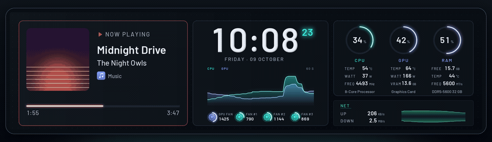
</picture>

<p align="center">
  <a href="https://github.com/syntensa/libre-panel/releases/latest"></a>
  <a href="https://github.com/syntensa/libre-panel/releases/latest"></a>
  <a href="https://github.com/syntensa/libre-panel/releases/latest"></a>
  <br>
  <sub>Windows 10 and 11 (x64) · Linux (x86-64) · every file and the release notes on the
  <a href="https://github.com/syntensa/libre-panel/releases/latest">latest release</a></sub>
</p>

<p align="center">
  <a href="#a-30-second-tour">Tour</a> ·
  <a href="#themes">Themes</a> ·
  <a href="#supported-panels">Panels</a> ·
  <a href="#out-of-the-box">Out of the box</a> ·
  <a href="#install-and-first-start">Install</a> ·
  <a href="#privacy">Privacy</a> ·
  <a href="#faq">FAQ</a> ·
  <a href="https://syntensa.github.io/libre-panel/">Website</a>
</p>

Plug in the panel, start Libre Panel, and it shows your processor, graphics card, memory,
fans, network, what is playing and the weather outside, in a theme you pick or build
yourself. It runs quietly in the tray and takes the vendor app's place.

**Everything works out of the box.** Sensors, fans, graphics card, game frame rates (Windows)
and the 50 fps video mode need no other program. The downloads carry what the features run;
the Windows installer sets up the rest, and the portable zip and Linux do it with one click in
the app. It asks once, for administrator rights on Windows and for your password on Linux
([what is set up](#out-of-the-box)).

## A 30-second tour

### Smooth, in video mode

<p>
  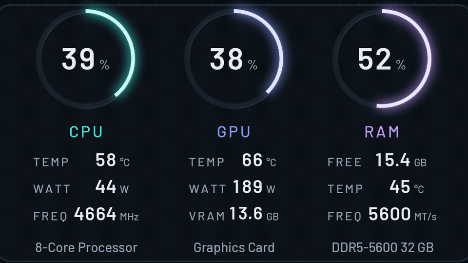
  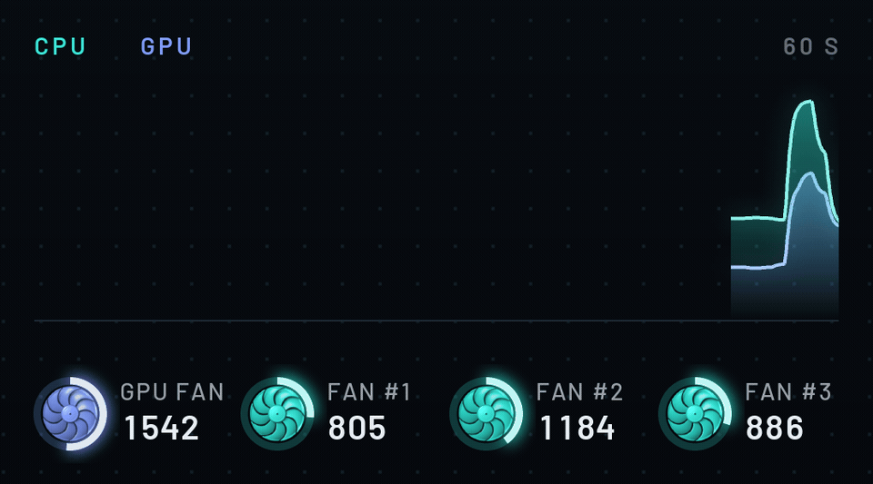
</p>

TURZX USB panels have a video decoder, and Libre Panel feeds it up to 50 frames a second.
Numbers count to each new reading, rings and bars glide, graphs scroll a little on every
frame and fans turn at their own speed. Values sit as light in milled grooves; lettering can
be faceted metal, and fine dust drifts in the depth behind. The downloads carry the ffmpeg it
needs, and it turns itself on on the 9.2" once the panel's standby clip is named
([what it needs](#faq)); every other panel gets still frames, sent where something changed.

### Cards that change by themselves

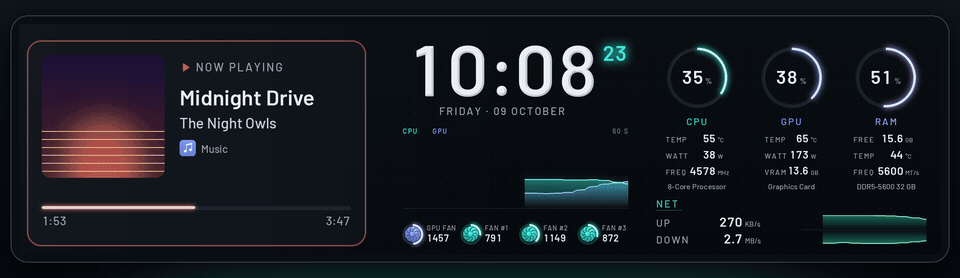

One slot, several cards: what is playing, with its cover and the player's icon; when nothing
plays, the weather with moving symbols, the next hours and the rain of the next two hours;
when there is neither, the day. A change ignites a line of light, the card rolls up into it
and the next one rolls down. With the downloads service on, the network card shows a
download in its place while one runs.

### Notices

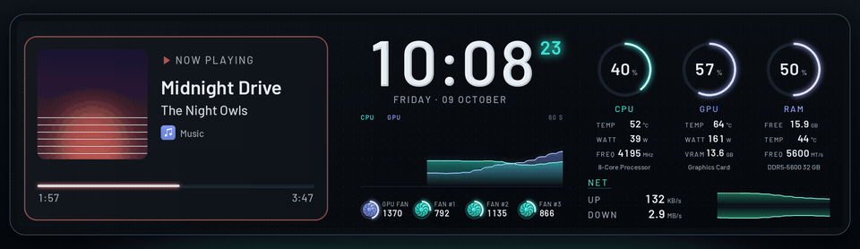

Turn the volume and it shows over every screen, in the look you pick: a *Bar* along the edge,
*Levels* that rise, a *Ring* that fills or a *Large* number, switched on with one click on
*Start*. A new track with its cover, a sensor past a limit you set, a stick or a game controller
plugged in (Windows): short notices in the theme's colours, as a band or a card; a screen
that shows the volume or the track itself gets none over it. Your own scripts and a Stream
Deck button can show one too, once you allow it: `libre-panel notify "Render done"`, or an
address with a key, from this PC only. Like every service, they are off until you switch them
on.

### Game mode

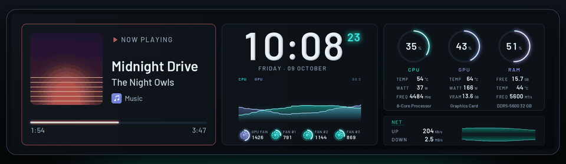

Start a game, from a list of your own or your Steam library, and the screen closes to a
line, the game's name lights up and the game screen opens: the frame rate, its 1% low and
who holds it back, counted by Intel's PresentMon, and the time, small in a corner. Its
screen is yours to pick in
*Design → Pages*: **Arena**, Libre Panel's own, or one of SPUR II's. After a round, an
optional report compares it with your last ten.

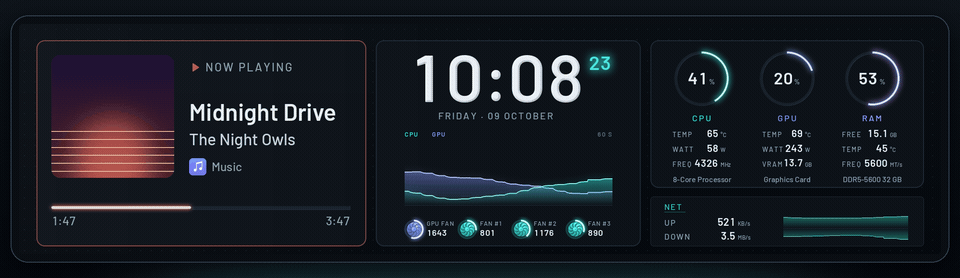

### Screens for music, weather and time

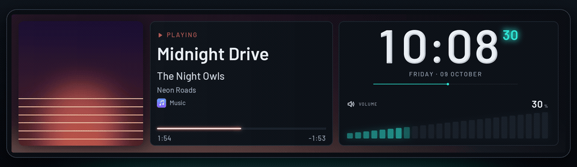

**Encore** is for music: the cover large and its colours behind the whole screen, the time
with rolling digits, and the volume as levels that rise while you turn it.

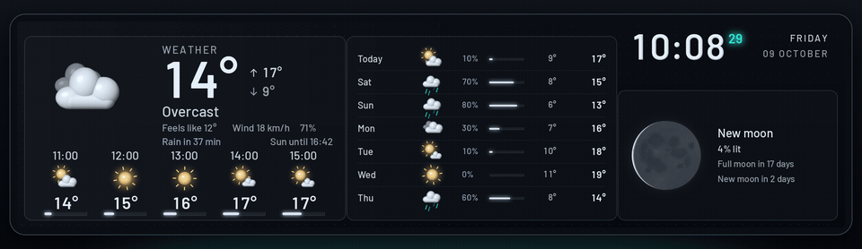

**Nimbus** is for the weather: now and the next hours, the next days with their rain, the
moon as it is lit tonight and a small clock.

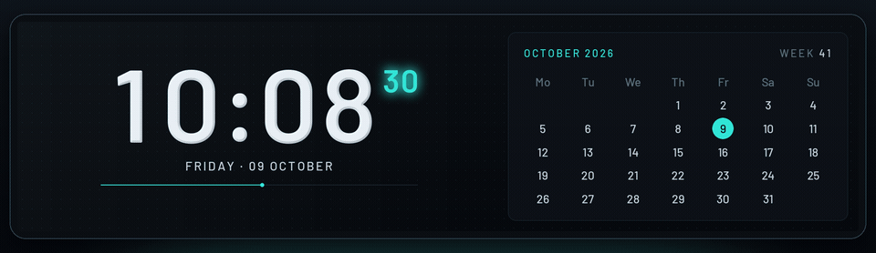

**Almanac** is a clock with the month, today and the week; **Almanac Analog** puts the time
on a face whose second hand glides, ticks or sweeps.

They come by themselves too: switch on the **Music** page in *Design → Pages* and Encore takes
over while a track plays, the **Idle** page and Almanac shows when you step away from the PC.

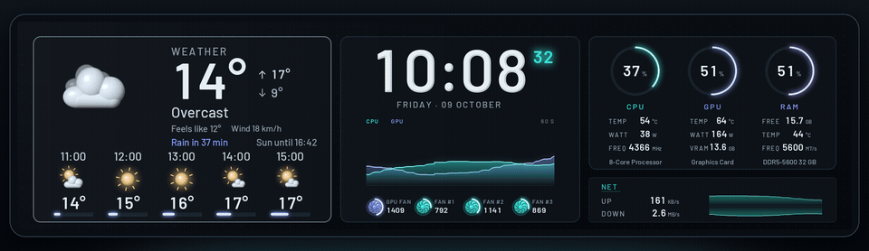

### Screens in turn

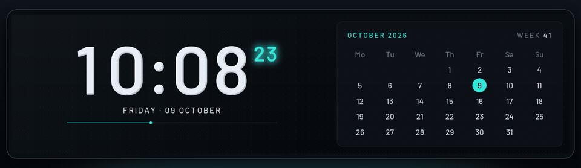

Five minutes Almanac, five minutes Nimbus, ten minutes Studio, and round again: on **Start**,
pick the screens, give each its seconds, minutes or hours, and the panel shows them one after
another. A game, a notice or a theme a service asks for still comes first.

### The panel's own start screen

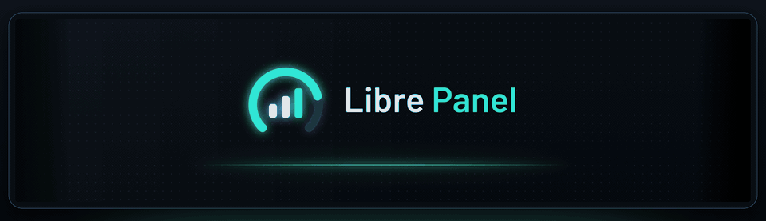

TURZX USB panels show a logo of their own when they are switched on and play a clip when the
PC starts, before any app talks to them. Libre Panel draws both in its own look, made for the
size of your panel, and puts them on it with one click on **Settings → Panel → Start screen**,
after a question; the factory logo stays on the panel and comes back with another click.

### Bars on end

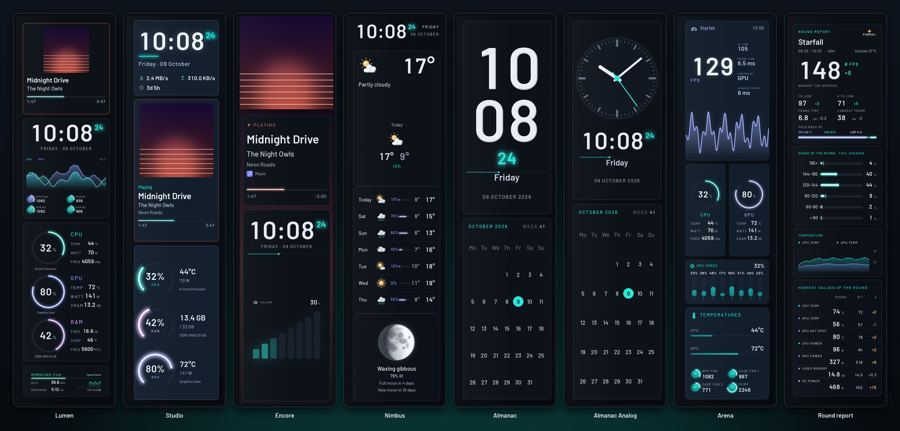

Mounted your bar upright? Say so on the first start, on *Start* or in *Settings → Panel*:
every screen then shows in its version for a bar on end, laid out anew, not turned on its
side: Lumen, Studio, Encore, Nimbus, Almanac, Arena and the round report each have one, and
the panel's own boot logo and standby clip are drawn upright too.

### More panels at once

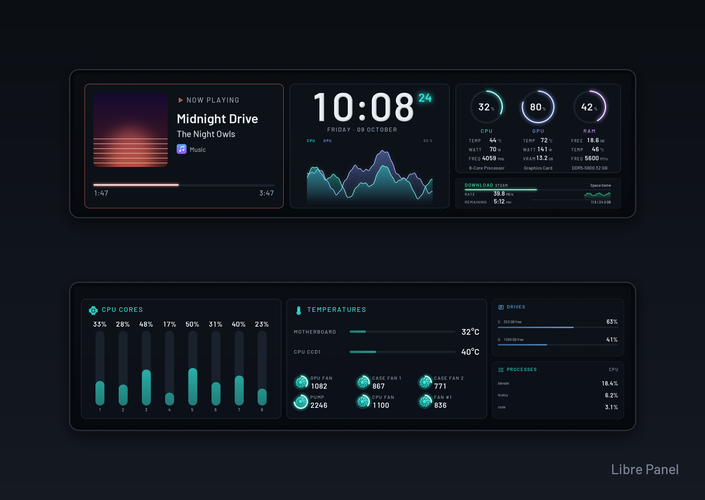

Up to four panels at once, each with its own theme, on the same readings. A panel added
beside Lumen gets Lumen Companion; *Settings → Panel* places them in their real sizes beside
your monitor, one picture can go across all of them, a scene changes every panel at
once, and *Picture of all panels* saves the picture above, to share. Live, the tray and the
Overview show each panel.

### Every panel size

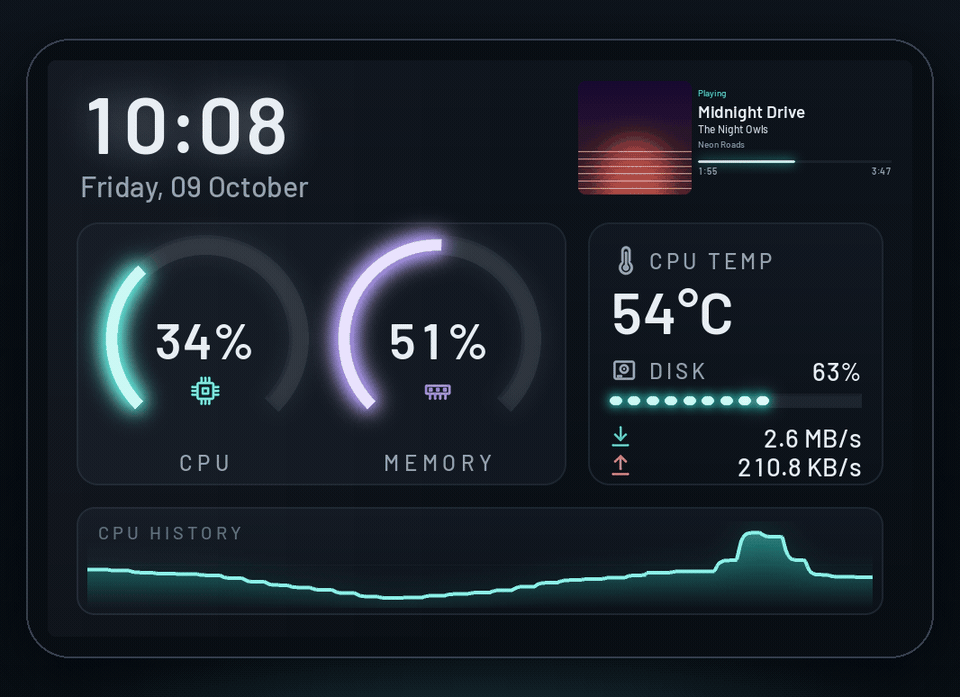

From the 0.96" stick to the 12.3" screen: every theme moves to every panel and lays itself
out for it. Libre Default, here on a 3.5" panel, is the default on every panel but the bars.

### The app

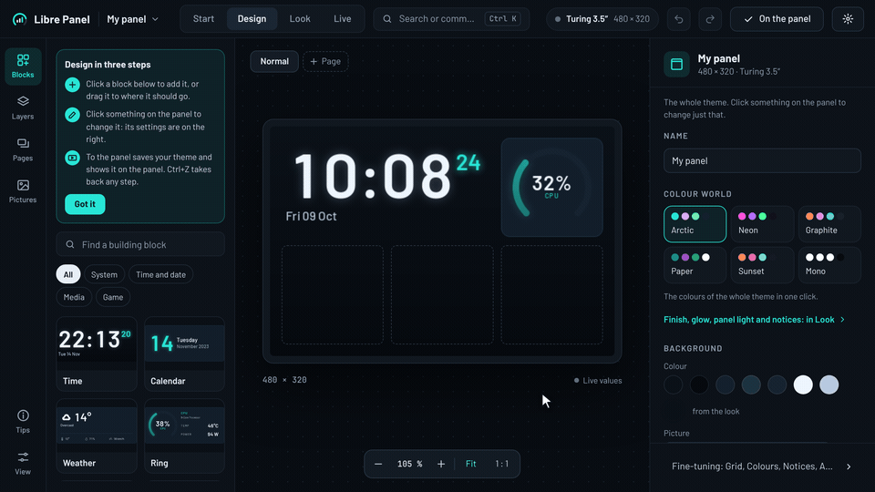

**Design**: drag building blocks onto the panel. A module fits itself to the room you give
it and shows more the larger it is; 28 of them, from every core to your next appointment.

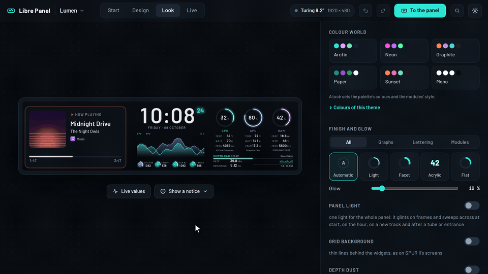

**Look**: six colour worlds, and how rings, bars, graphs and lettering are drawn (light,
facet, acrylic or flat), the panel light, the grid, the depth dust and the notices, beside
the picture of the panel.

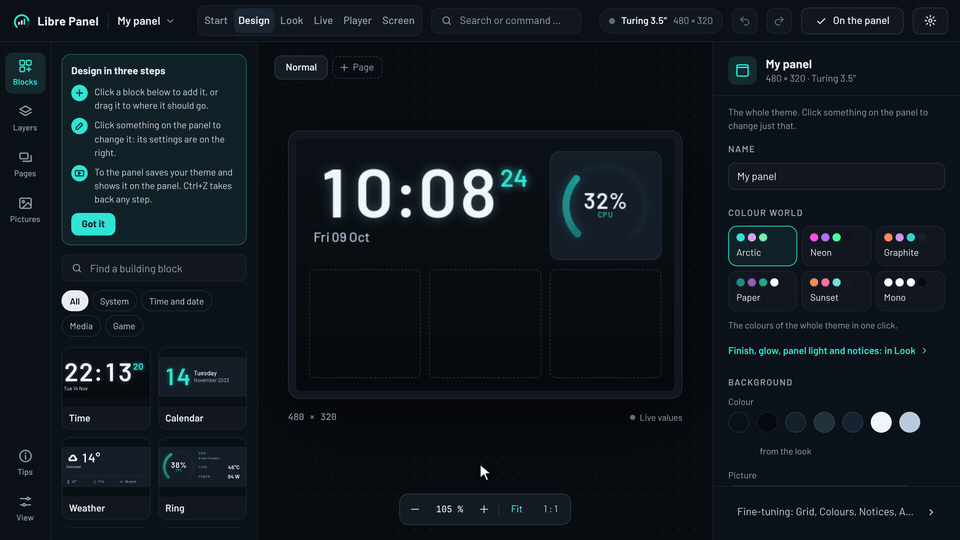

**Ctrl+K** finds every command, theme, module, sensor and setting by a few letters.
**Settings** writes `config.toml` for you, comments kept; the names of your processor,
graphics card and memory are found by themselves, and you can type your own. **Start** shows
the panel at a glance and the themes made for it, and says when a new version is out if you let
it look. **Live** shows how it runs, and with the memory on, the **history**: temperatures, load
and power over a day, a week or a month, and the games you played.
**Keyboard shortcuts** for the whole PC pause the panel, turn its brightness or open the app
from any window (Windows, Linux with X11), and switch off as a whole. The app speaks English,
German, French, Spanish, Polish, Portuguese (Brazil) and Simplified Chinese.

## Themes

<p align="center">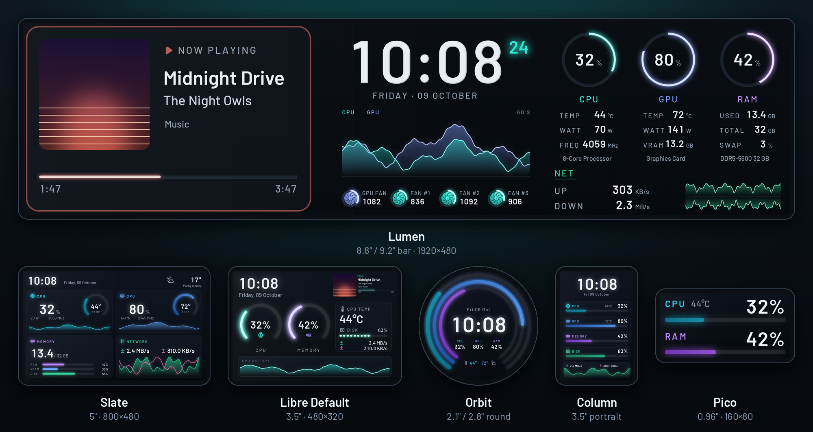</p>

| Theme | Made for | |
|---|---|---|
| **Lumen** | 8.8" and 9.2" bars (1920×480); the default there | Libre Panel's own: what plays, else the weather, else the day; the time with the load scrolling past as light and the fans turning; lit rings for CPU, GPU and RAM named after your hardware, over the network |
| **Studio** | 8.8" and 9.2" bars | calm: a large clock, the card slot and lit rings for CPU, RAM and GPU |
| **Encore** | 8.8" and 9.2" bars | for music: the cover large and its colours behind the whole screen, the time with rolling digits, the volume as levels that rise |
| **Nimbus** | 8.8" and 9.2" bars | for the weather: now and the next hours, the next days, the moon as it is lit tonight, a small clock |
| **Almanac** | 8.8" and 9.2" bars | a clock with the month: the time large, or on a face whose second hand glides (**Almanac Analog**), beside the month with today and the week |
| **Arena** | 8.8" and 9.2" bars | for game mode: the game's frame rate large with its 1% low, frame time and course, CPU and GPU as instruments, every core, the temperatures and, small in a corner, the time |
| **Libre Default** | 3.5" (480×320); the default on every other panel | two lit rings, temperature, disk and network, a history that scrolls; what plays, the weather or the day in the corner |
| **Slate** | 5" (800×480) | four cards: CPU, GPU, memory and network |
| **Orbit** | round 2.1" and 2.8" | three rings around a large clock |
| **Column** | 3.5" portrait | the clock, a row per resource and the network |
| **Pico** | 0.96" (160×80) | CPU with its temperature, and memory |

Every theme moves to any other panel from the panel button at the top of *Design*. Themes
are plain JSON with their pictures and fonts, and cannot run code
([theme format](docs/THEMES.md)). Made one you like? Share it in
[Discussions](https://github.com/syntensa/libre-panel/discussions). Also built in: the eight
screens of SPUR II as a legacy collection, see [Where it started](#where-it-started).

<details>
<summary><b>All 28 modules</b>: the building blocks of your own themes</summary>
<br>
<p align="center">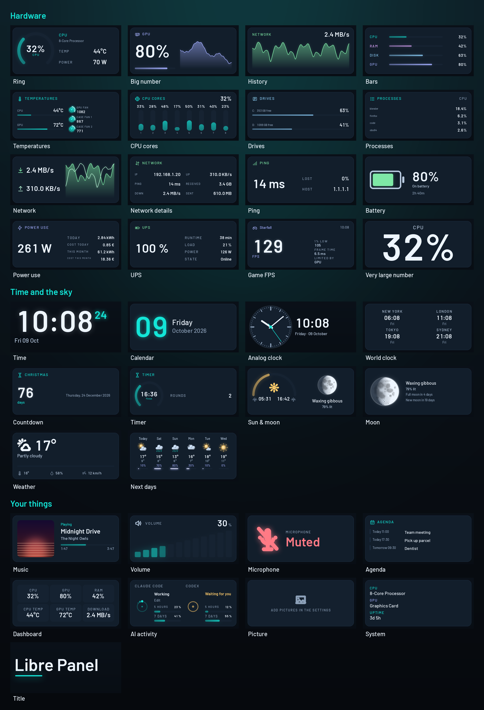</p>

Hardware down to every core, drive and fan; clocks for any time zone, a countdown, sunrise,
sunset and the moon (computed, no internet); what is playing, your calendars (any `.ics`),
Home Assistant and MQTT values, a slideshow. Each module shows more the larger it is, steps
aside when its readings are missing, and costs nothing while no theme shows it.
</details>

## Supported panels

| Panel | Sizes | Connects as | Status |
|---|---|---|---|
| Turing / TURZX | 2.8" round, 4.6", 5.2", 8", 8.8", 9.2", 12.3" | USB device (`1cbe:…`) | 9.2": proven for hours, as stills and as 50 fps video. 8.8" and 12.3": run, as their owners report. Other sizes: the same protocol, unverified |
| Turing Smart Screen | 2.1" round, 3.5", 5", 8.8" | virtual COM port | 3.5" and 8.8": run, as their owners report. 2.1" and 5": unverified |
| UsbPCMonitor | 3.5", 5", 7" | virtual COM port | unverified |
| XuanFang | 3.5" | virtual COM port | unverified |
| Kipye Qiye | 3.5" | virtual COM port | unverified |
| WeAct Display FS V1 | 0.96", 3.5" | virtual COM port | unverified |

*Unverified* means the driver follows a protocol proven on real panels, but nobody has
confirmed that model with Libre Panel yet. **Own one?** The panel test in the app (*Live →
Diagnose*, or `libre-panel doctor` in a terminal) checks it end to end and writes a report
without serial numbers; one click opens a
[panel report](https://github.com/syntensa/libre-panel/issues/new?template=panel_support.yml)
with it filled in, and the model becomes *supported* for everyone.

**The panels on a virtual COM port are slower.** They are the older kind. Libre Panel keeps
their motion calm by itself: a picture a second, of which it sends only the parts that changed,
so numbers, bars and the clock keep up. Graphs move on a step a second, numbers change without
gliding, the weather symbols stand still, themes change without a fade, and a new theme builds
up for a moment. *Settings → Panel → Motion on the panel* turns full motion on for a panel that
keeps up with it. For the most motion, the TURZX USB panels are the ones to have. Video mode is for the TURZX USB panels; the
others have no video decoder. Details, Linux permissions and the panels of other brands:
[docs/HARDWARE.md](docs/HARDWARE.md).

## Out of the box

Nothing else to download or install. The downloads carry the programs the features run, in a
`tools` folder next to the program: ffmpeg for the video mode (Windows and Linux), and on
Windows PresentMon for game frame rates and the installer of the PawnIO driver. One setup step
does the rest: the installer on Windows, a card in the app for the portable zip and for Linux.
Libre Panel itself runs without administrator rights.

| | Windows setup | Portable zip | Linux (AppImage) |
|---|---|---|---|
| **Processor, mainboard, memory and drive sensors** | the sensor service and the PawnIO driver, two checked boxes | *Unlock all sensors* on Start and in *Settings → Sensors* sets up the same | the processor and NVMe drives are read without rights; *Set up sensors and panel access* loads the kernel's drivers for the board's fan chip and for SATA drives |
| **Processor power** | read by the sensor service | the same | a switch in that card, off until you turn it on |
| **Graphics card** | built in (LibreHardwareMonitor) | built in | AMD, Intel and NVIDIA, read without rights |
| **Game frame rates** | PresentMon is in the download; the third box adds you to *Performance Log Users* | PresentMon is in the download; *Unlock all sensors* adds you | Windows only |
| **50 fps video mode** | ffmpeg is in the download | ffmpeg is in the download | ffmpeg is in the download |
| **The panel's USB access** | nothing to do | nothing to do | the same card writes the udev rule |
| **Settings** | in your own folder | in the folder `data` beside the program: it moves with it | in your own folder |

- **One question.** Windows asks for administrator rights once, for the setup or for *Unlock
  all sensors*; on Linux your system asks for your password once. *Install for me only* is
  still possible: the setup then installs without those rights and leaves the system parts to
  *Unlock all sensors*. The readings arrive within a few seconds; game frame rates count from
  your next sign-in, when Windows applies the group.
- **Read only.** The sensor service only reads: it sets no fan and changes no setting of the
  hardware. People signed in at the PC can read its values; network logons and other computers
  are refused ([how it is built](docs/BACKGROUND.md#the-sensor-service)). *Remove* in
  *Settings → Sensors*, the uninstaller and, on Linux, *Remove again* take it all out. Every
  release build installs the Windows setup on a Windows test machine, checks that the service
  runs and that Libre Panel reads through it, and uninstalls it again; the AppImage's setup is
  run as a dry run in the bare environment `pkexec` makes.
- **Video mode** turns itself on on the 9.2" once the panel's standby clip is named; *Start*
  asks for the name once ([what it needs](#faq)).
- **The programs** are the files their projects publish, unchanged, each checked against a
  SHA-256 when the download is built. ffmpeg is GPL-3.0, PresentMon MIT, PawnIO's driver
  GPL-2.0-or-later with an exception
  ([which programs](docs/CONFIGURATION.md#programs-that-come-with-the-downloads); their
  licences and sources are in [NOTICE.md](NOTICE.md)).

## <a name="install"></a>Install and first start

From the [latest release](https://github.com/syntensa/libre-panel/releases/latest), no
Python needed:

- **Windows 10 and 11:** `libre-panel-…-windows-x64-setup.exe` installs for all users, with
  a start menu entry, an optional start at login and, in checked boxes that say what each
  is, the sensor service, the PawnIO driver and what game frame rates need; Windows asks
  once for administrator rights, Libre Panel itself runs without them. A portable zip is
  there too: its *Unlock all sensors* sets up the same.
- **Linux (x86-64):** `Libre_Panel-…-x86_64.AppImage`: make it executable and start it, no
  installation. A tarball is there too.

1. **Close the vendor app.** It keeps the panel to itself.
2. **Start Libre Panel** with the panel plugged in. The Windows downloads are not code-signed
   yet: SmartScreen asks once (*More info → Run anyway*). On Linux, *Start* offers to give your
   user access to the panel with one click ([what it does](docs/CONFIGURATION.md#linux-sensors-and-panel-access)).
3. **Pick a look.** *Start* asks "How should it look?" with the themes made for the panel it
   found: Lumen on the 8.8" and 9.2" bars, Libre Default on the others.
4. **Turn on what you want.** In *Settings*: the weather and your place, video mode, the
   services (all off until you switch them on). The tray icon has the theme, brightness,
   pause and *Start with system*.

The app opens in a window of its own (WebView2 on Windows, WebKitGTK on Linux); the AppImage
opens it in the browser for now ([details](docs/BACKGROUND.md#the-apps-window)). What the
downloads carry and what each system sets up: [Out of the box](#out-of-the-box).

With Python instead:

```bash
pipx install "libre-panel[usb,serial,tray] @ git+https://github.com/syntensa/libre-panel@v0.5.0"
libre-panel tray                    # the background app with its tray icon; opens its window
libre-panel autostart enable        # start it whenever you log in
```

<details>
<summary>More commands</summary>

```bash
libre-panel                         # panel and app in a terminal (Ctrl+C stops)
libre-panel editor                  # only the app, without the panel (--browser: in the browser)
libre-panel run                     # only drive the panel
libre-panel preview lumen -o lumen.png    # render a theme to an image
libre-panel models                  # every known panel and its resolution
libre-panel devices                 # which panel is connected?
libre-panel doctor                  # check the panel end to end, write a report
libre-panel sensors                 # every sensor key with its current value
libre-panel config init             # write a commented config.toml
libre-panel location "Berlin"       # coordinates for the weather
libre-panel system-setup --linux    # Linux: one step for the panel's permission, the board's fans
libre-panel udev-rules              # Linux: the rule that gives your user USB access
libre-panel quit                    # quit the background app
```

</details>

## Privacy

**Nothing leaves your PC that you have not turned on.** No account, no telemetry. The app is
served to your own PC only (127.0.0.1), and only to requests that carry a secret token, new at
every start.

- **The weather** is off until you set a place. Then only its coordinates go to
  [Open-Meteo](https://open-meteo.com), every 15 minutes. A place you look up by name goes
  to Open-Meteo's place search when you press *Search*, and is kept to about a kilometre.
- **New versions**: *Start* asks once whether to look. Say yes, and once a day Libre Panel
  asks GitHub for its latest release; the request carries the version you have, nothing about
  you or your panel. *Settings → Start and system* switches it off again.
- **Notices from other programs** are off until you allow them, and then taken only from this
  PC and only with the key Libre Panel made for them.
- **What you connect yourself** talks to the address you give it: calendars (`.ics`),
  Home Assistant, MQTT. The ping of the network details module connects to 1.1.1.1 (or the
  host you set) while that module is on the panel, and a cover that a player names by a web
  address is loaded from there.
- **The optional services** keep what they learn on this PC: the memory and the round report
  in a SQLite file you can open or delete; the cooling analysis reads FanControl's
  configuration and never writes it. No track title, window title or file name is read.
- **The hardware's names** never go to the log, and `libre-panel doctor` writes no serial
  numbers or personal paths into its report.

## FAQ

<details>
<summary><b>Which panel do I have?</b></summary>
<br>

The product name and the back label usually say it. Plugged in, `libre-panel devices` lists
what it sees: a TURZX USB panel shows up with the USB id `1cbe:…` and its size, the others
as a virtual COM port (`COM3`, `/dev/ttyACM0`). *Start* in the app names the panel it found;
*Another panel* lets you choose. When in doubt, `libre-panel doctor` asks and checks. The
[hardware list](docs/HARDWARE.md) has every model.
</details>

<details>
<summary><b>Why do the CPU temperature and power show "--" on Windows?</b></summary>
<br>

The Windows downloads carry LibreHardwareMonitor's library and read the graphics card and
its fans with no other program. The processor's temperature, power and clock, the RAM's and
the drives' temperatures and the mainboard's fans need **administrator rights** and the
**PawnIO** driver, and the downloads carry its installer. Libre Panel's **sensor service**
has both, and the setup installs the two (the checked boxes *Sensor service* and *PawnIO
driver*), so after the setup nothing is left to do. You see "--" only where that part was
not set up: after *Install for me only*, or with the portable zip. *Unlock all sensors* on
Start, or in *Settings → Sensors*, sets it up with one question of Windows, and Libre Panel
itself goes on without administrator rights
([how it is kept safe](docs/BACKGROUND.md#the-sensor-service)). *Settings → Sensors* says
whether the service runs. With a pip install there is no service: install PawnIO from
[pawnio.eu](https://pawnio.eu) and use `libre-panel autostart enable --elevated` (as
administrator), or a LibreHardwareMonitor that you run yourself with its web server
([details](docs/CONFIGURATION.md#windows-sensors-gpu-power-fans)).
</details>

<details>
<summary><b>Why are the fans or the CPU power missing on Linux?</b></summary>
<br>

Most sensors need no rights on Linux (processor, graphics card, NVMe drives, memory). Three
things do: the **panel's USB permission**, the **driver for the chip that reads the mainboard's
fans** (the kernel has it, but nobody loads it), and, only if you want it, the **processor's
power** (the kernel has kept those counters from everyone but root since 2020). *Start* shows a
card when one of them is missing, *Settings → Sensors* always has it: one click, your system
asks for the password once, and the card says exactly what is changed. In a terminal:
`libre-panel system-setup --linux` (add `--rapl` for the power, `--remove` to undo it all).
A board whose fan chip the kernel has no driver for (some MSI and Gigabyte boards) needs one
from outside the kernel, which Libre Panel does not install. More:
[Linux sensors and panel access](docs/CONFIGURATION.md#linux-sensors-and-panel-access).
</details>

<details>
<summary><b>How do I get the smooth video mode? Do I need ffmpeg?</b></summary>
<br>

Video mode is for the TURZX USB panels, which have a video decoder. The Windows and Linux
downloads carry the [ffmpeg](https://ffmpeg.org) it needs, so you only name the panel's
standby clip, as the vendor app shows it, in *Settings → Panel*, or put Libre Panel's own
standby clip on the panel under *Settings → Panel → Start screen*, which names it for you. On
the 9.2" it then turns itself on; on the other TURZX USB panels set it to *on* to try it. With
a pip install, install ffmpeg yourself (Windows: `winget install ffmpeg`; Linux: your
distribution's package) or name it in the same place. Video mode saves nothing on the panel;
only the Start screen writes to it, on a click. The serial panels get still frames, with only
the changed parts sent ([details](docs/CONFIGURATION.md#video)).
</details>

<details>
<summary><b>Do I need LibreHardwareMonitor, FanControl or PresentMon?</b></summary>
<br>

No other program is needed: LibreHardwareMonitor and Intel's
[PresentMon](https://github.com/GameTechDev/PresentMon) (Windows, MIT licence) are in the
Windows downloads. The *Game frame rate* source is on by default on Windows and counts a
game's frames while a theme shows them. PresentMon needs administrator rights or your
account in the Windows group "Performance Log Users", which the setup's third box (or
*Unlock all sensors*) arranges; it applies from your next sign-in
([how](docs/CONFIGURATION.md#more-sensor-sources)). The cooling analysis reads FanControl's
fan curves, if you use FanControl.
</details>

<details>
<summary><b>Can it harm my panel?</b></summary>
<br>

Libre Panel sends display commands only: pictures, brightness, video. It never touches the
firmware and stores nothing on the panel; firmware updates stay the vendor app's job.
</details>

<details>
<summary><b>macOS?</b></summary>
<br>

Not since 0.5: Windows and Linux are supported, and nobody downloaded the macOS builds of
earlier releases.
</details>

## Contributing

The most valuable help right now is a **panel report**: `libre-panel doctor` on a model
marked *unverified* turns it *supported* for everyone. Themes are welcome in
[Discussions](https://github.com/syntensa/libre-panel/discussions); a language needs one JSON
file ([how](docs/CONFIGURATION.md#language)); code, drivers and plugins start at
[CONTRIBUTING.md](CONTRIBUTING.md) and the [plugin API](docs/PLUGINS.md). Security issues go
through a [private advisory](SECURITY.md).

**Documentation:** [panels](docs/HARDWARE.md) ·
[background app and autostart](docs/BACKGROUND.md) ·
[configuration](docs/CONFIGURATION.md) · [themes and sensor keys](docs/THEMES.md) ·
[plugins](docs/PLUGINS.md) · [architecture](docs/ARCHITECTURE.md) ·
[TURZX USB protocol](docs/protocol/turzx-usb.md) · [serial protocols](docs/protocol/serial.md) ·
[roadmap](docs/ROADMAP.md) · [releasing](docs/RELEASING.md) · [changelog](CHANGELOG.md)

## Where it started

Libre Panel grew out of SPUR II, a private dashboard for one 9.2" panel on one PC. SPUR II
proved the panel's USB protocol and its video mode on real hardware, and its ideas (light in
milled grooves, the cards, the band, the tube) are now Libre Panel's own, for every panel and
every PC. Its eight screens ship as the legacy collection *SPUR II*, at the end of *Start →
All* ([what came from it](docs/SPUR2_MIGRATION.md)).

<p align="center"><a href="docs/media/where-it-started.gif">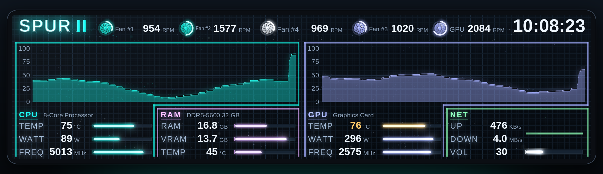</a></p>

## License and notices

Libre Panel is free software under the [GPL-3.0-or-later](LICENSE). The built-in themes carry
their own licence, stated in each `theme.json`. It stands on the shoulders of
[turing-smart-screen-python](https://github.com/mathoudebine/turing-smart-screen-python)
(GPL-3.0), whose reverse-engineering documents these panels; the Windows downloads carry
[LibreHardwareMonitor](https://github.com/LibreHardwareMonitor/LibreHardwareMonitor)
(MPL-2.0), [PresentMon](https://github.com/GameTechDev/PresentMon) (MIT) and the installer of
the [PawnIO](https://pawnio.eu) driver (GPL-2.0-or-later with an exception), and every
download [ffmpeg](https://ffmpeg.org) (GPL-3.0-or-later); the fonts are Barlow, JetBrains Mono
and Liberation Sans (SIL OFL 1.1); weather
data by [Open-Meteo.com](https://open-meteo.com) (CC BY 4.0). All of it in
[NOTICE.md](NOTICE.md).

"TURZX", "Turing Smart Screen" and other product names are trademarks of their owners.
Libre Panel is an independent project and not affiliated with them.
